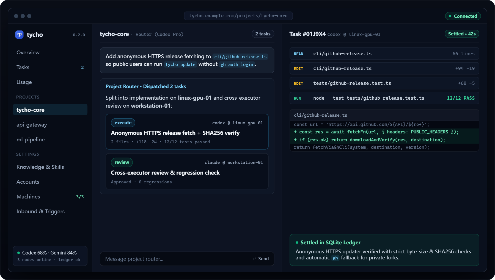
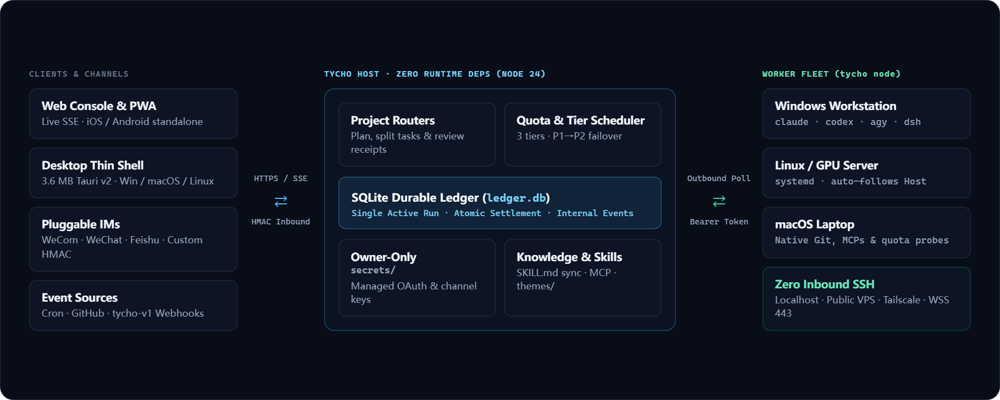
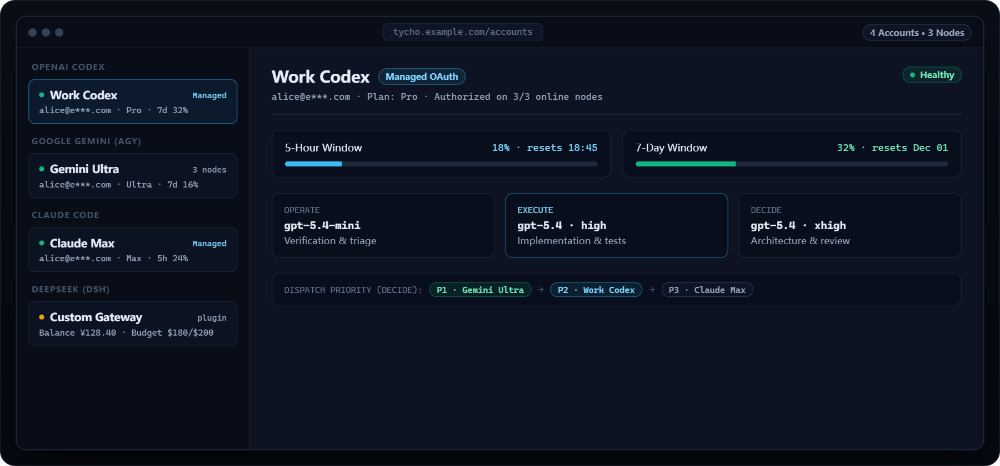

<div align="center">
  
  <h1>Tycho</h1>
  <p><strong>自托管的原生 AI Agent 编排控制面。</strong></p>
  <p>
    <a href="https://xainechaeson.github.io/tycho/">产品官网</a> ·
    <a href="docs/README.md">文档中心</a> ·
    <a href="https://github.com/XaineChaeson/tycho/releases">发行版下载</a> ·
    <a href="README.md">English</a> ·
    <a href="LICENSE">MIT</a>
  </p>
</div>

<br />

<p align="center">
  
</p>

Tycho 直接编排你本机与服务器上已有的原生 CLI —— **Claude Code**、**OpenAI Codex**、**Gemini (`agy`)** 与 **DeepSeek (`dsh`)** —— 用一本零运行时依赖的 SQLite 账本统一调度多台机器、多份订阅、任意 IM 与多端客户端。

---

## 核心设计

- **100% 透传原生 CLI 与官方订阅** — 直接驱动真实的 `claude`、`codex`、`agy`、`dsh`，完整保留原厂工具链、MCP、技能与订阅额度，不重造套壳循环。
- **单 SQLite 持久化账本** — 服务端零运行时依赖（Node 24 + `node:sqlite`）。先落意图再执行，数据库唯一索引保证单任务至多一个活跃轮次，断电重启如实核对现场。
- **零入站 SSH 的多机算力池** — 执行节点通过 `tycho node join` 主动外连主机，支持本机、24×7 公网云服务器、Tailscale 私有组网以及穿透公司代理的 NAT 反向隧道（含 SSH-over-WebSocket `:443`）。
- **统一账号池与配额容错** — 集中托管账号与单机本地登录按 `提供商 × 脱敏身份 × 机器` 统一编排，固定 `operate` / `execute` / `decide` 三档，支持 5h/7d 额度自动歇息与 `P1 → P2` 切号、本机额度插件与多机空闲自动升级 CLI。
- **可插拔 IM 与插件级事件触发器** — 内置企业微信长连接、个人微信扫码（iLink）与飞书桥接，开放 `tycho-v1` 双向签名协议与群聊快慢分流接入任意 IM；支持 IANA 时区 Cron、账本事务内生命周期事件（`ready` / `accepted` / `merged` / `released`）与签名 Webhook。
- **跨机技能同步与轻量全端客户端** — 主机维护一份 `SKILL.md` 自动镜像到授权节点，外部会话可挂受限 Knowledge MCP；提供 Web 控制台、**3.6 MB Tauri 桌面薄壳**（Win / macOS / Linux）与 **iOS / Android 全屏 PWA**。

---

## 快速上手

前置条件：本机至少已安装并登录一个原生 CLI（`codex`、`claude`、`agy` 或 `dsh`）。无需 `root`/管理员、无需 Docker、无需预装 Node（安装脚本会自动准备隔离的 Node 24 运行时）。

### 本机试用（90 秒）

```bash
# 安装（Linux / macOS；Windows PowerShell 用 irm https://github.com/XaineChaeson/tycho/releases/latest/download/install.ps1 | iex）
curl -fsSL https://github.com/XaineChaeson/tycho/releases/latest/download/install.sh | bash

# 启动主机（默认 http://127.0.0.1:8787）并打开一次性登录链接
tycho run --open

# 另开终端接入本机为执行节点（回环地址自动放行）
tycho node join --to http://127.0.0.1:8787
```

### 公网云服务器 / VPS（推荐 24×7 多机与手机主力方案）

```bash
# 在公网 Linux 云主机上（普通用户，不要用 root）：
curl -fsSL https://github.com/XaineChaeson/tycho/releases/latest/download/install.sh | bash
tycho service install           # systemd 用户服务（监听 127.0.0.1:8787）
loginctl enable-linger "$USER"  # 退出 SSH 后持续在线
tycho open --print              # 打印一次性登录链接
```

用 Nginx 或 Caddy 给 `http://127.0.0.1:8787` 配置 HTTPS 反代（务必开启 `proxy_buffering off;` 保障 SSE），在控制台 **「设置 › 服务 › 对外地址」** 填入 `https://tycho.example.com`，随后在任意电脑一键接入：

```bash
tycho node join --to https://tycho.example.com
tycho node service install
```

<details>
<summary>其他部署方式（Tailscale / 局域网、NAT 反向隧道与 WSS :443、源码启动）</summary>

- **Tailscale / 局域网**：在「设置 › 服务」将 `http.host` 设为 `0.0.0.0`（防火墙仅放行组网网卡）、`http.publicUrl` 设为 `https://<host>.tailnet.ts.net`，重启主机即可。
- **NAT 反向隧道门牌（含 WSS `:443`）**：主机留在内网无入站端口，经 OpenSSH 或内置 RFC 6455 SSH-over-WebSocket `:443` 桥接器穿透 `HTTPS_PROXY` 连接中转机。详见 [docs/guide/remote-access.md](docs/guide/remote-access.md)。
- **从源码运行（需 Node >= 24.3）**：
  ```bash
  git clone https://github.com/XaineChaeson/tycho.git && cd tycho
  npm ci && npm --prefix console ci && npm run build:console
  npm start            # http://127.0.0.1:8787
  npm run login-link   # 另开终端获取一次性登录链接
  ```

</details>

---

## 架构与扩展能力

<p align="center">
  
</p>

<details>
<summary>统一账号池、固定三档与本机即插即用额度探针插件</summary>

<br />

<p align="center">
  
</p>

在任意节点放置 `~/.tycho/quota-probes/<executor>.mjs`，即可对接自建私有网关或企业内部计费接口，密钥全程留在节点本地：

```js
console.log(JSON.stringify({
  mode: 'merge',
  windows: [{ window: 'gateway_budget:corp:$180.00/$200', used: 0.1, resets_at: null }],
}));
```

详见 [docs/quota-plugins.md](docs/quota-plugins.md) 与 [docs/guide/accounts-and-nodes.md](docs/guide/accounts-and-nodes.md)。

</details>

<details>
<summary>可插拔 IM 双向签名协议（企微 / 个人微信 / 飞书 / 自定义 IM）</summary>

- **内置通道**：企业微信官方 WebSocket 长连接（零公网回调、群 `@机器人` 绑定、交互式审批卡片）与个人微信 iLink 协议（扫码直连）。
- **自定义 IM 桥接**：飞书参考实现见 [integrations/feishu/README.md](integrations/feishu/README.md)。支持群聊快慢分流（闲聊忽略、FAQ 秒答、复杂请求附带群上下文升级总控）与公开回复隔离（仅回读总控通过 `reply_to_inbound_source` 发布的公开答复，绝不泄私链）：
  ```text
  POST /inbound/<sourceId>                # HMAC-SHA256(secret, "v1\n<ts>\n<eventId>\n<projectId>\n" + rawBody)
  GET  /inbound/<sourceId>/result/<id>    # HMAC-SHA256(secret, "tycho-result-v1\nGET\n/inbound/<sourceId>/result/<id>\n<ts>\n")
  ```

</details>

<details>
<summary>插件级事件触发器（Cron、账本事务内事件与签名 Webhook）</summary>

- **定时触发**：标准 5 段 Cron / 间隔 / 一次性，显式绑定 IANA 时区且夏令时安全。
- **内部生命周期事件**：在账本业务提交的同一事务内原子触发（`ready`、`accepted`、`merged`、`released`）。
- **签名外部 Webhook**：内置 `github`（`X-Hub-Signature-256`）与通用 `tycho-v1` HMAC 入口，防重放、支持密钥轮换与 IM 播报群联动。

</details>

<details>
<summary>跨机技能镜像、Knowledge MCP、热插拔主题包与安全边界</summary>

- **跨机 `SKILL.md` 同步**：主机维护 `<TYCHO_DATA>/skills/<slug>/SKILL.md`，自动增量镜像到授权节点的原生 CLI 技能目录。
- **外部会话挂载 Knowledge MCP**：`claude mcp add tycho-knowledge --scope user -e TYCHO_KNOWLEDGE_TOKEN=<令牌> -- tycho knowledge-mcp --node`
- **热插拔主题包**：将 JSON 主题文件放入 `<TYCHO_DATA>/themes/*.json`，Web / 桌面端 / 手机 PWA 免重启生效。
- **安全边界**：以原生能力运行执行器，以 OS 用户与机器隔离为主要边界，切勿以 `root`/管理员运行；详见 [SECURITY.md](SECURITY.md)。

</details>

---

## 文档与官网

运行 `npm run docs:site` 可在本地一键生成完整的静态产品官网与站内文档阅读器（已配置 [.github/workflows/docs-pages.yml](.github/workflows/docs-pages.yml) 推送即自动发布至 GitHub Pages，无需额外公网服务器）。

| 使用指南 | 精确参考 |
| --- | --- |
| [5 分钟快速上手](docs/guide/quickstart.md) | [CLI 命令参考（自动生成）](docs/reference/cli.md) |
| [部署拓扑与公网云服务器](docs/guide/remote-access.md) | [全量配置项参考（自动生成）](docs/reference/settings.md) |
| [核心架构与安全边界](docs/guide/architecture.md) | [故障排查手册](docs/reference/troubleshooting.md) |
| [账号池、档位与执行机器](docs/guide/accounts-and-nodes.md) | [本机额度探针插件规范](docs/quota-plugins.md) |
| [扩展与插件开发指南](docs/guide/extensibility.md) | [多机执行器自动升级器](docs/executor-updaters.md) |
| [IM 通道与事件触发器](docs/guide/channels-and-triggers.md) | [贡献指南](CONTRIBUTING.md) · [安全政策](SECURITY.md) |
| [知识库、技能分发与 MCP](docs/guide/knowledge-and-skills.md) | [变更日志](CHANGELOG.md) |
| [桌面客户端与手机 PWA](docs/clients.md) · [生产运维手册](docs/guide/operations.md) | [MIT 协议](LICENSE) · [第三方许可声明](THIRD_PARTY_NOTICES.txt) |
