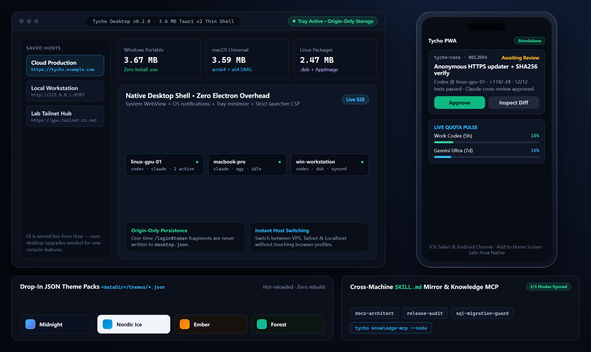

# Tycho 客户端分发与使用指南

Tycho 采用 **「服务端统一承载 UI + 3.6 MB 原生薄壳 / 手机全屏 PWA」** 架构：所有界面、工作流与功能升级均由 Tycho 服务端实时下发，客户端只需极少更新。

<p align="center">
  
</p>

> [!TIP]
> **找不到 `.exe` / `.dmg` 安装包？** GitHub 仓库右侧默认的 **Latest (`v*`)** 仅包含服务端包（`tycho.tar.gz`，供一键安装脚本自动拉取）；**桌面客户端独立发布在 [`app-v0.2.0`](https://github.com/XaineChaeson/tycho/releases/tag/app-v0.2.0)**（或查看 [全部 Releases 列表](https://github.com/XaineChaeson/tycho/releases)）。

## 平台支持矩阵与直接下载

| 平台 | 推荐形态 | 直接下载（[`app-v0.2.0`](https://github.com/XaineChaeson/tycho/releases/tag/app-v0.2.0)） | 特点 |
| --- | --- | --- | --- |
| **Windows 10/11** | **Portable 单文件 `.exe`**（3.67 MB）或 **NSIS 安装包**（1.32 MB） | [Portable `.exe`](https://github.com/XaineChaeson/tycho/releases/download/app-v0.2.0/Tycho-0.2.0-windows-x64-portable.exe) · [Setup `.exe`](https://github.com/XaineChaeson/tycho/releases/download/app-v0.2.0/Tycho-0.2.0-windows-x64-setup.exe) | Tauri v2 薄壳，复用系统 WebView2，支持系统托盘、单实例、`Alt+Shift+T` 全局呼出与后台告警通知 |
| **macOS (M 系列 / Intel)** | **Universal `.dmg`**（3.60 MB） | [macOS Universal `.dmg`](https://github.com/XaineChaeson/tycho/releases/download/app-v0.2.0/Tycho-0.2.0-macos-universal.dmg) | 通用二进制，复用系统 WKWebView |
| **Linux (x64)** | **`.deb`**（2.41 MB）或 **`.AppImage`** | [Ubuntu/Debian `.deb`](https://github.com/XaineChaeson/tycho/releases/download/app-v0.2.0/Tycho-0.2.0-linux-amd64.deb) · [`.AppImage`](https://github.com/XaineChaeson/tycho/releases/download/app-v0.2.0/Tycho-0.2.0-linux-x86_64.AppImage) | 复用系统 WebKitGTK；AppImage 免安装即点即用 |
| **iOS / iPadOS** | **PWA（添加到主屏幕）** | Safari 打开你的 Tycho 控制台 | 全屏独立窗口、适配刘海/灵动岛安全区、免 App Store 审核、随服务端实时更新 |
| **Android** | **PWA（安装应用）** | Chrome / Edge 打开你的 Tycho 控制台 | 独立图标与全屏窗口、零安装包维护、随服务端实时更新 |

校验文件：[SHA256SUMS.txt](https://github.com/XaineChaeson/tycho/releases/download/app-v0.2.0/SHA256SUMS.txt)

## 桌面端安装说明

### Windows
- **免安装便携版（推荐）**：下载 `Tycho-*-windows-x64-portable.exe`，放到任意目录双击即可运行。
- **安装包版**：下载 `Tycho-*-windows-x64-setup.exe`，自动创建开始菜单与桌面快捷方式。
- 点击「连接本机」默认连接主机默认端口 **`http://127.0.0.1:8787`**；配置保存在 `~/.tycho/desktop.json`（仅持久化服务器 Origin，不落盘一次性登录链接），更换或更新客户端可执行文件时服务器列表不会丢失。

### macOS
1. 下载 `Tycho-*-macos-universal.dmg`，将 `Tycho.app` 拖入「应用程序（`/Applications`）」。
2. 若未配置 Apple 公证签名，首次打开时系统 Gatekeeper 可能提示「无法验证开发者」或「已损坏」，在终端执行一次即可：
   ```bash
   xattr -cr /Applications/Tycho.app
   ```

### Linux
- **AppImage（便携单文件）**：
  ```bash
  chmod +x Tycho-*-linux-x86_64.AppImage
  ./Tycho-*-linux-x86_64.AppImage
  ```
- **Debian / Ubuntu `.deb`**：
  ```bash
  sudo apt install ./Tycho-*-linux-amd64.deb
  ```

## 移动端（iOS / Android）安装为桌面应用（PWA）

移动端无需单独下载安装包，通过浏览器安装为独立 Web App（PWA）即可获得接近原生的全屏体验，且自动复用登录会话与 HTTPS/尾网连接：

### iOS / iPadOS（Safari）
1. 在 **Safari** 中打开你的 Tycho 控制台地址并完成登录。
2. 点击底部工具栏的 **「分享」** 按钮（方框向上箭头）。
3. 选择 **「添加到主屏幕」**，确认名称为 `Tycho` 后点击 **「添加」**。
4. 从主屏幕图标启动，即进入无浏览器地址栏的全屏独立模式（已自动适配顶部状态栏与底部横条安全区）。

### Android（Chrome / Edge）
1. 在 **Chrome** 或 **Edge** 中打开 Tycho 控制台地址并完成登录。
2. 点击浏览器地址栏或右上角菜单中的 **「安装应用」**（或 **「添加到主屏幕」**）。
3. 确认安装后即可在桌面与最近任务中作为独立应用启动。

> **说明**：内置的 Service Worker (`/sw.js`) 仅用于满足 PWA 安装规范，**不缓存** HTML、`/api/*` 接口或 SSE 事件流，保证任务状态永远实时且不会产生陈旧本地缓存。

## 维护者：发布新版桌面客户端

桌面客户端版本号（`app-v*`）与 Tycho 服务端版本（`v0.1.xxx`）完全解耦，仅在 `desktop/` 原生薄壳有改动时才需要发版。

1. 确认 `main` 分支包含最新 `desktop/` 代码并已推送：
   ```bash
   git push origin main
   ```
2. 打 `app-v*` 标签并推送，GitHub Actions（`.github/workflows/desktop-release.yml`）会自动并行构建 Windows / macOS / Linux 全平台产物、生成 `SHA256SUMS.txt` 并发布到 GitHub Releases：
   ```bash
   git tag app-v0.1.0
   git push origin app-v0.1.0
   ```
3. 如需先试跑构建而不创建 Release，可在 GitHub 仓库的 **Actions → Desktop Release → Run workflow** 中手动触发。
