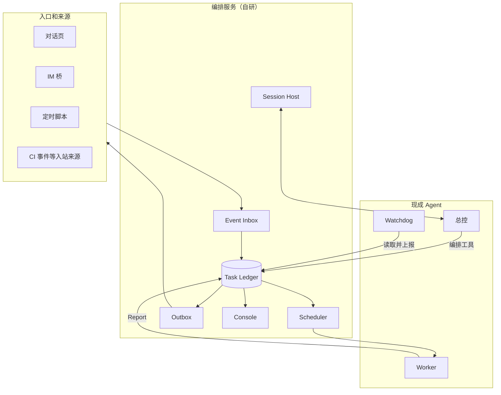

# 个人工作流编排服务：终态产品设计

状态：2026-11-04 用户确认方向。这是终态设计，不是第一版范围；分阶段见第 13 节。

最新终态与实施验收见[《Tycho 终态架构》](terminal-architecture.md)。它统一说明多服务部署、开放入口、项目总控、轨迹、知识与持续改进。下文记录早期整体设计，节点和其他现有机制以各专题文档为准。

**结论：我们做一个独立于桌面会话的个人编排服务。它接收事件、保存任务状态、驱动现成 Agent，并提供总览和总控对话页面。推理、工具、上下文和 subagent 全部用执行器自带的能力，不开发 harness（定位见 §1.1）。**

## 1. 目标与边界

要解决的问题：

- 总控和工作线绑定桌面会话，重启后状态丢失。
- 没有一个地方能看到全局状态。
- 额度或执行器出问题时，要靠人工切换。
- 只靠提示词，无法保证总控只派发、不动手。

不做的事：

- 不开发 coding harness、编辑器、终端、desktop app、IM 或手机 app。
- 不做多用户、多租户、工作流画布或插件市场。
- 不与集群门户耦合。门户操作只是一项受控资源操作。

### 1.1 定位：编排层，不是 harness

**tycho 是编排层：只做跨任务、跨机器、跨登录才成立的事；执行器已有的能力一律透传，不重做，也不先关掉再自己补回来。**

执行器（Claude Code、Codex、dsh）不管跑在哪台机器上，都是完整的 harness：推理、工具、上下文、沙箱、git、MCP 和连接器、技能、记忆、全局指令都是它自己的，用的是那台机器上已有的配置。tycho 做的是 harness 没有的部分：多件工作的编排和账本，谁在哪台机器上用哪份登录跑，额度轮换，审阅和授权关卡，通知和触发器。

一项能力归谁，只问一句：执行器自己有没有？有就透传；只在多件工作、多台机器、多份登录之间才成立的，才归 tycho。

理由（2026-11-11 主人裁定）：把执行器的能力关小，再用自研功能补回来，就是在重做 harness。这是旧项目 constellation 走过、已经证明失败的路；补回来的那一份也永远追不上执行器自己的更新。

例外只有下面几处，各有理由：

- **总控**是 tycho 自己的编排进程，不是派出去干活的一轮，它有哪些工具由 tycho 给定（[project-sessions.md](project-sessions.md)）。
- **权限和沙箱模式由 tycho 按职能在启动参数里给**：无人值守的一轮没人回答权限提示，只读还是可写也是职能的事；实际用的记进快照的 `access`（[roles-and-tiers.md](roles-and-tiers.md) §5）。
- **要独立视角的轮次**（审阅，以及知识的把关和整理）关掉执行器自带的跨任务记忆，免得带着它在别的轮次里对同一件事的看法（[knowledge-and-skills.md](knowledge-and-skills.md) §1.3）。
- **派出的轮次不读 tycho 的知识出口**：tycho 写的全局知识入口和主人装的知识 MCP。这一轮的知识已按钉住的修订在快照里，机器上那份可能是另一个修订（[knowledge-and-skills.md](knowledge-and-skills.md) §4.1）。

这条定位决定了两条底线的写法（[AGENTS.md](../../AGENTS.md)）：

- **输入如实记录，不控制。** tycho 送去的东西（brief、知识与技能的修订、档位内容、代码的提交、登录和机器）记进这一轮的快照，确定送达。机器上执行器自己的配置（全局指令、MCP、技能、插件、记忆）照常生效，账号只替换身份；快照照实记下机器报告的清单，报不出的（例如随登录带来的远端连接器）记“未知”。细则见 [knowledge-and-skills.md](knowledge-and-skills.md) §1.2、§4.1。
- **只读用执行器原生的手段，加事后核对。** Codex 用只读沙箱，Claude 拒掉写文件的工具，执行器只读模式本来允许的照常（Claude 的联网、MCP；Codex 只读沙箱里的 shell 默认不联网）；这一轮结束后核对代码目录和分支还是快照绑定的那个提交，不是就不采用这一轮的结果。核对防误判，不防存心作恶。细则见 [roles-and-tiers.md](roles-and-tiers.md) §5。

## 2. 整体结构

图：所有入口都经事件进入服务，服务驱动现成 Agent，状态只存在服务的账本里。

| 模块 | 职责 | 不做什么 | 来源 |
|---|---|---|---|
| Event Inbox | 校验来源、去重、归并、熔断 | 判断事件要不要做 | 自研 |
| Task Ledger | 保存任务、执行、决定、资源和消息 | 保存完整对话和代码 | 自研，用 SQLite |
| Scheduler | 依赖调度、选执行器、并发、预算、重试 | 判断技术方案 | 自研 |
| Session Host | 驱动长会话，翻译事件流，支持重连和中断 | 推理、工具执行 | 自研薄层 |
| Runner | 在执行机上启动、停止 Worker，回传结果 | 决定做什么 | 自研薄层 |
| Outbox | 可靠发送回复和通知 | 决定通知内容 | 自研 |
| Console | 总览、任务详情、总控对话 | 重建 IDE 或终端 | 自研网页 |
| Delivery Gate | 核对交付证据和合入规则 | 自建 CI | 自研，对接 GitLab |
| Resource Gateway | 执行登记过的实例和门户操作 | 任意命令 | 自研薄层 |
| 总控、Worker、Watchdog | 判断和执行 | 成为状态权威 | Claude、Codex、dsh |

判断标准：一个 Agent 自己工作时用的能力归执行器，多个 Agent 之间的协调归编排服务。

## 3. 组织模型

运行实体只有一种：Agent Run。总控、技术负责人、Worker 不是三种程序，只是配置不同。

下表是最初的设想，已被职能取代：落地的是职能对象（实现、审阅、分析、验证，主人可增删改），权限只有只读 / 可写两种，见 [roles-and-tiers.md](roles-and-tiers.md)。表里其余的名字没有对应的实现。

| 名称 | 权限配置 | 范围 | 生命周期 |
|---|---|---|---|
| 总控 | `coordinator`：编排工具加只读的代码、git、gh，写只能派任务（project-sessions.md“总控能读、不能写”） | 每个项目一个 | 逻辑常驻，进程可重建 |
| 技术负责人 | `worker-readonly` 加提议计划的权限 | 一个工作包 | 按需启动，可结束和替换 |
| 开发 | `worker-write` | 一个任务 | 任务期间 |
| 审计、调研 | `worker-readonly` | 一个任务 | 任务期间 |
| 机械执行 | `command`：不用模型 | 一个任务 | 任务期间 |
| Watchdog | `worker-readonly` 加上报权限 | 全局 | 定时启动 |

规则：

- 总控和技术负责人决定拆分和派发。~~开发、审计等只是任务标签，没有权限含义。~~（作废）任务按**职能**建：职能是控制台里可增删改的对象，带默认档位、权限（只读 / 可写）、交付物和要不要独立审阅，任务的档位由职能推出，见 [roles-and-tiers.md](roles-and-tiers.md) §3。职能因此有权限含义；只读的落实是那份设计的第 4 步。
- 权限配置固定且数量少；目标、验收标准、技能、职能由总控写进每个任务，档位由职能推出，单个任务覆盖档位要写理由。
- 业务子任务都进账本。Worker 不能自己派生登记外的工作，只能提议新任务。
- Worker 内部的 subagent 不进账本，开销算在所属 Run 上。
- 你只定总规则和回答 Approval，不逐项配置。

## 4. 核心对象

| 对象 | 用途 |
|---|---|
| Project | 仓库、规则、可用后端、预算、风险设置 |
| Task | 目标、范围、验收标准、父任务、依赖、档位、技能、状态。顶层 Task 是一个工作包，可配技术负责人；父任务由必需子任务和验收结果决定完成 |
| Run | 一次执行：执行器、配置版本、会话、代次、用量、错误 |
| Event | 外部输入：来源、编号、类型、主题、内容或链接 |
| Message | 总控对话的用户消息和回复 |
| Artifact | 提交、MR、报告、测试结果，注明来自哪次 Run |
| Approval | 等你决定的事：问题、选项、影响范围、失效条件 |
| Decision | 你或总控做出的长期裁定，可被后续任务查询 |
| Resource | 实例、目录、分支等；记录归属、占用和清理条件 |
| Timer | 预约复查：什么时候回来查什么 |

权威来源：账本管编排状态，Git 管代码，CI 管检查结果。页面和台账导出只是展示。

Task 是标准化记录，由总控经编排工具创建，服务按 schema 校验；字段按写入方划分：

| 字段 | 谁写 | 服务校验 |
|---|---|---|
| 目标、范围、验收标准、父任务、依赖、档位、技能、权限配置 | 总控 | 验收标准必填；依赖无环；子任务范围不超父任务 |
| 执行器、Run、会话、代次、用量 | Scheduler | 按路由表和额度选；总控不能指定模型 |
| Approval 答案、Decision | 用户 | 绑定具体对象和范围 |
| Report、Artifact | Worker | 只能写自己 Run 的结果 |

架构图见设计稿画板“架构：Task 的流转”。

## 5. 事件与通道

所有来源都是独立小程序，通过同一接口写事件。对话页、IM、定时脚本和 CI 走同一条路。

- 事件只提供资料，不能指定执行器、目录或权限。外部文本不拼进指令。
- `(来源, 编号)` 唯一，重复事件只记一次。
- 同一主题排队时，新事件并入同一轮。
- 已归属任务的事件直接送到该任务；新事件交给总控判断。
- 事件带层数，超过上限只记录不派发，并通知你。
- IM 等来源要有发起白名单；主动规则先走观察模式，只记录本来会做什么。
- Agent 可以预约复查，等 CI 或发布时不占会话。
- 出站走 Outbox，通道崩溃或重启后继续发送。

接入层：每个 IM 一个通道适配器，只做收、发、认人、挂载四件事。

- 收：消息、按钮点击、转发内容变成 Event，带来源、发送人、会话线程。飞书和企业微信都用长连接。
- 发：文本、卡片、更新已发卡片。飞书互动卡片，企业微信模板卡片。
- 认人：发送人映射到用户身份，白名单在适配器配置里。
- 挂载：IM 的工作台或应用主页放 Console 入口，登录用 IM 身份。
- 通道间规则由账本统一管：回复回到来处的线程；Approval 可多通道投递，先答者有效，其余卡片更新为已决定；转发内容标为资料，不进指令；多个通道可同时在线，互不影响。
- 企业微信主通道、个人飞书备用。用户已能打开“创建智能机器人”页面，有 API 模式选项；部署时选 API 模式加长连接取得 Bot ID 和 Secret，“可使用成员”只勾用户本人，和白名单构成双重限制。若届时受阻则飞书为主，设计不变。

## 6. 总控会话与实时体验

总控是逻辑常驻：身份、历史和待办都在服务里，进程只是可替换的载体。

Session Host 的工作方式：

- 有人对话时保持一个长会话进程，空闲一段时间后退出。
- 把各 harness 的输出翻译成统一事件：文本增量、思考、工具开始和结束、回合结束、错误。
- 每个事件先写日志再推给页面。页面用光标重连，断线后补齐。
- 同一会话可以被对话页和 IM 同时观察，但只有一个驱动者。
- 进程崩溃时，用会话 ID 恢复；恢复不了，就换一个执行器上下文，带着从账本生成的恢复材料接着这一段对话。不按时间或 token 定期重开：上下文压缩由执行器自己处理。每个项目一个总控、对话分段、什么时候换上下文，见 [project-sessions.md](project-sessions.md)。

2026-11-04 实测结果（Windows 工作站和集群实例）：

| Harness | 总控驱动方式 | 实测结果 |
|---|---|---|
| Claude Code | `claude -p --input-format stream-json --output-format stream-json --include-partial-messages` | 流式、中断、恢复、工具白名单都通过；回合中发的消息排到下一轮；CLI 需要独立登录 |
| Codex | `codex app-server` | 流式、回合中追加、中断和续接都通过；接口标注实验性，没有工具白名单 |
| dsh | `dsh acp` | 工具调用和取消通过，但文本在回合结束才整段到达，不能作为流式对话通道 |
| dsh | `dsh sdk` | 未实测 |

总控默认用 Claude Code，因为它同时满足流式体验和工具白名单。Codex 作为备用，运行在没有业务目录和业务凭据的环境里。主账号额度耗尽时，总控不能跟着不可用。

Session Host 还要处理三点：

- 中断结果在 Claude 里是 `error_during_execution`，要归类为“已中断”，不算失败。
- 回合中的新消息，Claude 排到下一轮，Codex 可以并入当前回合。页面要显示“已排队”。

体验验收目标（部署前实测，数字可调）：

- 发送后 1 秒内出现“已收到”，首个模型输出不慢于原生客户端太多。
- 文本连续流式显示，能看到工具步骤。
- 能中断当前回合，并追加新消息。
- 刷新页面和断网重连都不丢内容。

IM 是日常主入口：和总控对话、回答 Approval（卡片按钮）、接收结束和异常通知、看一行进度摘要。企业微信里，对主人消息的回复在同一个气泡里流式显示；内部事件的回复、通知、问题卡片是单独的消息（[phase1-design.md](phase1-design.md) §9）。现场时间线、插话、中断、接管和长输出只在 Console，IM 里给链接。Console 可挂进 IM 的工作台或应用主页，登录用 IM 身份。飞书和企业微信（智能机器人 API 模式）都支持长连接收消息，工作站不需要公网；企业微信的自建应用回调才需要公网，不用。IM 入口沿用发起白名单。

## 7. 执行与模型配置

- 档位固定为决策 / 执行两个（`decide`、`execute`），另有不用模型的 `command`。档位名是全局固定的，各账号只填内容。证据不足时不加档。
- 模型只写在执行器配置文件里。规则、brief 和总控都不写模型名。
- 总控只声明需求：权限配置、档位、所需能力。Scheduler 从路由表里按顺序选可用候选。
- 执行档的结果审阅不通过时，Scheduler 升到决策档（见 [roles-and-tiers.md](roles-and-tiers.md) §6）。
- 换执行器产生新 Run。迁移的是任务、产物和 checkpoint，不是原生会话。
- 技能用各执行器都能读的文件。brief 只写通用命令或技能路径。
- 每次 Run 记录配置、技能和 brief 的版本。

### 执行器适配契约

harness 之间不直接交流，所有交换只经账本里的 Brief、Report、Run 事件流三种对象。每个执行器一个适配器，只有四个接触点：启动命令、实时事件解析、结果解析、续接。

- 实时事件翻译成统一词汇：`text`、`thinking`、`tool.start`、`tool.end`、`turn.end`、`interrupted`、`diagnostic`（告警、恢复中、终止）。工具名映射为读、改、运行、搜索等类别，保留原名，另带短标题、完整输入和执行器报告的结果。现场页只画这套词汇（形状见 [phase1-design.md](phase1-design.md) §8.1，展示规则见 §9.1）。
- Worker 的汇报是最后一条消息末尾的回执块加退出码，由 Runner 写进账本。Worker 不连账本、不用 tycho 的编排工具、不持有密钥。回执写错只重写最后一条消息。
- MCP 编排工具只给总控和技术负责人。
- 插话只承诺“下一步或下一轮送达”，界面显示“已排队”。
- 每个适配器带录制的真实输出做契约测试；Run 记录 harness 版本；升级先过测试再切换。

2026-11-04 已实测：三家的启动、工具级事件、结果、中断映射；Claude 的续接。Codex、dsh 的续接据文档。

## 8. 权限与安全

管控分三层：工具集决定能看到什么（总控是编排工具加只读的代码、git、gh，见 project-sessions.md“总控能读、不能写”；Claude 只读那一轮另外拒掉写文件的工具），沙箱决定能碰到什么，服务端令牌决定能对账本做什么。

| 执行器 | 落地方式 | 边界 |
|---|---|---|
| Claude | 用机器上自己的配置；只读那一轮拒掉写文件的工具 | 工具层；代码变没变由事后核对查（§1.1） |
| dsh | 用机器上自己的配置 | 不提供只读：档位能重新定义它的只读模式 |
| Codex | 用机器上自己的配置；`--sandbox`，只读那一轮是 `read-only` | 文件系统层；没看到工具白名单，不作总控首选 |
| command | 固定程序和参数 | 不让模型现场生成任意 shell |

- 风险门槛绑定动作，不绑定标签。合入、生产变更、门户操作都走固定接口，凭据不进通用 shell。
- 每个 Run 有独立令牌，只能写自己的结果。
- Worker 回传内容是资料，不是总控的指令。
- 审计最好换执行器，只给代码和验收标准，不给作者结论。
- worktree 共享 `.git`，需要硬隔离时用独立 clone。
- 项目规定可用后端。研究数据和内部代码不能因为配置可用就自动外发。
- 用户授权沿用现有规则：规则内的开发、审阅和合入自动推进；删除他人内容、改他人权限或共享资源、不可逆外部操作先问。

## 9. 多项目与额度

Project 隔离仓库、规则、技能、记忆和可用后端。模型额度、机器资源和优先级全局共享，所以多项目也只有一个编排服务。

- 总控只加载项目摘要，需要时按 ID 读取详情。
- 跨项目依赖以后单独设计（2026-11-09：本期不做跨项目的自动协调，见 [project-sessions.md](project-sessions.md) §7）；无论将来怎么做，都不让 Worker 跨项目通信。
- 依赖分两种：必须等上游合入，或基于上游分支先做。
- 同一资源用同一个锁，比如 main 合入队列、共享缓存、生产通道。
- 额度按实际账户和后端分组。到限后暂停这一组，避免多条线同时重试。

凭据池：

- **第一阶段已经做了这条的一半**：执行目标拆成了账号与机器（“谁来做”和“在哪儿跑”分开），额度状态跟着账号，额度用完自动换账号、换不动就等着（[phase1-design.md](phase1-design.md) §4；模型见 [accounts-and-machines.md](accounts-and-machines.md)）。凭据由 tycho 保管、每一轮下发，档位内容随快照下发，都已落地；机器上已经登录好的执行器是“机器自己的登录”（[accounts-machines-decoupled.md](accounts-machines-decoupled.md)）。
- 单位是凭据槽：一个执行器加一份登录态或 key。账号只替换身份：凭据经专用通道交给这一轮，执行器照常用机器上自己的配置目录（§1.1）。
- 槽记录类型、激活方式、额度窗口、状态（可用、冷却到何时、登录失效）、允许的项目。
- 路由表条目是“(执行器, 档位) → 有序槽列表”。Run 启动时锁定一个槽并记录；额度或登录错误是结构化的，Scheduler 据此把槽标为冷却，下一次 Run 换槽。
- 换槽只发生在 Run 之间，运行中的 Run 不换；会话记录随槽，换槽续不上原会话。
- 槽状态在总览可见。
- 多个个人订阅给自动化扩容可能违反各家消费者条款，开工前由用户核实；API key 无此问题。订阅账号建议只用于总控这类交互式使用。
- 优先级：生产问题高于发版，高于功能开发。
- 人的消息保留独立槽位，任务排满时也不被堵住。
- 只有信任边界不同或总控确实成为瓶颈时，才拆多个总控。

## 10. 交付

`完成` 由证据决定，不由 Agent 自己宣布。

- Task 必须有验收标准，`ready` 和 `done` 分开。
- 合入证据绑定源提交、目标分支版本、审阅结果、检查结果和当前规则。变基后重新核对受影响的证据。
- 同一目标分支按队列串行合入，并检查冻结状态。
- 合入后以 GitLab 返回结果和要求的后续检查为准。
- 生产任务记录业务日期、时区、最迟开始时间和错过后的处理方式，错过不自动补跑。
- 产物保存、无未交付改动、无运行进程后，才清理这条工作流创建的资源。

## 11. 可靠性

- 派发是至少一次，有副作用的动作执行前先核实现场。
- Run 带执行代次。失联先标待核实，保留占用；迟到结果只留作证据，不推进任务。
- 合入响应丢失先查 GitLab，实例申请超时先查是否已创建。
- 回执格式错误只修回执，不重做业务。
- 规则写错时继续用旧规则，并通知你。错过定时只补最近一次。
- 心跳只证明进程在线。Watchdog 看提交、检查、checkpoint 等实质进展。
- Watchdog 用和总控不同的执行器，第一阶段只上报，不修改系统。
- 服务由系统服务管理重启，定期备份到独立位置，升级前先备份。
- 提供全局暂停：停止新派发，运行中的任务不丢。

## 12. Console

设计稿：<https://claude.ai/artifact/GnN9xsb2gwjL3VxzrcRZHC>。

产品承诺：

- 派发出去的任务要像 subagent 一样可见，结束时主动回到总控对话。
- 系统负责告知结束、回收和无进展提醒，不靠监控脚本、人工询问或全局规则。
- 任意 Worker 都能看实时工具时间线，并能插话、中断。插话同步给总控，在下一轮送达。第一阶段不做在线接管：任务停住时可打开原生会话查看或人工操作，之后点“继续”，新 Run 先核对现场。
- 系统只管理经总控派发的任务，不自动发现用户手动开的会话。
- 默认视图是对话优先。离开后回来，对话开头先给简报；总览是单独页面，随时可切。

界面名称与底层对象一一对应，界面不发明底层没有的概念：

| 界面 | 底层对象 | 说明 |
|---|---|---|
| 总控 | Router 会话 + Message | 唯一和用户对话的会话 |
| 工作 | 顶层 Task（工作包） | 不是 Project；Project 只是配置和标签 |
| 任务 | 子 Task | 一个任务可有多次 Run |
| 现场 | 当前 Run 的事件流 | 一次 Run 对应一个 harness 会话，界面不出现“会话”一词 |
| 需要你 | Approval | 同一对象同时出现在总控对话和左侧列表 |

交互原则：

- 左边选什么，中间就是什么。总控对话是默认页，也是左侧第一项；工作页是任务树，任务页是现场时间线。只有任务页有右侧详情栏。
- 任务页不是另一个聊天：它是总控的派发说明、Worker 的事件和汇报、用户插话组成的时间线。
- 左侧只列工作，大型工作用分段进度条压缩显示；用户在某个任务里时，所属工作在左侧保持高亮。
- 总览只有一个视觉中心：先用一句大字回答“现在要我做什么”。没有待办时，这句话变成整体状态。
- 决定直接在对话里完成，不用单独弹窗；做完后可以撤销。
- 中断不弹确认，保留现场并提供“继续”。
- 状态用一句人话表达。时间线默认只显示步骤，点开才看细节。
- 接管和打开原生会话是次要动作，只在专注视图出现。

总览按顺序回答：

1. 现在有什么事要我处理？
2. 哪些任务在跑，交给谁，最近有什么进展？
3. 哪些卡在依赖、额度、资源或合入队列？
4. 哪些已经交付，哪些只是产出了代码？

任务详情能看到触发事件、依赖、Run 历史、配置版本、产物、审阅和检查结果，并能一键追溯这轮为什么启动。

可以实时查看 Worker 输出。需要深入时，用链接打开对应的原生会话，并标记人工接管，避免服务同时驱动。

Console 是 `console/` 下独立的 React + TypeScript + Vite 前端工程，使用 shadcn/ui（Tailwind、Radix）和 TanStack Query。服务端零运行时依赖、无构建；控制台需要构建，发布包的控制台部分只带 `console/dist/`，安装后不需要前端工具链，也不从网上取资源。服务端只提供其中真实存在的文件。服务端和控制台共用的文字与纯函数只放在 `shared/`，服务端不 import `console/`。浏览器可直接打开控制台。dsh 和 Claude 可以经 MCP 接入同一服务，但不是必需入口。

远程访问（2026-11-05 改为优先经门牌，见 §13；以下 EasyTier 方案保留给没有公网机器的部署和连接私有执行机器）：走用户已在用的 EasyTier 覆盖网络（2026-11-04 本机隧道在线）。服务的对内监听改成 `0.0.0.0`，由防火墙限制到局域网或组网，不开公网端口；EasyTier 的入网凭据是全网共享的，不能认人，所以 Console 必须有自己的登录。本机代理（Mihomo）要把覆盖网段加进 `NO_PROXY`。总控机器上 EasyTier 要以服务方式常驻，不依赖 GUI（能否直接装服务待确认）。手机端：用户用 Android，EasyTier 有 Android 客户端，手机可直接打开 Console（响应式页面，加到主屏幕）；IM 只负责推送“需要你”。手机通知经 IM 推送，可提前到第二阶段。Claude Remote Control 不做总控入口（总控只能有一个驱动者），保留用于远程打开 Worker 的原生会话。

## 13. 谁连谁：主机、干活的机器、门牌

**结论：只有四样东西——你、主机、干活的机器，外加一个可选的门牌；主机够到一台干活的机器只有三种连法。有没有公网机器都能用，区别只是有没有门牌。**（2026-11-05 定；图见设计稿“架构：四样东西，三种连法”。）

| 东西 | 是什么 | 有几个 |
|---|---|---|
| 你 | 手机上的企微或飞书，电脑上的浏览器 | — |
| 主机 | 跑 tycho 服务的那台机器；总控会话和账本在这里。主机内部的零件见 §2 | 只有一台 |
| 干活的机器 | 装了执行器的机器，任务在上面跑；账号带着凭据走之后机器上不用预先登录（[accounts-and-machines.md](accounts-and-machines.md)） | 任意多台，随时添加、吊销 |
| 门牌（可选） | 一个外面能访问到的地址，让你在外面也能打开主机的页面；它负责 HTTPS，把请求转给主机，不参与任何逻辑 | 有或没有 |

主机对一台干活的机器只做四件事：启动、核实、停止、读输出。三种连法只决定这四件事经哪条路送达，账本、判定表、结算、页面都不因此改变（代码里是同一个接口 `RemoteHost` 的不同实现）。

| 连法 | 条件 | 那台机器上要什么 | 状态 |
|---|---|---|---|
| ① 直接连 | 主机连得到它（SSH） | 什么都不装 | 已删掉（[nodes.md](nodes.md) §11 第 6 步，账本版本 24）：机器只经 ② 接入 |
| ② 它自己连进来 | 它能打开主机的地址 | 装 tycho，运行 `tycho node join` | 已落地，是主路径（[nodes.md](nodes.md)） |
| ③ 托别的机器转达 | 只有某台已连上的机器够得到它 | 什么都不装；转达的那台声明“我够得到这些机器” | 第二阶段 |

添加机器的体验（连法 ②）：在那台机器上运行 `tycho node join --to <主机地址>`，它打印一个六位数，主人在控制台侧栏的“放行”里输入（或点企业微信卡片）；之后它保持一条向外的连接，页面里它变为在线，并显示它报告的执行器。之后的派发、现场、结算、通知与其他机器完全一样（[nodes.md](nodes.md) §1.1）。

你现在的情况：主机是工作站，干活的机器是工作站自己和集群实例，正在从连法 ① 换到 ②。门牌用来在外面打开页面：公网机器负责 HTTPS 并转给工作站，工作站向外连它。企微和飞书这条路始终是主机连出去，不需要任何人连得到主机，所以在外面聊天永远可用。

主机也可以直接放在公网机器上（开源时的默认说法：找一台能被访问的机器跑服务，其他机器一条命令加入）。这时它自己就是门牌，工作站变成一台干活的机器，并用连法 ③ 替主机转达到集群。代价有两条：账本和任务内容落在那台公网机器上；它被攻破就能经转达的机器够到内网，所以转达的那台必须有自己的闸门（允许转达到哪些主机、哪些执行器、哪些工作目录），默认全关。自用时主机留在工作站。

转达的机器只是带路，不持有账本，不做派发判断。它离线时，经它才够得到的 Run 一律进 `unknown`（不是丢失、不重派），页面提示“某机器离线，其下 N 个 Run 状态未知”，恢复后按判定表核实。在总控和 Worker 之间要不要再加一层按项目的负责人 Agent，是另一个问题，由上下文和管理跨度决定，不由网络决定；目前不引入。

从旧项目 constellation 的需求探索里保留下来的要求（它的对象模型和基础设施不沿用）：

- 远程执行是产品的基本形态，不是特殊部署模式；规模变化时对象、页面、交接约定都不变。
- 不把远端机器当成盲 shell：机器有身份、声明自己能提供什么（执行器、档位、并发上限、允许的工作目录）、有心跳；每个 Run 的启动、存活、结束、产物都回到账本。
- 影响信任的事实必须可见：哪些机器在线、失联、过载；哪个 Run 卡在环境或连接上。
- 干预分三级：只读查看、插话、接管并交回。第一阶段做了前两级；接管借执行器自带的远程会话实现，不自己做。
- 同一台机器可以同时跑多个 Run，并发上限由机器自己声明。

门牌是受信任的（2026-11-06 主人裁定）：它通常是使用者自己能控制的机器。它不安全是使用者的运维问题，本项目不为“门牌被攻破”付设计成本。所以 HTTPS 在门牌上解开（常见的反向代理做法，证书也在那里签和续），主机不自己做 HTTPS、不管证书；主机和门牌之间走主机向外建立的 SSH 连接，主机不需要开任何入站端口。本项目要负责的是另一头：从互联网来的请求不能碰到只该本机用的接口，见下。

公网入口的边界：

- 主机已分开对内和对外监听。对外监听只绑 `127.0.0.1`，门牌经主机向外建立的 SSH 反向转发接入。`service/http.ts` 路由表用 `outside: true` 显式开放页面以外的接口，默认只在对内监听；令牌接口的类型不允许带这个标记。工具转发、生成登录链接、停止服务、实例身份、用令牌问自检只在对内监听。经门牌进来的请求一律当作互联网请求，不靠对端地址区分。
- 控制台功能完备（2026-11-06 主人裁定）：主机以后可能在云上、没有本机浏览器，登录后的主人经门牌能做控制台里的一切，包括改总控用的程序、门牌、对外地址、企业微信和账号、机器。本机令牌接口供本机程序使用，不是控制台功能。
- 门牌 nginx 提供 HTTPS；对外会话和对内会话互不通用，对外 Cookie 带 `Secure`，写请求来源只认 `http.publicUrl`。登录限速只限制失败的兑换答复，有效链接随时可用，打开链接不计数。

上公网之前仍须完成的机器接入约束：

- 添加机器等于授权主机在那台机器上运行 Agent：口令一次性、每台机器独立密钥、页面可一键吊销；机器端有自己的闸门，默认最小。主机被攻破即所有接入的机器被攻破，这一点写在文档最前面。
- 跨境链路用 443 上的 WebSocket；连接断开不影响正在跑的 Run，重连后按判定表核实。

## 14. 分阶段

1. **状态和对话：** 详见 [phase1-design.md](phase1-design.md)。Ledger、Event Inbox、Outbox、Session Host、Console、IM 入口、Claude 和 Codex 启动、执行代次、恢复、预约复查、全局暂停、追溯。来源接 IM、对话页和定时。合入走现有流程。第一阶段 Worker 只跑在集群实例，插话一律下一轮送达。
2. **机器接入，然后额度和依赖：** 先做 §13：机器成为一等对象（登记、在线状态、能力声明、吊销）、连法 ② 和 ③。主机对内对外两个监听和门牌已在第一阶段提供。再做依赖调度、按额度换账号（第一阶段已做，[phase1-design.md](phase1-design.md) §4）、预算、资源登记、自动升档、Watchdog 上报。
3. **交付自动化：** GitLab 合入队列、证据绑定、受控清理、生产时间窗。
4. **更多入口：** CI 事件等入站来源、观察模式。
5. **按需扩展：** 服务迁到长期主机，加 Resource Gateway；dsh Console 插件；多总控，只有证据支持时才做。

第一阶段前先做体验验证：用真实 harness 跑通流式、中断和重连，再定总控默认 harness。

## 15. 未验证项和待定决定

未验证：

- dsh SDK 的流式能力。
- 一次 Claude 工具调用回合用了 32 秒，之后两次复测约 2–4 秒，原因未查明；需要在试运行中持续记录。
- dsh Desktop 能否直接接入同一总控会话。
- 自动化使用 Claude、Codex 账户是否符合各自条款，是否需要 API key。
- 集群上的 CLI 登录、工具限制行为和 dsh 模型路线。
- 实例脚本和 GitLab 接口的具体条件。
- 代码规模。Codex 估全量 6000–10000 行、4–8 周，这是粗估。

尚未设计，第一阶段详细设计要覆盖：

- EasyTier 以服务常驻的方式。
- 服务自身的生命周期：休眠、锁屏、重启时的存活与恢复；数据目录备份位置与恢复演练。
- 用户在 Console 直接停止、改优先级、取消任务时，作为 Input 告知总控。
- 账本 schema 的迁移与回滚。
- 故障验收清单：服务和 Runner 重启、重复回执、额度耗尽、迟到结果、变基导致证据失效、遗留子进程、备份恢复。
- 总控的长期记忆：Decision 的检索方式。

待定：

- 各项目的数据可以发往哪些后端。
- 第一阶段试跑哪个项目。建议选较小的工作线。
