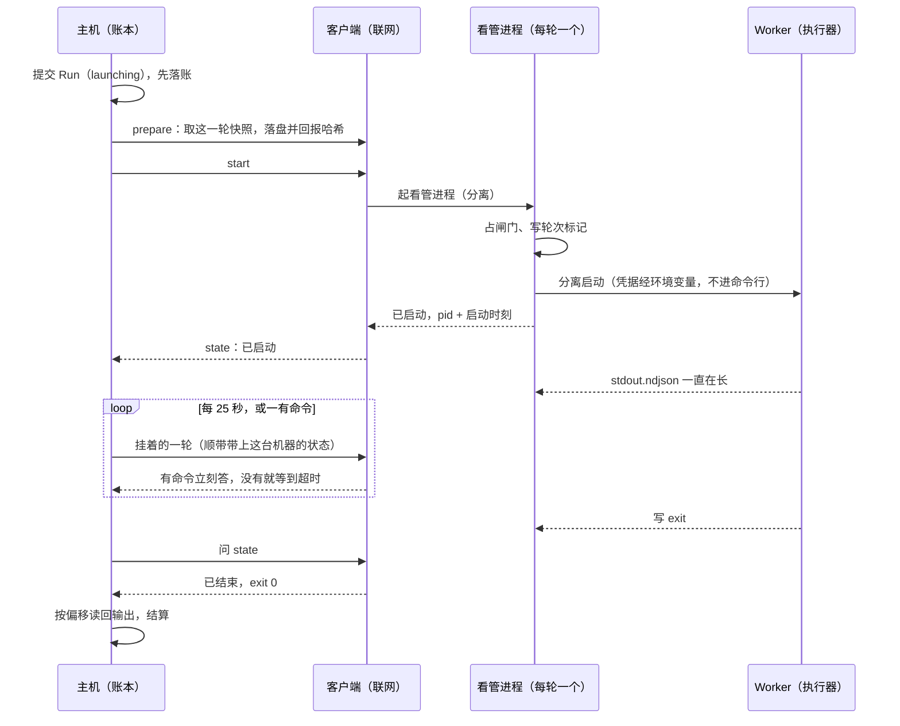

# 机器主动连回来：节点客户端取代 SSH

读者：主人和实现者。状态：**已确认，§11 的六步都已落地**（2026-11-06 三方审计裁决后定稿；2026-11-10 第 6 步删掉 Worker 的 SSH 路径，账本版本 24）。这份文件是实现的依据；当时动手的顺序见 §2。

## 结论

节点协议第 7 版为原生知识投影增加发布集合归属。旧客户端的检查结果不能用于新协议派发，发布握手仍独立于协议，供旧客户端正常跟随升级。共享原生目录的多服务升级边界见 [知识发布归属](knowledge-publisher-ownership.md)，不以项目归属身份代替发布集合编号。

**每台机器上装一个 tycho 客户端，由它主动连回主机。** 一个程序两种角色：`tycho run` 是主机，`tycho node` 是机器上的客户端。**执行机器上不需要开任何入站端口**，主机也不用 SSH 进去，不管那台机器是 Windows、macOS 还是 Linux；接一台机器是「在那台机器上跑一条命令，再在控制台点一次放行」。

原来的形状是主机伸手出去：用系统 OpenSSH 连到机器上，`scp` 传快照，几段 shell 脚本在远端跑。改成节点时，**那些脚本的职责一条不少，只是执行者从"SSH 会话"换成了"机器上的客户端"**；SSH 那条路随后整个删掉了，机器只有经客户端接入这一种。

四件必须先说清的事：

1. **每轮执行有一个独立的看管进程，必须有。** 联网客户端只管连接（它会重启、会升级、会崩）；启动闸门、Worker 的生死、退出证据、停止和轮次栅栏由**每轮一个看管进程**负责，它脱离客户端存活。否则会出现：客户端崩溃期间 Worker 正常结束，新客户端回来既看不到进程也没有退出码，主机把"完成"误判成"丢失"并接续。它记两样东西：自己的 pid 和启动时刻，以及**它起的那个 Worker 的 pid 和启动时刻**——看管进程可以被杀而 Worker 还在，那时"这个 pid 是不是这一轮的"只有 Worker 那份证据说得清。Worker 有自己的进程组（POSIX）：整组一起停，脱离父进程的后台进程也带走；一轮结束前先结束整组、再核实留下的残留，核实不了就记 `unverified`，绝不记成"什么都没留下"。收尾里的等待由看管进程自己撑着，直到残留记录和退出码都写完才退出（Worker 退出后它可能是唯一还在的东西）。读这些证据时只有"文件不存在"算没有；文件在却读不出来、或内容不是看管进程会写的样子，`state` 回"未知"并写明是哪份记录、为什么，主机不把它当成"看到不在"。同一个"说不清"贯穿各条命令：`stop` 回 `alive: null` 并带上原因；`list` 把这样的轮次报成 `alive: null`，只列活着的清单里也保留它（重连清扫靠这份清单去停账本里已结束的轮次）；`drop_run` 只在确认没有进程时才清理，说不清就拒绝并给出原因。主机把"机器回答了但核实不了"和"机器没有回答"分开：前者不开始失联区间、不进宽限期、不撤销启动，也不按中断或失联结算，Run 停在未知，原因记进账本、显示在任务页上，直到机器能给出确定的答复；机器真的失联或被移除时照原规则判定。撤销一轮没人确认的启动之后，复查的答复和平常一样判定：读到结束证据就带着退出码照常结算，确实没有结束证据、也没有进程才算丢失。
2. **机器只经客户端接入。** Worker 没有 SSH 路径；删它是这份设计的最后一步（§11 第 6 步），排在自迭代第一步和节点各步之后，所以没有半路断供。
3. **接入材料有两种，都不进账本、不进快照、不进命令行和日志。** 人工接入用**六位数加设备手里的高熵秘密**（沿用现有新设备登录那个形状：秘密由服务端生成、交给发起请求的那台设备自己保存，服务端只在内存里留一份用于比对，重启即失效）：六位数只用来在另一台机器上指认"是哪一条请求"，光知道它拿不到东西，换回来的是**节点令牌，不是控制台 Cookie**。自动化接入（临时机器）用**一次性材料**：15 分钟、用一次，走凭据通道。兑换要能**重试认领**：请求绑定设备事先持有的那个秘密，重复请求认领同一条登记、不新增第二台机器，消费材料和建立登记在同一个事务里提交。
4. **机器自带的登录默认只属于这台机器和这个用户。** 适配器只报告它确实读到的登录状态；tycho 不解析身份、不按邮箱或组织自动建账号、不自动合并额度。要让几台机器共用一个账号，是主人在控制台里明确关联。

已经否决、不再考虑的：客户端兼任看门人；把节点令牌塞进现有的本机令牌接口；按登录身份自动合并账号；"Runner 基本不动"（`RemoteHost` 的调用方式要换，见 §5.2）；不做预演就上线（见 [self-iteration.md](self-iteration.md)）。

## 1. 主人的使用路径

这一节是操作说明：在哪台机器上、以谁的身份、做什么、怎么算成功。

### 1.1 接一台机器进来

1. **在那台机器上**，以将来跑 Worker 的那个用户（不是 root、不是管理员）装一次 tycho，然后跑：

   ```sh
   tycho node join --to https://tycho.example.com
   ```

   `--to` 填控制台的对外地址（配了门牌就是门牌的 HTTPS 地址）；主机本机或同一局域网里也可以填对内地址，例如 `http://192.168.1.5:8787`。**那台机器只要能打开这一个地址就行**，走公司代理也可以（§8.3）。

   成功标志：命令打印一个**六位数**和一句话——"在已经登录的控制台上点侧栏的『放行』，输入 482913"（配了企业微信时再加一句：手机上的卡片也能放行）；命令不退出，等着。`--to` 是本机回环地址、而且这台电脑上跑着主机时，命令直接打印"本机接入，免放行"并转入常驻（第 2 步第一种情况）。

2. **放行，三种情况，主人能少做就少做**（2026-11-09 主人指出原来的做法太麻烦后改定）：

   - **本机接本机：不用放行。** 加入命令连的是主机的回环地址、并且出示了这个数据目录里 `service.json` 的本机令牌时，主机当场放行，时间线记一行"本机接入，免放行"。依据：能读到本机令牌的就是运行主机的那个系统用户，它本来就能读写主机的账本和数据目录，再让主人确认一遍什么也没多防住（§9"本机节点是同一信任边界"）。只认对内监听上的回环请求；对外监听（门牌）上的加入请求永远不走这条路。
   - **远程机器：手机上点一下。** 配了企业微信时，机器人给主人发一张卡片："机器 DEV-WORKSTATION（win32）请求加入，号码 952307。只有你面前那台机器上显示着同样的数字时才放行。[放行] [拒绝]"。点按钮走和控制台同一个放行入口，卡片随请求过期作废。没配企业微信就只走控制台。
   - **控制台：一个放行入口。** 侧栏只有一个"放行"：输入六位数，系统自己认出它是新设备登录还是新机器加入，先显示是什么（设备的名字和地点，或机器的名字、系统和主机名；加入请求里没有执行器，找到的执行器在机器连回来后的机器页上看），主人再点放行。不再有两个长得一样、号码不通用的入口。"机器"页照旧列出等着放行的机器。

   落地的形状（2026-11-09）：

   - 本机令牌就是 `service.json` 里的那一个，只经 `tycho stop`、`tycho open` 已经在用的那条本机通道发（`cli/service-client.ts` 的 `joinLocally`）：读自己数据目录的 `service.json`，按里面的端口直连字面的 `127.0.0.1`，不走代理、不跟重定向。只有 `--to` 的主机名是 `127.0.0.1`、`localhost` 或 `[::1]`，端口和 `service.json` 一致，并且持有数据目录锁的进程被核实就是写 `service.json` 的那个时才走这条路（`service/lock.ts` 的 `heldBy`：锁的 PID 等于 `service.json` 的 PID，锁里记了启动时刻，系统现在按这个 PID 报得出启动时刻，两者相等；缺启动时刻、查询失败、没有权限、对不上都不算。防误抢锁的 `holderAlive` 是相反的保守判断，不拿来用）；不先发令牌去“验证”对方。其余一律走六位数，发往 `--to` 的普通请求里从来没有令牌。本机接入之后客户端连的就是这个 `127.0.0.1` 地址，不再是 `--to` 原样写的那个。主机只在对内监听、对端是回环地址时比对它（定长时间比较），对上了就在一次账本写入里建机器、发节点令牌，`change` 记 `machine.join_local`；对不上、或请求来自对外监听，就当没带，照常发六位数。令牌不进日志、不进 `change`。`service.json` 和 `login-token` 都经 `service/secrets.ts` 的 `writeOwnerOnly` 写：先建空文件、收紧权限（POSIX 0600，Windows 切断继承、只留运行服务的用户），再写令牌、整份换上；收紧不了就不写、服务起不来，因为“读得到 `service.json`”在这里被当成“是运行主机的那个用户”。本机接入的回答丢在路上时不能重试认领（下一次会说“已经加入过”）：回环上丢回答几乎不会发生，真发生了就在控制台删掉再接一次。
   - 每条加入请求除了六位数还有一个只在内存里的请求编号。卡片的按钮认的是这个编号，不是六位数：号码在请求消失后可以被下一条请求拿到，晚点的卡片不能落到别的机器头上。请求过期或已经处理过之后，主机在内存里记一阵（设置项 `node.endedJoinKeepMs`、`node.endedJoinMax`，默认一天、200 条），按钮如实回"这个请求已经过期"或"这个请求已经处理过了"；主机重启后不记得的按过期回答。 降级模式和恢复清点期间不放行也不拒绝：这道屏障在共用的放行决策（`nodes.decide`）里，控制台和卡片按钮得到同一句话，请求原样留着。
   - 卡片不走 Outbox，有新请求时直接发给 `wecom.owner`：请求只在内存里，重启就作废，排着等发的卡片只会指向不存在的请求。发不出去只记一行日志（不带号码），控制台照常能放行。本机免放行的加入不发卡片。
   - 按钮的身份校验和总控提问卡片、企业微信里的"登录 482913"一样：只认企业微信白名单里的人（白名单一开始只有主人，之后由主人自己加）；别人点了什么都不动，卡片也不更新。
   - 控制台的入口是 `POST /api/admissions/lookup`（按号码同时查设备登录和机器加入，返回 `matches`，每条带 `kind`）和 `POST /api/admissions/approve|reject`（带 `kind` 和号码；不带 `kind` 就拒绝，不猜）。撞号时两条都列出来，主人放行或拒绝其中一条，另一条原样留着。原来的 `/api/device-logins/*` 和 `/api/node/joins/:code/approve|reject` 删掉；`GET /api/node/joins` 留着给"机器"页列等着放行的机器。那张列表不显示号码、没有放行按钮：号码要从那台机器的屏幕上抄过来，这本身就是核对。

   成功标志：机器列表里出现这台机器，状态"已连回来"；那台机器上的命令打印"已加入"，然后在那个终端里接着运行（后台和开机运行是客户端的自启，§1.4、第 3 步）；加入时留下的等候记录随之清掉（`tycho node status` 不再说"有一个等着放行的加入请求"）。

   控制台“机器”页的“接入一台机器”就是这一节的指引：在那台机器上以谁的身份装、跑哪条命令（`tycho node join --to <地址>`，地址取主人填的对外地址；没填就用页面当前的地址，并写明只有能打开这个地址的机器能用）、跑完回到控制台点侧栏的“放行”、怎么算成功。那里没有填地址的表单：机器不是在控制台里加出来的。

3. 之后不用再管。客户端开机自启（和主机的服务同一套做法：Windows 计划任务、Linux systemd 用户服务、macOS LaunchAgent），断线自己重连，升级跟着装机时那份安装走。

三条硬规矩：

- **六位数字只用来指认请求。** 光知道它拿不到任何东西；换到令牌的是那台设备自己留着的秘密。
- **人工放行只有主人能做，总控没有放行工具。** 本机接本机是唯一的免放行，凭的是本机令牌而不是任何人的确认。总控看不到加入请求里的秘密；临时机器是另一条路：由受校验的 `invite_machine` 在名额内签发一次性材料（§1.3），不需要六位数、不需要主人逐台放行。
- **一台机器一个身份。** 身份目录在 `<数据目录>/nodes/<本机标识>/<节点 id>/`（§7），不新增环境变量。

### 1.2 机器上已有的执行器登录

客户端在加入时、以及之后每隔一段时间（主机的设置项 `node.executorRefreshMs`，默认 10 分钟，主机在每次长轮询的回答里带上 `look_every_ms`，客户端照它走，自己不设钟；“测试连接”让它马上看一次），会**问那台机器上的执行器自己**："登录了吗"——就是适配器已经声明的那一条命令（Claude 是 `auth status`，Codex 是 `login status`）。控制台的机器页显示它确实读到的内容：

```
mac-mini-01   已连回来   macOS   已登录 Claude Code   ·   未登录 Codex
```

三条边界：

- **机器报告自己读到的账号名或默认线路。** Claude 复用登录状态，Codex 用 app-server 的 `account/read` 读取当前 ChatGPT 账号。两者只上报通过校验的邮箱用户名。dsh 复用模型配置查询，只上报默认线路的短名称。账号页和派发顺序会显示这些名称，同时保留执行器和机器。读不到名称时用执行器和机器标识。节点少报一次名称时保留已知名称，确认退出时清除。同一订阅仍由经过核实的个人订阅组织编号识别。
- **这个登录属于这台机器、这个用户，它就是"机器自己的登录"**（[accounts-machines-decoupled.md](accounts-machines-decoupled.md)，账本版本 18、39）。它不是账号，不用为它建账号：机器报告已登录后，主机在处理这份报告时就写下一份，带好适配器声明的默认档位，机器页和账号页都列出来，项目就能把它加进允许的登录，派发只在这台机器上用它。默认只写决策档和执行档，操作档留空、按同一份登录的执行档内容顶替；模型留空（用机器上执行器自己的默认）、决策档强度高、执行档强度中；dsh 的决策档和执行档都是空文本（用它自己的配置）。想换模型就在机器页或账号页改，和账号的档位表单同一个组件。机器最近一次报它"没登录"或"没装"，或者还没报告这个执行器，派发就不用它，等报告。运行中执行器报登录失效（`auth`），这份登录停止接新活，直到这台机器之后再报告"已登录"（"现在就试"只结束额度歇息，不清这一条）。主人删掉这份登录后，机器再怎么报告也不会加回来，直到在 tycho 里对这台机器这个执行器完成一次登录，或主人显式保存一次它的设置。同一台机器上要跑第二份 Claude 登录，就建一个账号，账号的登录按执行器声明的方式取得（见 [native-login.md](native-login.md)），tycho 每轮下发。
- 两种来源各是各的登录，不互相兜底：一轮用的是账号，就只用账号的凭据；用的是机器自己的登录，就只用机器上那份。没有"凭据留空的账号"：账号必须有凭据。

登录查询通过不等于实际能跑：自启用户的 PATH、系统凭据库、权限策略和网络都可能不同。所以第一次接入必须真跑一轮；运行中登录失效就停止向这个能力派新任务（额度用完可以歇一歇等它自己恢复；登录失效不会自己恢复，要停下来找主人）。

执行器的命令按“PATH 优先，然后适配器声明的常见安装位置”找（`node/locate.ts` 一处，机器的探针、看管进程起 Worker、主机起总控和自检都用它）：Claude 是原生安装器的 `~/.local/bin/claude`（Windows 上是 `%USERPROFILE%\.local\bin\claude.exe`），然后是 Windows 桌面应用在 `%LOCALAPPDATA%\Claude-Data\<安装>\claude-code\<版本>\<哈希>\claude.exe` 里最新的一版（目录名整个是版本号才算）；dsh 是 Windows 卸载登记（HKCU、HKLM 的 Uninstall 键里显示名为 “DeepSeek Harness” 的条目，用系统自带的 `reg query` 读，读不到就是没有）记下的 `InstallLocation` 下的 `resources\runtime\cli\bin\dsh.cmd`；Codex 只看 PATH。这些位置是本程序自带的封闭集合，按命令名从自带的适配器里取，主机下发的东西加不了也改不了。

机器上找命令只用一份**查找用的环境**（`node/lookup-env.ts`），由客户端持有：Windows 上是客户端进程自己的环境；Linux/macOS 上是这个用户登录 shell 的环境（客户端可能由自启服务起，没有登录时的 PATH），每次看一遍执行器时重读一次。探针用它找命令并运行；每一轮起 Worker 时客户端把它交给看管进程，看管进程用它找到命令的绝对路径，再用合并了主机下发 `env` 的 Worker 环境启动这个路径——主机每轮下发的 `PATH`、`HOME`、`USERPROFILE`、`LOCALAPPDATA` 不参与定位。所以探针报告的路径就是 Worker 起的那个。机器端的每个候选都守 PATH 的规则（只认完全限定路径、不进这一轮的目录和工作目录）；主机找总控的 Claude 不做工作目录排除，信任主机自己完全限定的 PATH。报告里带上找到的路径，机器页写“在哪里找到的”；找不到时报告写明查过哪些地方（“找不到 X：查过 PATH、…”，只有 `missingText` 一处生成），连接检查原样转述这句。报告里的 `path` 是可选字段：旧客户端不带它、主机照收，旧主机不认它也照收，所以不升协议版本（仍是第 4 版，§5.3）；查找用的环境经客户端给看管进程的交接（`TYCHO_NODE_HANDOVER` 里的 `lookup`，只在 POSIX 上带）传过去，是同一台机器上同一个程序内部的事，不进节点协议。

执行器探针先在查找用的环境里确认命令能找到，再问版本和登录；找不到就是没装，不起任何 shell。每条问题到时限后，客户端先等待结束命令返回，再清点进程树；Windows 包装进程先退出时，仍按保留的父链接找到并结束子进程。清点被拒或仍有进程时，报告“无法确认探针进程树已经结束”，不把超时当成清理完成。清理所需的时间可能让整次探测超过问题本身的时限。

**只读探针**（[roles-and-tiers.md](roles-and-tiers.md) §5、§9 第 4 步）。同一次上报里，客户端还按适配器声明的只读方式（`readOnly.probe`）再问一条：不写任何东西、不耗模型额度。只问声明了只读方式的执行器：Codex 是让它自己的只读沙箱跑它自己的版本命令（`codex sandbox -c sandbox_mode=read-only -- codex --version`），沙箱起不来就是不可用；Claude 没有不经模型的沙箱自检，问的是帮助里有没有拒写要用的开关（适配器声明的那几个，`claude --help` 里查）；dsh 不提供只读，不问。退出码 0 且检查通过才报“只读可用”，失败、超时、说不清都报不可用并带上原话（一行，截到页面放得下）；报告里还带上这种方式兜到哪一层（工具层 / 文件系统层）。适配器另声明最低版本（`minVersion`，现在只有 dsh：0.2.2-rc.1，再旧的不认 `--permission-mode`、连可写的一轮都起不来），机器上的版本更低时报“这一版用不了：……，升到 X 以上”，这个执行器别的都不再问，派发不往这台机器派它的任何活。派发不靠客户端自己算的这一句：主机拿报告里的版本和主机自己的适配器声明比，客户端比主机旧、不知道新要求时也拦得住。报告随 poll 上报，主机按协议形状校验后存在那台机器上；机器页按主机自己的声明读它，每个执行器后面写“只读可用（层）”、“只读不可用（原话）”、“这个执行器不提供只读”或“这一版用不了：……”。没报只读（旧客户端）就是不可用：只读的任务不派过去。客户端还在 `read_only` 里带 `checks_code: true`，说它会在只读那一轮结束后核对代码（[roles-and-tiers.md](roles-and-tiers.md) §9 第 6 步）；没带的同样不接只读的活，机器页写“机器上的 tycho 太旧”。判断只在 `service/readonly.ts` 一处，派发挑机器、只读任务停下的理由、没起来的一轮换机器都用它；已经在跑的一轮不因为报告变了被动。

**令牌会不会被采用**（[accounts-and-machines.md](accounts-and-machines.md) §凭据）。同一次上报里，声明了问法的执行器（现在是 Claude）再问一条：用一段占位值设好账号凭据的那个变量（`CLAUDE_CODE_OAUTH_TOKEN`），跑一次 `claude auth status`——不写东西、不耗额度——只看它说用的是哪份登录。`authMethod` 是 `oauth_token` 才算会采用；说是机器自己的 `claude.ai`、`none`，或者读不出来，都算不会采用并带上原话。退出码不是 0 也照样交给适配器判（什么都没登录时它就是 1）。没装、这一版用不了的、没声明问法的执行器都不问。报告里没有这一项就是“没报告”，不是“能用”。判断只在 `service/readonly.ts` 的 `accountHere` 一处：派发挑机器、账号的任务停下的理由、没起来的一轮换机器都用它。只有账号受影响：机器自己的登录不交令牌，不看这一项。所有能用的机器都说不会采用时任务停下，理由“没有能用账号登录跑 <执行器> 的机器：……”；还有机器没报告就只是等，报了执行器却没有这一项（旧客户端）也一样——等它下次上报，不据此停下任务。

**可用模型**。机器自己的登录能用哪些模型，是那台机器上的事实，所以由机器报告，主机只显示：主机不替它问，也不往账本里存。同一次上报里，客户端按适配器声明的那条列模型的命令（`listModels` 里要在机器上运行的那一种：Codex 是 `codex debug models`，dsh 是 `dsh --profile headless --dump-config`，没有令牌的 Claude 是 `claude --help` 里写的别名）再问一条，和登录、只读并排问，但**用自己更长的时限**：刚登录完的执行器要上网重新拉厂商的列表，6 秒不够。时限是设置项 `node.modelListTimeoutMs`（默认 30 秒），由主机在每次 poll 的回答里带 `models_timeout_ms` 下发，客户端照它问；旧主机不带这一项时客户端用自己默认的 30 秒，其余探针仍是 6 秒。超时的原因照旧报出秒数，机器页照实显示。没装的、这一版用不了的、适配器没声明这种命令的不问。这一问不保证“什么都不写”：dsh 每次启动都会重写自己的 `<DSH_HOME>/profiles/headless/cordis.yml`，转储配置也一样（实测 0.2.2-rc.1，内容不变、约 0.4 秒答完），和一轮自己启动时做的是同一件事。命令的输出**在机器上**由适配器自己的解析读成模型列表（每个模型的名字、显示名、它接受的推理强度、默认强度、执行器自己藏没藏起来），随报告上报的只有这张列表：配置转储里可能有密钥，输出的其余部分一个字都不出这台机器。没读到时报空列表和原因（跑不了、没有回答、退出码、一个模型都没列出来）；原因里也不带命令的输出，退出码不是 0 时只说退出码。一份列表不合报告的形状（超过 200 个模型、一个模型超过 20 个强度、名字不是一行文字）时，客户端自己就把它说成“没有列表”加原因——主机对形状不对的报告是整份拒收，而报告随每次 poll 走，不能让一份古怪的列表把机器挡在外面。模型这一问不改报告里装没装、登没登录、只读能不能用的任何一项。`models` 是报告里的可选字段，和 `read_only` 一样不升协议版本：旧客户端不带它，主机照收。机器页上这份登录的档位表单从这张列表里选模型，没设置过的登录也一样（第一次填档位正是这时候），列表旁边写的是这份报告读到的时刻；没有列表时写清原因并让主人手填：机器报的原因原样写，机器不在线、报告里没有这个执行器、机器上的 tycho 太旧（报告里没有模型这一段）各有一句。账号的列表仍由服务带着账号的令牌去问（`service/models.ts`），定时的那一轮只问账号。

**自己登录的额度**（[usage.md](usage.md) §3）。机器自己的登录的凭据在那台机器上，主机没有也不能有，所以它的额度只能在那里问：声明了读法的执行器（Claude 是 `claude -p "/usage" --output-format json`，读它 `result` 里的窗口行；Codex 是 `codex app-server --listen stdio://`，按行发初始化、再发一次 `account/rateLimits/read`，读那一行的窗口；dsh 没有不耗额度的问法，不声明）由客户端在本机跑，答的原文在机器上按适配器自己的解析读成窗口，随报告上报的只有窗口名、已用比例、重置时刻和**机器实际读到的时刻**；读不出来时只报原因，原因里没有命令的输出（那里面可能有账号身份）。这一读**不在 `probeExecutors` 里**：一次 look 的报告先走，读是 look 结束时另外起的，读完把结论并进那份报告，随下一次 poll 上报，所以 55 秒的 Claude 那一问不拖慢报告、不拖慢派发。时限是设置项 `node.quotaReadTimeoutMs`（默认 120 秒），由主机在每次 poll 的回答里带 `quota_timeout_ms` 下发；旧主机不带这一项时客户端用自己默认的 120 秒。同一台机器同一个执行器同时只读一次（定时重看可能赶上还在读的那一次），只在这个执行器报告已登录、或没说登录状态时读。`quota` 是报告里的可选字段，和 `models` 一样不升协议版本：旧客户端不带它，主机照收；没有它时页面写“还没有读数”，不写“没读到”。主机收到这一段后把它写进那份机器登录的 `login_state`（和别的读数同一处、同一形状），判新旧用机器读到的时刻：重复的报告、比手上旧的读数都不覆盖，也不把时刻刷新成“刚刚”；它报的是那一刻的完整窗口集合，所以执行器不再报的窗口跟着消失。这些计算是通用代码，不认执行器的名字。

### 1.2.1 本安装的系统服务状态

节点在自己的进程之外，每分钟最多查询一次本安装的自启定义与运行状态，随 poll 上报；正在查询时不再启动第二份，也不等待它才能继续领活、收讫或结算。查询是固定的本机 `tycho node service status --json`，不接受主机指定的命令、unit、路径或环境。它不创建节点身份，不读凭据或账本，也不改变自启定义。

归属仍由现有自启模块识别，只观察本安装的节点角色及安装记录中已有的主服务角色。它不枚举其他 prefix 或整机所有服务。机器页和项目总控的 `list_machines` 读取同一份白名单报告，区分已安装、已启用、运行中和无法核实；离线时注明最后报告时间。旧客户端未上报时明确显示未报告，主服务重启后等待节点重新报告。

Linux 查询自己的 systemd 用户服务，macOS 查询自己的 LaunchAgent，Windows 查询自己的计划任务。不能可靠取得 PID 的管理器不猜 PID；Startup 文件不证明进程仍在运行。用户总线不可达、权限不足、超时或无法解析时保留未知与原因，不自动提权、修复或改变派发权限。子进程总预算 10 秒、输出上限 32 KiB，系统查询分别限时且只返回必要状态，原始命令、环境和管理器日志不上报。

本机也可用 `tycho service status --json` 或 `tycho node service status --json` 取结构化观察。普通 `service status` 同时显示同一观察结果；`doctor` 仍检查既有自启定义，不另复制运行观测。

### 1.3 临时机器

场景：一个任务跑在一台机器上，它按项目的技能开了一台实例（或容器），要把活接着干在那台上。主人什么都不用配。

1. 项目上有一个开关"允许派生机器"（默认关，主人在控制台的项目页改）。关掉之后，已经发出去的材料也兑换不了；已经接进来的机器不受影响，要撤销就逐台撤销。
2. 开着的时候，总控经**受校验的工具 `invite_machine` 申请一个接入名额**：绑定项目、归属任务、允许的执行器、有效期、可登记的数量上限。校验在工具和账本里：项目没开、超过设置的上限（`node.inviteMaxMachines`、`node.inviteTtlMs`）、名额写了项目允许的账号里没有的执行器、项目里没有一个账号（派生的机器是新机器，上面没有"机器自己的登录"，只有 tycho 每轮下发凭据的账号能在上面跑），都直接拒绝。一个任务同时只有一条打开的名额。
3. 名额本身不是材料。这个任务的**下一轮启动时**，服务按名额还能登记几台，就当场签发几份一次性材料（每份接一台、只能用一次，从签发起 `node.materialTtlMs` 内有效，默认 15 分钟），经**凭据通道**交给这一轮的 Worker：环境变量 `TYCHO_JOIN_MATERIALS`（空格隔开），新机器要连的地址在 `TYCHO_HOST_URL`。客户端在取凭据时（`POST /api/node/runs/:id/credential`）一起取回，经看管进程放进 Worker 的环境；起这一轮的命令里只说“这一轮有名额”，不带材料。一轮只签发一次：同一轮再取凭据（答复丢在路上），拿回的是它已经拿到、还有效的那几份，不签新的；主机重启之后再问就什么都不给。账本只存每份材料的哈希和它交给了哪一轮；材料不进命令行、不落盘到任务目录、不进账本明文、不进快照、`change`。早一轮发出去、还没用的材料到期前一直有效（那台实例可能还在开机），所以多轮下来在外的材料可以多于名额的上限：上限在兑换时把关，不是"一共发几份"。

   **材料到这一轮的 Worker 环境为止，这一段不是隔离。** Worker 起的每个子进程（项目的测试、git hook、构建脚本）都会继承它，同机同用户能从 `/proc/<pid>/environ` 读到；谁把环境打出来（`env`、`set -x`、崩溃报告），它就进了这一轮的输出，主机会把输出读回来显示在控制台。"不进日志和对话记录"靠技能里那几句不要做的事，不是交付机制能保证的。兜住它的是：有效期（`node.materialTtlMs`）、一份只接一台、上限在兑换时把关，以及兑换来的机器只接名额那个项目的活。

   `TYCHO_HOST_URL` 是新实例要打开的地址：这一轮所在的那台机器的客户端连主机用的那个地址。这个地址要从新开的实例上打得开（不是只有主机本机或内网能到的地址，比如本机接本机时的 `127.0.0.1`），这由主人保证，主机核实不了；打不开时执行者按平台约定不开实例、在回执里说明（`runner/conventions.ts`）。
4. 技能把一份材料注入实例的启动脚本、镜像或容器入口；实例起来后运行 `tycho node join --to <地址> --material-fd 0`（材料从标准输入或别的文件描述符读，不在命令行上），**不需要六位数、不需要主人放行**。兑换可重试认领：客户端先在自己的身份目录里生成一个秘密，请求带着它；同一台机器重复请求认领同一条登记、换一个新令牌，不新增第二台机器；用掉材料和建立登记在同一个事务里提交，并发兑换同一份材料只成一台。控制台和 `list_machines` 显示来源："由任务 T-xxxx 第 3 轮派生"，以及"临时"标记。它的权限不超过名额规定的范围，派活时按四者的交集挑机器：名额的授权（项目、允许的执行器）、项目（派生的机器只接名额那个项目的活；项目点了名的机器清单不排除它——打开开关就是主人把它们算进来）、登录（只有账号能派到它：机器自己的登录只在它自己那台机器上）、机器能力（它自己报告没装的执行器不派给它）。
5. 结束分成几件不同的事，分别记录、分别显示：接入材料失效（名额的事实：用完、过期或被撤销）；节点停止接新活（排空）；结果和日志持久交付完成（证据确认：它上面的轮次都结算了、没有一轮是按失联结束的；有一轮按失联结束，它的结果就不会再交回，页面直说"有一轮按失联结束，结果没交回"，不显示成还在等）；登记结束（它自己注销、主人撤销，或报告销毁后由主机结束）；实例实际销毁。前四件由主机记；最后一件**只能由创建技能报告**——在某一轮的回执里写 `destroyed_machines: [机器名]`，只认同一项目派生的机器。没有报告就显示"实例销毁未确认"，**"登记里消失了"不能显示成"实例已释放"**——tycho 不认识门户和云厂商，销毁实例是创建技能的事，失败要留下可处理的任务和记录。
6. 名额对应的任务结束（完成或放弃）、机器上没有在跑的轮次：主机给它排空、确认证据，发一条 `retire`；客户端答完就 `POST /api/node/leave`、清掉本地令牌、退出 0。报告了销毁且空闲的机器，主机直接结束它的登记（不用等它自己说）。撤销名额不等于撤销它已经换出的机器：名额撤销只停材料。

tycho 里没有门户和云厂商的名字，也没有它们的凭据。开实例是技能和主人的事，tycho 只认"一条接入材料"。

### 1.4 主机和客户端同一台机器

主人自己的工作站常常两个角色都装。这不是特例，要按正常情况设计：

- 两个角色的进程、自启和锁互不干扰（客户端的东西在数据目录的 `nodes/` 下）。自启按角色分开：主机是 `tycho service …`，客户端是 `tycho node service …`，定义各有各的名字（`tycho` / `tycho-node`）、文件和归属标记，安装记录 `install.json` 里一个角色一格（`autostart.host` / `autostart.node`）；装、升、卸一个角色不碰另一个；两个角色凡是读改写自启定义和 `install.json` 的命令（`service install|uninstall`、`node service install|uninstall`、`doctor --fix`）都从头到尾拿程序目录的安装锁（`install.lock`），和升级互斥，后到的直接拒绝并说清谁在做。升级只重写客户端的自启定义，不停客户端、不停正在跑的看管进程；每个客户端在锁旁写一份 `client.json`（pid、它运行的程序目录），升级据此把**这个数据目录下所有身份**还在用的版本目录算作在用、不清理——它们要从那个目录起每一轮的看管进程。整包卸载（`tycho uninstall`）在删程序之前，先核实客户端属于本安装（`client.json` 的程序目录在这个程序目录里），用停止标记请它退出并等到它确实退出，说不清是谁的就拒绝卸载；看管进程、任务证据和机器身份都留下；`tycho node service uninstall` 只卸自启定义，不停客户端。停客户端（`tycho node service stop`）是请它自己退出：写一个带它 pid 的 `stop` 标记，客户端每秒看一次、中断手头的 poll、退出 0，三种服务管理器都不把退出 0 当失败重启；从不让服务管理器去停它，因为 systemd 停单元杀整个 cgroup、计划任务 `/End` 带走任务起的所有进程，分离出去的看管进程会一起死。Linux 的客户端单元因此是 `KillMode=process`（客户端崩溃被拉起时看管进程也不能被 cgroup 清理带走）；Windows 上计划任务正常结束时会不会带走分离出去的看管进程还要实测（§12）。
- 客户端只看自己接的活，不碰主机的账本；主机把本机也当一台普通机器。

**同一用户的两份安装。** 每份程序目录仍各有主机、客户端两个自启槽。服务名由 `cli/autostart.ts` 一处按现有安装归属标记选择：新定义一律使用本安装的确定后缀名，已有本安装的后缀定义就沿用；只有原固定名明确属于本安装时才继续使用它。不会因为另一安装卸载就换名或重占固定名。自己的后缀定义不可读、属于外来程序，或固定名与后缀名同时归本安装时，如实报告且不改、不停、不卸任何定义。其他安装或归属不明的固定定义不被触碰。Windows 计划任务、Linux unit、macOS LaunchAgent 共用该寻址出口。用这份安装的 `service status`、`node service status` 查看实际名称，无须记住后缀。主机服务不隐式启动本机 Worker；每份需要执行工作的服务都须接入自己的客户端。这里只支持不同程序目录的安装；同一程序目录的每角色仍只有一个数据目录槽。

### 1.4.1 客户端跟着主机换版本

`tycho update` 把新版本装好、改了 `current`，正在跑的客户端仍然是旧版代码。协议没变时它就一直停在旧版；主机升了协议时旧客户端每次 poll 拿 426、整个进程退出，这台机器的活和只读的活一直等着。集群上的机器还各有自己的一份程序目录，主机升级根本到不了它们。每次手动重启不被接受，所以客户端自己跟上主机：

1. **主机说目标版本、并提供包。** 主机自己跑的那一版就是目标（`appVersion(程序目录)`）。两条接口为此存在，形状**冻结**，写进 `shared/node-protocol.ts`，注释说明冻结：`POST /api/node/release`（客户端报自己的版本和换版状态，主机回答目标版本、包的大小和 sha256、没有包时的原因、下次多久再问）和 `GET /api/node/release/package`（包字节，带版本和 sha256 头）。它们不查协议版本——它们就是协议对不上时让客户端换版本的通道——但要节点令牌。
2. **客户端发现不是目标版本时，把目标版本装到自己的程序目录。** 目标版本已经是 `current` 时什么都不用装。主机从自己的版本目录用系统 `tar` 打成 `<数据目录>/node-release/<版本>.tar.gz`（先写临时名再改名，按版本缓存、只打一次，旧版本的缓存在打新版本时删掉），包里的顶层布局就是 `tycho update --from` 认的那一种（`cli/main.ts`、`package.json` 在包根）。客户端把包下到自己的身份目录，核对字节数和 sha256，再用 `current` 那一版自己跑 `tycho update --from <包> --expect-version <目标> --expect-sha256 <sha256>`（不带 `--automatic`：节点机器没有账本）。主机从源码目录跑时没有包，`why` 说明；这份安装同时装着主机角色时不装（装会停掉同一份安装上的主机服务），等主机的升级把 `current` 带过来，报 `waiting`。
3. **等这台机器空闲时，客户端以退出码 75 退出。** 空闲是：这台客户端起的轮次都不在了或已确定结束（`alive: null` 算不空）、没有正在执行的命令、没有正在进行的机器登录。不空闲就报 `waiting`，说明在等什么；协议兼容时照常干活，每次 poll 回来按循环自己刚清点的轮次更新这句状态，不另外查进程表。**判定只在 poll 循环每轮的开头做**，也就是上一个 poll 已结束、下一个还没发出的那一刻：这时不会有命令在路上；`current` 已是目标版本、循环最近一次清点的轮次里没有 `alive` 为 true 或 null 的、没有在途的命令和登录，才先报一次“现在换到 <版本>”（发不出去不阻塞），结束循环，干净收尾：不清令牌、不写注销。退出前等在途的命令全部做完、报告发出去，停止标记、注销、换版这些路都一样。426 时不再让整个进程报错退出：停掉 poll、按同一张表判定，空闲后以 75 退出（这时没有 poll 可等，每 30 秒看一次，用同一个空闲定义）；只有“自己已经是目标版本还 426”照原来的报错。换不成报 `failed` 和原因，同一个目标等下一次检查再试，不悄悄停在旧版。
4. **外面固定的看守进程从 `current` 重新起它。** `tycho node run` 和加入成功后的 `tycho node join` 不再自己常驻，而是当看守：起子进程 `node run --to <地址> [--name <名字>] [--log <文件>]`（`stdio: 'inherit'`、不 detached、环境原样继承），子进程退 75 就重新读 `current` 再起一次，别的退出码照它退。看守自己不拿 `client.lock`、不写 `client.json`；Ctrl+C 不自己先走，等子进程退出后用它的码退出，SIGTERM 转发给子进程。子进程用内部环境变量 `TYCHO_NODE_SUPERVISED=1` 知道自己是被看守起的；这个入口命令行从此冻结，看守的代码会以旧版一直运行到它自己被重启，所以它只做这几件事。服务管理器不停客户端、不带走看管进程（§1.4）这条不变：看守一直在，客户端换版本不会让服务管理器去重启谁，Windows 计划任务的实例也不会因为客户端退出而结束。
5. **版本状态在机器页和 `list_machines` 上。** 版本一致时显示“tycho <版本>”；不一致时“tycho <机器版本>，主机 <主机版本>”，后面跟换版状态：`waiting` 显示它在等什么（例如“等 2 轮跑完后换到 0.1.480”），`failed` 显示“换版没成功：<原因>（<多久前>）”；没报过的（旧客户端）显示“没报版本（客户端太旧，重启一次它就会跟上）”。字段和文字只在 `shared/` 一处，页面和工具共用。主机把它记在内存里那台机器上，不进账本，主机重启后等下一次报告。
6. **清理认所有身份。** 同一数据目录 `nodes/` 下所有身份的 `client.json` 的 `program_dir` 都算在用；持锁的进程在别的机器上、本机核实不了时（`lockElsewhere`）也算在用。别的规则不动。

为什么是看守而不是让服务管理器重启：集群上的临时机器是启动脚本直接前台跑 `tycho node join`，没有服务管理器；Windows 计划任务的实例在进程退出时结束、可能带走分离出去的看管进程（上面写着未实测），看守一直在，任务实例就不结束。这条形状照 GitHub Actions 自托管 runner 的做法：服务端说它该跑哪一版，runner 在两次作业之间从服务端给的地方取包、装到旧版旁边，用一个专门的退出码退出，外面固定的 `run-helper` 看到这个码就从新版重新启动它。

不动的：这一段自己不动节点协议，也不动账本 schema（后来代码来源那一步把协议升到第 6 版、账本升到 41，与本段无关），`/api/node/poll`、`/api/node/report` 等已有接口的形状一个字段都不改；看管进程和正在跑的轮次不因客户端换版本被停、被动；主机 `tycho update` 的行为不变（它仍不停客户端）；没有新的配置文件或环境变量配置入口，唯一的新配置项是账本里的 `node.releaseCheckMs`（默认 10 分钟）；不引入任何 npm 依赖。

已知范围：用一次性材料加入时版本就对不上的新机器不在这次范围内（`/api/node/join` 仍回 426），它要装和主机一样的版本。

### 1.5 有界待传输出

新 Run 默认使用有界采集格式 1；节点协议仍为 7，通过 `bounded_output: 1` 明确能力。机器未报告能力、可用容量不足或存储无法核实时，新工作等待机器升级或释放容量；不启动后再宣布 Worker 永久失败，也不退回旧原始文件读法。真实历史 Run 的快照没有 `output_capture` 才走旧路径。新 Node 为旧 Host 保留原有物理文件路径。

快照单独带 `output.json`，只含执行器和冻结的采集规格。`prepare_capture` 先预留，`start` 只取已有、同 source/Run 绑定的预留。watch 通过适配器的 `resultReader` 解析，两路管道始终排空；解析状态超限后释放 reader 引用，继续排空，并封存“不完整”原因。缓存 `ready` 只说明原生结果已封存，不说明 `Reading.finished`、回执成功或业务完成。

`read_capture` 给出有逻辑偏移、已提交边界和显式缺口的诊断窗口；`read_result` 每页最多 256 KiB，主机固定 source、总长、SHA256 后归一 Reading，并沿用原凭据代次检查和隐藏规则。`read_output`、`read_file` 继续读取物理文件，不能偷偷以尾段代替整份文件或正式报告。诊断缺口后跳过不完整记录；仅 sealed 且逻辑末端已完整读到才收尾最后一条无换行记录。

账本 schema 43 的 `run.capture_result_json` 只记结果引用、完整性与采用/不采用理由，不存第二份 Reading 正文。结果处置与原回执、会话、用量、正式 `run.report` 同事务提交。正式报告仍用原 128 KiB 策略及完整性、原字节数和摘要；长报告应交文件。已采用的回执把最后回复声明为报告时，成功和失败都保存正文，失败任务继续按原判决等待处理。正式结算需要采用结果时，超限或无法核实的结果让任务 held；核现场指检查工作目录和产物，再改文件交付或调限，不自动重做已启动的副作用。诊断可能已淘汰，或随明确不采用的持久处置释放；新模式不以诊断尾段恢复正式报告。没有 `output_capture` 的真实旧轮次仍按既有完整原始输出核验入口恢复报告。已经明确失联、停止或未启动而不采用结果的结算仍按原判定执行，缺结果不改变其收尾或接续。

输出总预算只覆盖本机数据目录的输出保留根，并计入仍在的旧 stdout/stderr；不代表整机磁盘或 RSS。默认总预算 1024 MiB，每轮原始窗口 32 MiB，原生结果上限 16 MiB；配置由设置表归一，新轮次冻结自己的上限。下调预算不强删活跃或未处置材料。来源不明的材料保留计费并说明原因，不能按 TTL 或仅由 Run ended 推断已保全。

释放只依据持久处置或未启动改派的同事务 `run.capture_release`。项目正常删除在同一事务把这些明确来源和原机器身份移交既有 `work_cleanup`，旧 schema42 清理记录不凭空获得释放权。节点已接受的释放在本地完成，不把墓碑每 poll 反复上报形成热循环。重新登记不能继承旧身份的读取、释放或凭据权限，也不能另开一份总预算逃避旧预留计费。

升级后的节点上报旧轮次原始输出时，服务依据原结算和已保存的交付确认处置，再让节点核实本轮进程已退出后回收。旧轮次已采用的回执把最后回复声明为报告时，须先保存正文；缺失时可从该轮报告入口恢复，保存成功后自动回收。原结算明确未采用的回执不产生正式报告正文义务，也不依赖任务后来完成或放弃才能回收；原裁决无法核实则继续保留。独立报告文件不随原始日志清理。迁移本身、重新登记和移交来的历史不产生源节点清理权限。

portable handoff 仍要求双方相同 schema：双方先升级到43，再由源服务重新导出；旧775/741的42冻结包不能直接导入43。格式v1/v2的同schema读法保留。项目 portable handoff 不迁移源服务的 Node 结果邮箱和释放权；目标的该列置空，源释放审计不成为目标活权限。快照、正式报告、知识和业务历史照原规则保留。schema43 不能只退回 schema42 程序；按部署文档恢复兼容账本备份，不能修改 schema 数字伪装回退。

## 2. 顺序

改动排成一条队列，前一步跑通再走下一步：

0. **先修 §7 "现在就修"的两条**（共享 home 的单写者、同机两个角色的自启槽）——裁决要求"现在就修"，不等节点。
1. **自我迭代第一步**：用当时的 SSH 路径跑通"派任务改代码 → 独立审阅 → 主人一条命令上线 → 故意失败的候选包能退回上一版"（见 [self-iteration.md](self-iteration.md) §7 第一步）。
2. **节点各步**：§11 的第 1～5 步。
3. **删 SSH 放最后**：那时自迭代闭环已经能干活，节点通道已经跑通，删掉不会有半路断供（已落地，§11 第 6 步）。
4. 再往后才是配置和提示词自助、预演、外部插件（见 [self-iteration.md](self-iteration.md) §4、§5、§7）。

主人跑的是**安装版**，不是源码 clone：只有安装版有"上一版"可退（`tycho update` 对源码目录直接拒绝）。

机器只有一种：经客户端接入的那种。机器对象上没有“用哪种连接”的开关，也没有为没接入的机器留的读法；项目没有发布过、没有外部用户，所以不留兼容层。

## 3. 一个 Run 跑起来的样子

图：一轮从"先落账"到"读到输出"的全过程；命令搭在客户端本来就要发的那一轮上，主机不需要主动连进去。图里省掉了凭据、快照和看管进程的具体实现。



## 4. 客户端要做什么

### 4.1 命令是一个封闭枚举

客户端不接受任意命令，也不接受脚本路径。主机能发的只有这些（最早是七条，后来按实际需要加的几条也在表里，下面说各自的来历）：

| 命令 | 做什么 |
|---|---|
| `prepare` | 取这一轮的快照（文本文件，其中 `source.json` 说清这一轮的代码从哪来），按相对路径落盘，回报每个文件的哈希。**取快照不是启动**：取不到就换一台机器，那时什么都没启动 |
| `start` | 起这一轮：占闸门、写轮次标记、起看管进程和 Worker，回报进程证据 |
| `stop` | 先写停止标记（撤销），再占闸门，再结束归属进程；重复调用安全 |
| `state` | 回答启动痕迹、进程是否还在、退出证据；查不清就回"未知" |
| `list` | 清点这台机器上还活着的 Run（启动时、重连时） |
| `read_output` | 按 Run、字节偏移读日志分片 |
| `drop_run` | 清掉这台机器上已确认不用的本轮暂存文件 |
| `drop_task_code` | 清掉这台机器上一个任务的代码副本（`tasks/<task>/repo/`，工作结束满保留期才发，见 phase1-design “已结束的工作”）；任何一轮还有进程、或说不清有没有，就拒绝并说明是哪一轮；`runs/` 下的执行记录不动，目录本来不在算成功、可以重复发 |

这条改变了 `RemoteHost`：原来是 `run(脚本路径, 参数)` 和 `ask(任意命令)`，换成了上面这个封闭枚举（`runner/host.ts`）。判定表、宽限期、结算、接续的规则一条没改，**改的是调用方式**——这是实现的主要工作量。也因为没有任意命令可问，要靠在机器上跑执行器自己的命令才能读到的模型清单（Codex、dsh 的 `listModels`）现在读不到，模型清单只对能经 API 问的账号有。

实现时按实际需要又加了三条同类的：`artifacts`（列这一轮的产物，§11 第 1 步）、`probe`（让这台机器现在问一次它自己的执行器，§11 第 5 步）和 `retire`（告诉一台临时机器它在这里的活干完了，它答完就自己注销，§1.3、§11 第 4 步）。三条都不带参数：`artifacts` 问的是这一轮自己的目录，`probe` 问的是客户端自己那份封闭的问题清单，`retire` 只发给凭材料接进来的机器——主机能发的东西没有变多，客户端还是不接受任意命令。后来还加了一条 `drop_task_code`：清掉一个任务在这台机器上的代码副本，路径只认 `tasks/<一段>`，客户端的校验和 `run_dir` 一样（含 `..` 拒绝），只删 `repo/`、不碰 `runs/`。客户端在每次 poll 里带 `drops_task_code: true` 表示自己收得了这条命令；旧客户端不带，主机就不发，它机器上的副本留着、页面也不说清理了（不升协议版本）。

### 4.2 每轮一个看管进程

看管进程从客户端接过活，独立存活，负责：

- 占启动闸门（`mkdir started` 语义，占不到就什么都不做）、写轮次标记；
- 起 Worker、等它、原子写 `exit`（退出码）；Worker 根本没起来（找不到命令、系统拒绝）和代码解不开一样是“这一轮没有开工”：`stderr.log` 写原话（Worker 起不来的写“Worker 没能启动：<原话>”）、另写一份“Worker 确认未启动”的证据（`not-started`）、`exit` 写 2，不写成被杀的 137。证据只由看管进程在自己没能把 Worker 起出来时写；节点状态只在这一轮以 2 结束、且没有 Worker 启动证据（`worker-pid`/`worker-at`）时才报 `not_started`，看管进程一旦记下了 Worker 的启动，这个文件一律不认。证据经节点状态的 `not_started` 报回主机，账本据它（不凭退出码 2：Worker 自己也可能退出 2）撤掉这一轮的 `started_at`、不把它的执行器算作写过产物、把它绑定的插话放回待送达，任务以原话停住等主人。机器上的这些证据文件和 Worker 是同一个系统用户，跑起来的 Worker 能改它们：这些检查防的是误判，不防存心作恶的 Worker——真正的边界是机器本身；
- 每 10 秒看一次轮次标记，发现更大的轮次就整组结束、写 `exit` = 86；
- 本地时限、停止标记；
- 把进程证据（pid + 启动时刻）交给客户端上报。

客户端重启后只做清点：对每个有 `started/` 的 Run 核对"pid 活着 + 启动时刻和记下的一样"（pid 会被重用，启动时刻才是证据），对上就接着读输出；**不重新启动**任何已经占过闸门的 Run，也不自己结算。

### 4.3 Windows 的进程归属与停止

- **认自己起的那个进程**：pid + **启动时刻**（不需要 WMI）。Windows 上这个时刻由编译好的小助手（`service/procinfo.cs`，见 `service/procinfo.ts`）给出：同一句柄上 `GetProcessTimes` 再加一次零等待，进程已经退出就不报时刻（不能按退出码判活，进程可以以 259 退出）；没有编译器、编译失败或助手起不来时退回 `Get-Process` 的 `StartTime`，结果只和自己比较。命令行读不到，所以命令行标记不能用来核对单个进程。助手按源码哈希放在 `~/.tycho/cache/procinfo/<哈希>/`，和程序目录处于同一信任边界；编译通过草稿原子改名落地，已有的直接复用（`service/csharp.ts`）。
- **按标记扫全机找进程**（`TYCHO_RUN`）仍然要 WMI——`Get-CimInstance Win32_Process` 现在在同一个助手里面（用户不给编译器时退回原来的 PowerShell 查询）。扫不到、被拒绝（沙箱、权限）就**报未知**，不能当成"没有进程"。
- 停整棵树：`taskkill /T /F`。
- **怎么起执行器的命令只在 `node/launch.ts` 一处**，探针和看管进程都用它：按 PATH 的每个目录、PATHEXT 的每个后缀找；PATH 只认完全限定的盘符路径或 UNC 路径，交给 spawn 的就是检查过的那个完整路径；不从这一轮的目录拿命令（所有任务目录、本轮任务目录和它的 `repo/`、它们下面的任何目录，以及工作目录），即使 PATH 写明了它们或它们的别名：每个候选都按磁盘上的真实位置（realpath，含 junction、符号链接、短路径名、UNC）和排除目录比（排除目录按写法和真实位置各比一次），候选文件本身的真实位置也要在外面，查不到真实位置的候选一律跳过、不当作安全；`Path` 不分大小写。真正的 `.exe`/`.com` 直接起；npm 的 cmd-shim 写的标准包装解析出背后的 node 和脚本、直接用 node 起，少一个进程；其余 `.cmd` 包装经 `cmd /d /e:on /v:off /s /c` 起（Node 2024 年的安全修复后，不经 shell 起 `.cmd` 一律 EINVAL），令牌是环境变量、经 cmd 照常过去；参数按 Rust 标准库为同一个 CVE 定下的规则转义：不在安全字符集里的一律加引号、`"` 双写、引号前的反斜杠加倍、`%` 写成 `%%cd:~,%`（不展开变量），带换行的参数拒绝、不截断。
- **查不清就报未知**，不能把 `taskkill` 返回成功当成"已经清干净"。
- Job Object 只在实测证明 `taskkill /T` 不够时才上：它要一个原生辅助程序，成本高（构建、分发、签名），不作为首版必选。先按 §12 的实测把归属和停止范围测定，再决定。

### 4.4 客户端重启、主机重启、断网

下表第一行的前提是 §12 的分离存活复测通过；没过就按"机器一次执行"处理——Windows 上只接短任务，客户端退出即视为执行丢失。

| 情况 | 正在跑的 Worker | 恢复动作 |
|---|---|---|
| 客户端重启（升级、崩溃、机器重启） | 看管进程和 Worker 继续跑 | 客户端起来先清点：核对 pid + 启动时刻、从已读偏移续读；向主机重新认领 |
| 看管进程崩溃 | 进程可能留下残留，要核实 | 不按旧 Run 重启；确认进程不在后由主机按判定表结算 |
| 主机重启 | 照跑（不依赖通道） | 客户端退避重连；主机先开放节点接口，再在恢复屏障内清点（§5.1） |
| 断网 | 照跑，到本轮时限或本地停止条件为止 | 日志留在机器上，恢复后先核对 Run，再按偏移续传 |
| 机器重启 | 原进程已结束，磁盘上可能还有退出和日志证据 | 补报证据；没有正常退出证据就按判定表处理 |

主机不在时命令不补发（今天也不补发）：重连后主机**问状态**，不重发 `start`。

**机器在不在，看连接，不看心跳计时。** 有一条 poll 挂着就在；一条答完之后只再算一个宽限（设置项 `node.gapSlackMs`，默认 10 秒，下一条 poll 在路上的时间），没来就是不在，它上面的 Run 从这一刻起算失联；连接在答复之前断掉当场不在。所以客户端两次 poll 之间不能停下来做别的：清点自己的轮次（Windows 上每轮一次进程表查询，编译好的助手一次读完整张表）在后台做，下一条 poll 带上一次清点的结果；只有第一条 poll 和断线重连后的第一条先清点再发——那是主机据以认领的两条（`service/nodes.ts`、`node/client.ts`）。

**连回来就认领。** 一台机器从不在变成在的那一条 poll 带着它还在跑的轮次：主机对其中账本里属于这台机器节点身份、还没结束的 Run 当场再问一次状态（不等自己的下一次巡视），同时把这台机器标成"刚回来"，下一次清扫立刻清掉账本在它不在期间已经结束的轮次（判丢的旧轮、主人放弃的任务）。"刚回来"这个请求由开扫时取走它的那遍清扫兑现；清扫期间新到的通知留给下一遍。一遍没问到机器就没清过什么，取走的请求放回、立刻再问，不按"刚失败过的机器歇一会儿"的冷却去等——那条冷却管的是给机器派新活，不管这台机器自己的 poll 要的清场。判定不了的 Run 不是每一轮派发都再问：问过一次还是未知，就等一个宽限期再问。

## 5. 主机要改什么

### 5.1 启动顺序

现在恢复清点在监听之前，客户端连不进来，两边互相等。改成：

1. 先开放**节点接口**（只认节点令牌）；
2. 派发、消息消费、Outbox 保持暂停（恢复屏障不撤）；
3. 在屏障内清点，**有界完成**：不无限等离线机器，没回来的明确标未知；
4. 清点结束才撤屏障、开始派发。

### 5.2 连接层换实现

| 地方 | 原来 | 现在 |
|---|---|---|
| `runner/ssh.ts`（已删） | 系统 OpenSSH、`scp`、任意命令 | `runner/node-channel.ts`：同一组职责，走长轮询和上面那个封闭枚举 |
| `runner/remote/*.sh`（已删） | 远端 bash 脚本 | 职责搬进客户端的平台实现（`node/`，Node 写一份，不再有第二个实现） |
| `runner/runner.ts` | 判定表、宽限期、结算、接续 | 规则一条没改；调用 `RemoteHost` 的地方按新枚举改了 |

### 5.3 路由与协议版本

- 新增一组 `/api/node/*`，一条一行接口，全部标 `outside: true`，**只认节点令牌**：控制台 Cookie 在这里不认，反过来节点令牌也进不了控制台和总控工具的接口。
- **主机和客户端各带一个协议版本。** 对不上时主机拒绝并如实上报"版本不符"；客户端也拒绝执行并说明。**这个拒绝是记在那台机器上的一条事实**，不是一次沉默：只要它还在，那台机器上的 Run 就不判"失联超过宽限期"、不排进接续候选——否则"版本太旧"会被当成"执行丢了"去接续。客户端换回对的版本，这条记录就清掉。第 6 版引入一轮的代码来源（`shared/sources.ts` 的 `SnapshotSource`）随快照的 `source.json` 到达，机器自己 clone 仓库（按来源的绑定身份 `binding_key` 分开保存）或直接用机器上的文件夹，工作目录因此不再总是任务目录；适配器命令里的材料路径和交付目录用占位符 `MATERIALS_PLACEHOLDER`、`ARTIFACTS_PLACEHOLDER` 交给机器换成绝对路径，Codex 那个要 TOML 的可写根另用 `ARTIFACTS_TOML_PLACEHOLDER`（[code-sources.md](code-sources.md) §2）。第 5 版的客户端不认 `source.json`，会把这一轮当"没有代码"起在空任务目录里，所以两边混用一律当场答版本不符。第 5 版：凭据经启动环境交给 Worker（`NodeStart.credential` 写明变量名；`via` 只有 `env` 一个值，留着是为了这一版的客户端读得懂，主机要求别的交付方式会被客户端当场拒绝），机器上可以发起执行器自己的登录（`sign_in`、`sign_in_cancel` 两条封闭命令，进度随 poll 的 `sign_ins` 上报，主机在回答里列出还记着的登录编号），第 4 版的客户端不认 `credential`、会不带凭据起这一轮，身份错了没人知道，所以混用当场答版本不符（[native-login.md](native-login.md) 文末）。第 4 版：多久重看一次执行器改由主机在每次长轮询的回答里说（`look_every_ms`，设置项 `node.executorRefreshMs`，§1.2），第 3 版的客户端不读它、照旧每十分钟看一次，第 4 版的客户端碰上第 3 版的主机听不到它、看过第一次就不再看，所以混用当场答版本不符，不给旧的一端补默认值。第 3 版：挂起时长改由主机在回答头里说（§8.1），第 2 版的客户端不读这个头、到 75 秒自己断开，第 3 版的客户端碰上第 2 版的主机听不到挂起时长、按普通请求的期限断开，所以两边混用一律当场答版本不符。第 2 版是第 4 步升的：凭据接口的回答可以只有接入材料、没有令牌，主机多了一条 `retire`；第 1 版的客户端会把那个空令牌当成令牌用。
- 门牌的反向隧道**不动**：它连的是主人管理的入口机器，和 Worker 的 SSH 是两回事。

### 5.4 机器对象与总控工具

- 机器对象：名字、主机名、节点身份、登记号（`uid`，每次接入各不相同，从不重用）、备注、平台、加入时间、最近一次往来、令牌哈希、来源（手动 / 哪个任务的第几轮派生）、临时标记；临时机器还有它的名额（范围从名额读）、认领秘密的哈希和几件结束事实（§1.3）。名字、主机名和节点身份都是客户端报上来的，控制台只能改备注（`PUT /api/machines/:id` 只收 `note`），页面上写明机器名改不了、要换名字须先删除旧登记，再在那台机器上带 `--name` 重新加入；新登记不继承旧登记的项目许可。
- 项目允许的机器按登记号记，不按名字：删掉的机器那一项不再匹配任何机器，同名的机器重新接入是新的登记号，不继承任何项目的许可；清单里只剩删掉的机器时，这个项目哪台机器都不能用（派发停住并说明），不会变成“哪台都行”，主人在项目页重新选并保存，删掉的那几项随之清掉。控制台和服务之间，项目的机器选择也只用登记号：读接口每一项给登记号和它现在的名字，写接口只收登记号，收到不属于任何机器的登记号就拒绝并说是哪一项；页面只在主人确实改了机器选择，或明确点了去掉已删机器条目时才发这一项；已删条目本身不算编辑，保存其他字段原样保留。机器选择处显示已删条目仍在限制项目，并提供明确的清理动作；原来有限制、这次将清成空清单时，保存前说明会变成“哪台机器都行”并请主人确认，所以一个在机器被删、同名重新接入之前打开的页面，保存别的字段不会把旧选择按名字落到新机器上。总控没有写项目机器的工具，名字到登记号的解析也就只在页面这一处（读的是当下的机器列表）。删机器时，它自己的登录（按 `machine_login.id`，显示名为 `机器名/执行器`）在同一个事务里从所有项目的允许登录里去掉，每个受影响的项目在时间线上记一笔（`project.update`）。
- 总控工具是**改现有的三个**，不是从零新建：`add_machine` 删掉了（第 6 步）；`list_machines` 加上连接状态、来源、临时标记，临时机器还有范围和结束情况；`remove_machine` 的语义变成"撤销这台机器"；新增 `invite_machine`（申请一个接入名额，材料在下一轮启动时交给执行者，不经过总控）。
- 删除机器 = 撤销设备：令牌立即失效，下一次 poll 就是 401；正在跑的执行的后果按现有"机器被移除"规则办。手动放进来的机器连同记录一起删；临时机器的记录留下（带着结束事实，实例有没有销毁另说），对已经结束登记的临时机器再删一次才删掉记录。控制台的机器页同样列出接入名额，可以撤销。

## 6. 九条底线

| 底线 | 靠什么保住 |
|---|---|
| 启动前持久化意图 | 不变：Run 行先提交，提交之后才把 `prepare`/`start` 放进那台机器的队列。队列只在内存里；队列丢了不补发，改为问状态 |
| 旧执行判定不在之前不重派 | 三种证据照旧，来源换成节点：**看到** = 客户端答的 state；**机器被移除** = 控制台删了机器（令牌同时作废）；**失联超过宽限期** = 连接断了够久。判定发生在"就要发出接续的那一刻"，做法一字不改。判定不了的如实显示未知 |
| 单活跃 Run | 不变，账本管 |
| 修订绑定 | 不变 |
| 原子单次结算 | 不变，仍由主机一个事务办 |
| 答复校验 | 不变 |
| 写库失败停止副作用 | 降级时不再向任何节点发命令，队列里的也清掉（在等的调用当场得到答复，不等超时）；客户端的最近往来同样走写库包装，它写不进去也算写入失败；客户端在没拿到完整快照之前不启动任何东西 |
| 总控进程唯一归属 | 主机侧不变，客户端不另起总控驱动者 |
| 输入如实记录 | 快照内容照旧，多一个哈希核对：客户端把实际写下去的字节算哈希回报，主机和发出去的对一遍；机器上执行器自己的配置照常生效，客户端报告能问出的清单，快照照实记下（[knowledge-and-skills.md](knowledge-and-skills.md) §1.2） |

一句必须说的话：**主机被攻破等于所有机器被攻破。** 客户端的命令是封闭枚举，主机不能让它跑任意 shell——但"跑一个 Worker"本身就等于在那台机器上以那个用户身份跑任意代码。这条只是减少意外，不是边界；真正的边界仍然是机器本身（和今天一样）。

## 7. 目录、身份与共享 home

**不加新的环境变量。** 客户端认同一个数据目录（`TYCHO_DATA`，默认 `~/.tycho/host`），节点的东西放在它下面：

```
<数据目录>/nodes/<本机标识>/<节点 id>/            身份、令牌、主机地址、本机锁（client.lock：同一身份同时只有一个客户端）
<数据目录>/nodes/<本机标识>/runs/<task>/<run>/    PID、启动时刻、Worker 证据、残留记录、停止标记
<数据目录>/tasks/...                          Run 证据（快照、任务保留的 repo/（仓库来源）、输出、产物、退出码、闸门、轮次标记），跨机器有意共享
```

- **节点 id 不是 hostname，也不是操作系统的 machine-id**——克隆的镜像和容器会复制它们。客户端第一次运行时生成一个随机 id（32 位十六进制）并持久保存，主机侧的机器对象绑这个 id。**它上面一层按机器分**：`<本机标识>` 是 `service/lock.ts` 的 `machineId()`，和锁用的是同一个答案——操作系统自己的机器标识（Linux 的 `/etc/machine-id`、Windows 的 `MachineGuid`、macOS 的 `IOPlatformUUID`），读不到就用主机名，都没有就是 `unnamed`，不能当目录名的字符换成 `_`（`node/runbox.ts` 的 `machineScope`）。两台机器共用一个数据目录时，各自只看得到自己那一份身份和进程证据；这一层用操作系统的标识而不用节点 id，是因为进程证据（PID）只对本机的进程命名空间有效，身份目录换了也要能找到这台机器上还在跑的轮次。
- **Run 绑的是节点身份，不是机器名。** 机器名是主人在控制台里读的那个字符串，删掉一台机器、再用同样的名字接入一台新的，名字会一样、身份不会：旧 Run 的快照和凭据都不给新机器（`run.node_id` 与令牌所属机器的 `node_id` 比对）。
- **锁里记持有者的机器身份**：发现另一个身份持有，就拒绝启动，而不是覆盖。
- 共享 home 下**只共享有意共享的东西**：任务资料和轮次标记共享；PID、启动时刻、看管证据只对本机进程命名空间有效，不能拿另一台机器留下的 PID 文件判断"这里没有这个执行"。
- **进程证据只在能证明归属时才用**：pid 加"系统说它什么时候开始的"。别人的程序占了这个号码（时刻对不上）就不动它；时刻读不出来就不发信号、如实说"说不清"；pid 已经没人用了，它下面的父链接还是这一轮的，这正是"看管进程死了、Worker 还在"时找到那个 Worker 的路子。

### 现在就修（和节点无关，但必须先修）

**1. 共享 home 推翻单写者。** `service/lock.ts` 用本机 `kill(pid, 0)` 判活，另一台共享 home 的机器会判成"已不在"并覆盖锁（日志原话：`锁文件的进程 N 已不在，覆盖`），于是两份服务同写一个账本、抢同一个企微长连接、共用一份 `install.lock`。修法：锁里记机器身份，别的身份持有就拒绝启动；可写的安装状态和运行状态按真实实例隔开。

**2. 一台机器两个角色（已修，第 3 步）。** `cli/record.ts` 的自启原来只有一个槽（`autostart?: { dataDir, path }`），主机和客户端同机时会互相改写。现在一个角色一格（`autostart.host` / `autostart.node`；只有一格的旧记录不再读，2026-11-10），两个角色的定义、生命周期分开；两个角色跑的都是启动器（`current` 指向的版本），升级换 `current` 时客户端和看管进程照跑旧版本的文件；客户端还在用的版本目录由升级的清理算作在用（它在锁旁的 `client.json` 里说了自己跑的是哪个目录；同一数据目录下别的机器身份的也算，§1.4.1），连升几次都留着，所以没有"连升两次之间要让轮次结束"的限制。客户端自己换版本（§1.4.1）是在机器空闲时交给看守进程从 `current` 重起，也不需要在两次升级之间先结束谁。升级改写 `install.json` 之前留一份原样副本，候选没通过核对而自动回退时，连同程序和 `current` 一起放回去：旧程序读到的还是它自己写的那份记录（自启的数据目录、PATH），不是新版重写过的。

## 8. 传输

### 8.1 选 HTTPS 长轮询

客户端每轮发一个 `POST`（带上自己的状态和游标），服务端把它挂住，有命令立刻写出去并结束响应，没有就等到超时回一个空结果。结果是另一个普通的 `POST`。

| | 长轮询（选它） | SSE + POST | WebSocket |
|---|---|---|---|
| 服务端零依赖 | 内置 `http` 就够 | 内置 `http` 就够 | 不够：Node 24 只有客户端 WebSocket，服务端要自己写握手和帧层 |
| 客户端 | 内置 `http.request` | Node 没有内置 `EventSource`，重连和断点续传要自己写 | 内置 WebSocket 能连，重连、去重、重放全在应用层 |
| 经现有门牌 | 普通请求，现有 nginx 配置直接适用 | 依赖中间层不缓冲事件流 | 要 `Upgrade`，穿前向代理还要 CONNECT |

挂起时长默认 **25 秒**，登记为配置项（`node.pollHoldMs`）：文档化的最小中间层空闲超时是 60 秒（nginx 默认、AWS ALB 默认），25 秒留出余量；门牌链路实测（§12）之后再定最终值。挂起时长只由主机决定：开始挂住一次 poll 时，主机当场发出回答头，头里的 `x-tycho-hold-ms` 写着这一次挂多久（`shared/node-protocol.ts` 的 `NODE_HOLD_HEADER`）；客户端在回答头到之前按普通请求的期限等，到了之后等“挂起时长 + 网络余量”（协议常量 `NODE_POLL_MARGIN_MS`，15 秒）再算断开。客户端自己不设挂起上限，主机把挂起调到多长都不会把空闲的 poll 当成断线。这是协议第 3 版的约定。

### 8.2 协议

| 方法 | 路径 | 做什么 |
|---|---|---|
| POST | `/api/node/join` | 加入：出示六位数对应的持有证明、一次性接入材料，或（只在对内监听的回环地址上）本机令牌，换回长期节点令牌。唯一一个匿名可达的节点接口 |
| POST | `/api/node/poll` | 挂住；带上状态和游标，取回一条命令或空。请求还带它按哪份摘要写过执行器的全局指令入口（`entry`），落后于主机现在那份时回答里附上内容（[knowledge-and-skills.md](knowledge-and-skills.md) 第 2 步落地）；第 7 版的入口内容携带发布集合，固定知识轮次还要核对实际投影报告，未报告不能当作无投影。同一份请求还带 `drops_task_code`（能收清任务代码副本的命令，§4.1）；这项可选能力未报告时，主机不下发清任务代码的命令 |
| POST | `/api/node/status` | 只问一句"主机还认不认这台机器的令牌"。**不碰队列**：状态查询不能把一条等着下发的命令取走又丢掉 |
| POST | `/api/node/report` | 命令的结果：state 回答、日志分片、哈希、错误 |
| GET | `/api/node/runs/:id/snapshot` | 取这一轮的快照（文本文件，一次取完）；`source.json` 是这一轮的代码来源，缺失就是没有代码来源 |
| POST | `/api/node/runs/:id/credential` | 取这一轮要用的账号凭据和（任务有名额时）接入材料（只有这一轮所在的那台机器、在这一轮启动时能取） |
| POST | `/api/node/leave` | 自己注销（临时机器空闲了，或主人让退出）。临时机器的登记随之结束、令牌作废；手动放进来的机器还在，要删在控制台删 |

- **大块数据是机器自己取的**（快照走 GET 的响应；代码由机器自己 clone，见 [code-sources.md](code-sources.md)）。
- **每块日志的原始字节不超过 256 KiB。** `read_output` 的请求和节点读取都受 `NODE_CHUNK_BYTES` 限制，为 base64 编码和协议开销留出余量，不触及门牌的 `client_max_body_size 1m`。
- 每条命令带 id，客户端在下一次 poll 里回报结果，并把**最后收下的那条命令的 id** 当游标带上。游标是主机唯一拿得到的"送到了"的证据：**写进一条连接不等于送到**——对方正在退出时，字节进的是一条没人读的 socket。机器没有点名的命令就是它没看见的命令，要还给下一条连接；只有 `start` 例外，永不重发：把"没送到"当场告诉调用方，这一轮到底起没起来改问 `state`。机器点过名的命令在途，之后连接断掉也不改判：主机对"没回报"的命令的态度是**问，不是重发**。
- Worker 原始日志留在节点，主机用 `read_output` 按字节偏移分块读取；同一 Run 恢复连接后继续补读。主机把脱敏后的有界事件与已处理完整行的游标一起写入检查点，临时文件刷新后原子替换；主机重启后恢复已保存的事件和游标，需要补读时再从原机器读取。源日志截断、缺失或登记变化时明确显示原因或缺口。保存失败时提示已显示的诊断可能在服务重启后丢失。`poll.cursor` 是命令送达证据，`report` 的 `202` 响应中 `accepted` 字段只说明命令回报是否仍被主机识别，两者都不是诊断持久化确认；业务结算与诊断完整性分别记录。
- 节点接口不提供任意文件读写、任意路径写入或通用 shell RPC。

### 8.3 代理

客户端要显式带上 `--use-env-proxy`：光设 `HTTP_PROXY`/`HTTPS_PROXY` 没用（实测，§12）。客户端由我们自己的启动器拉起，所以命令行上直接带这个开关最稳。企业做 TLS 拦截时还要 `--use-system-ca`。

系统代理、信任根、PATH 属于机器运行环境：客户端继承，不再发明 `TYCHO_PROXY` 这类重叠配置。

## 9. 安全

- **节点令牌是长期凭据，但范围小。** 它属于一台机器，只能：取派给这台机器的活、报自己的状态、读写这次运行的证据文件。它**不能**登录控制台、改项目或账号、看别的机器、读账本、调总控工具、自己签发新的机器身份。
- **撤销**：控制台删掉这台机器，令牌哈希随之消失，下一次 poll 就是 401；客户端删掉本地令牌并停下，在终端上说明原因。撤销接入材料不等于撤销它已经换出的机器身份，两种操作分开：控制台撤销名额（`DELETE /api/invites/:id`）只停材料，撤销机器是删机器。**机器离线时不能承诺"已经停干净"**：页面要区分"已撤销接入"和"已确认进程停止"。
- **秘密的交付**：接入材料经专用凭据通道交给机器，这是协议本身必需的秘密交付；它不得出现在 URL、命令行、普通日志、`change`、快照或对话里。通道的终点是这一轮 Worker 的环境：它的子进程会继承、同机同用户可读，再往后不出去靠的是技能的约定（§1.3 第 3 条）；兜底是有效期、一份一台、上限在兑换时把关。回执里的 `destroyed_machines` 是执行者报的，不是主机核实的。加入成功后长期令牌存 `<数据目录>/nodes/<本机标识>/<节点 id>/`，只有运行客户端的用户可读。
- **主机是信任根**：主机说什么客户端就做什么，所以主机被攻破等于所有机器被攻破。能做的只有四件：客户端以低权限用户跑、命令是封闭枚举、机器本身仍是隔离边界、删机器立即失效。**"门牌受信任"这条不变**：门牌能看到节点令牌、能伪造来源，我们不为"门牌被攻破"加机制。
- **本机节点是同一信任边界。** 主机和 Worker 用同一个 OS 用户时，"Worker 碰不到真实账本和安装目录"只是工作约定，不是权限隔离；要真隔离就得独立用户或虚拟机。这条要写在主人能看到的地方，不能一边说"复用主机登录"一边说"Worker 改不了安装"。

## 10. 客户端的分发

**要装两样：tycho 自己，和一个够新的 Node。都走现有的那一行安装脚本。**

- `install/install.sh`、`install/install.ps1` 已经在做：找 PATH 里的 Node，找不到或不够新就自己下载一份并校验，然后把发布包解到 `versions/<版本>`，写启动器、PATH、开机自启。**最低 Node 版本只在 `package.json` 的 `engines.node` 一处声明**，这条照旧。
- 发布包形状不用改：客户端就是同一个程序里的另一个入口 `tycho node`，"装好 tycho"和"装好客户端"是一件事。首版不需要精简包，也不需要单文件可执行（Node SEA 要引入构建步骤，和"服务端无构建、零依赖"冲突）。
- 第 1 步不依赖安装脚本：从仓库直接跑 `node cli/main.ts node join --to ...` 就够，本机和集群实例都能用。

## 11. 分步实现

每一步做完都能单独用。**第 1 步就要 Windows 和 Linux 各真跑一轮**，只跑通 Linux 不算兑现。

**第 1 步：代码已落地，真机验收还没做**（2026-11-06 审阅后修完，账本版本 13）。落地的形状：主机侧 `service/nodes.ts`（加入登记、令牌、长轮询、命令投递、降级时清空队列、协议版本不符记在这台机器上）、`/api/node/*` 八个接口加控制台的放行接口、`runner/node-channel.ts` 接上封闭枚举、启动顺序按 §5.1 改成"先开节点接口、再在屏障内清点"；机器侧 `node/`（加入、长轮询、七条命令加列产物、每轮一个看管进程、Windows 进程归属与停止）。**还欠的验收**：这台 Windows 工作站和一台 Linux 集群实例上各真跑一轮真实任务（本次只有在受限沙箱里跑通的编排链路，那台机器读不到自己的进程表，一轮跑完按未知处理，见下）、杀客户端/杀主机/断网、停止竞争。仍按原样留给后面几步的：macOS 未做真机验收（未支持）。临时机器的一次性材料已在第 4 步落地（见下）。

**第 2、3 步：代码已落地（2026-11-08）。** 第 2 步的形状：机器在不在看连接（§4.4 的"机器在不在，看连接"），连接断了主机当场不再向它发命令（`NodeAway`），它上面的 Run 由 Runner 现有的判定表从这一刻起算失联；客户端重启或断网恢复后的第一条 poll 带着新鲜清点，主机据以当场再问一次状态、并立刻清扫它不在期间账本已结束的轮次（§4.4 的"连回来就认领"）；接续前再问一次、宽限期、单活跃 Run 都是原来的规则，一字没改。真进程测试 `tests/node-judgment.test.ts` 覆盖杀客户端、断网（经一条可切断的本机中继）、杀主机再起、客户端不在时另一台机器接续（旧轮次在机器回来后被叫停，日志只有一份）。第 3 步的形状见 §1.4、§7"现在就修"第 2 条；`tycho node service install|uninstall|start|stop|status`，Windows 走和主机一样的 `conhost --headless`；真进程测试 `tests/node-service.test.ts` 覆盖"升级时客户端和它正在跑的一轮都不受影响"、"连升两次后原客户端仍能起新轮次"、"整包卸载先请客户端退出，看管进程和证据留下"。另修的缺口：同一机器、同一节点身份只有一个客户端（`client.lock`，`service/lock.ts` 的做法；第二个说清 pid 后退出，被杀的客户端留下的锁由下一个接管），`tests/node-clients.test.ts`。**这两步的真机验收和第 1 步一起欠着**：Windows 工作站和 Linux 实例上各真跑一轮，覆盖杀客户端、杀主机、断网、开机自启经一次真实登录。

写代码时按实际需要动过的几处：命令多了一条 `artifacts`（§4.1 的七条里没有列产物的路，而 `artifacts.sh` 的职责要一条不少地搬到客户端，见 §1 与 §5.2）；`state` 的回答多一个 `unknown` 字段（机器读不到进程表时如实说"说不清"，判定表按"未知"处理）；`/api/node/status` 是单独一条接口（`tycho node status` 不能借 poll 问"在不在"，那会把队列里的命令取走又丢掉）；进程证据（pid、启动时刻、看管证据、残留记录、停止标记）从共享的 `tasks/<task>/runs/<run>/` 挪到按机器分开的 `nodes/<机器>/runs/<task>/<run>/`（§7：PID 只对本机进程命名空间有效）；Run 记下所属机器的节点身份（§7、§9：机器名可以被删掉再被同名机器接走，身份不行）。

代码来源也走这条通道（§8.2、[code-sources.md](code-sources.md) §2、§8）：这一轮的 `source.json` 随快照到达——仓库的一个地址（连同它的**绑定身份** `binding_key` 和一个可选的提交）、或者机器上一个文件夹的路径和同一个 `binding_key`；缺失就是没有来源，执行器在空的任务目录里干活。**看管进程**在起 Worker 之前按它准备：仓库来源的可写轮在任务目录的 `tasks/<任务>/<binding_key>/` 里 `git clone`（用这台机器自己的 git 登录；同一个绑定的后续轮次复用那一份，`origin` 是 clone 自己的，不再删掉重建；绑定身份由主机写好带来，机器不自己按来源编号推——同一个编号改了地址就是新的一份副本），只读轮（审阅、分析、验证）都克隆到这一轮自己的 `runs/<轮>/repo/`（审阅按被审的提交检出，其他的按 clone 下来的 HEAD），不给远端；工作目录来源核一下目录存在且可读写，执行器直接在那个文件夹里干活，tycho 不往里写东西。准备失败就写 `stderr.log` 并以 2 结束，也就是这一轮没有开工；仓库来源失败时把 git 的原话（脱敏、截短）写进这条理由，别处读不到。读一个工作目录（只读的那一轮比开始和结束时它有没有变）只读不写：HEAD 和 `git status --porcelain`，不留可选锁，也不改它的忽略规则。这里没有第二个下载接口，也没有主机发来的代码字节。

命令里的两个占位符由机器换成绝对路径（`shared/node-protocol.ts`）：`{tycho-materials}` 是本轮快照目录（说明、知识），`{tycho-artifacts}` 是交付目录。可写轮由适配器用自己的原生参数增加交付目录写权；Claude 和 Codex 都用 `--add-dir` 的原始 argv 路径，只读轮不给它。Codex 当前可写与审批策略见 [codex-native-policy.md](codex-native-policy.md)。协议仍识别旧的 `{tycho-artifacts-toml}`，供已冻结的旧启动命令使用；新 Codex 适配器不再生成它。看管进程在起 Worker 前建立交付目录，失败就报告本轮没有开工。

推送、开 PR、合入是执行器自带的本事，tycho 不替它做。仓库地址在保存时就用 `shared/remote.ts` 的 `machineRemote` 核过（网络地址、不带秘密和查询串），机器 clone、fetch、推送都用那台机器自己的 git 登录。Worker 的环境里 git 和 ssh 不弹出来要凭据（`GIT_TERMINAL_PROMPT=0`、`GCM_INTERACTIVE=never`、`SSH_ASKPASS_REQUIRE=never`，排在主机下发的 `env` 之后，盖不掉），要不到就失败，不把一轮等到超时。

已知限制（现在不改，2026-11-11 记下）：自动合入只认 `https://` 的 PR、MR 网址（`shared/pull-request.ts`），自建的 GitLab 走 `http://` 时执行器能推、能开 MR，合入会被拒。执行器用机器自己的 git、`gh`、`glab` 登录去 fetch、推分支、开 PR，回执写 `branch`、`commit` 和至多一项 `pr`；推不上去不算失败，照实写在回执里。审阅绑定的提交号不再从交回的代码包里读：仓库来源取回执报的分支和提交、由机器在一轮结束时用 `git ls-remote` 读那条分支的远端头并随这一轮的结束报告报回，工作目录来源取同一份报告里机器读到的 HEAD；主机照报告绑定，自己不问远端。报告的形状是 `shared/node-protocol.ts` 的 `NodeSourceHead`（`NodeState.source_head`），机器端在 `node/source-head.ts`，还带着这一轮开工时读到的 HEAD（任务起点）和读不出来时的原因（docs/design/code-sources.md §2、§8）。
2026-11-06 的审阅报告（15 条阻断、4 条非阻断）逐条修完，每条都有对应的测试。修的过程中定下的几条口径：**退出码在进程核实之后才读**（看管进程写完就走，先读文件会把刚结束的一轮读成"什么都没有"）；**`left` 只是记录，回答"还有没有进程"永远看当前现场**（`some` 不再永久为真，`unverified` 不再当成"没有"）；**只对能证明归属的 pid 发信号**（pid 加启动时刻，读不出来就不动它，报"说不清"）；**停止按"现在能找到的这一轮的进程"停，不是按那个早就不在的看管进程 pid**；**进降级就清空队列**，最近往来写不进去也算写库失败。

受限沙箱（本次开发环境）里 `Get-CimInstance`/`Get-Process` 被拒、抓子进程输出的管道 `EPERM`，所以那台机器读不到自己的进程表：一轮跑完残留核实不了，`state` 如实回"未知"，主机不按成功结算——这是 §4.3 要求的行为，不是缺陷。**真机验收必须在一台读得到进程表的 Windows 和 Linux 上各做一次**，那两次验收完成之前，这一步不算兑现。

1. **节点通道 + 客户端 + 独立看管进程，一轮跑完。**
   客户端：加入（六位数放行）、长轮询、`prepare`、`start`、`state`、`read_output`、`stop`、凭据经专用通道交给这一轮（凭据本身怎么保管、怎么下发，见 [accounts-and-machines.md](accounts-and-machines.md) §凭据）。
   主机：`/api/node/*`、启动顺序（§5.1）、机器对象加节点字段、`runner/node-channel.ts` 接上，机器逐步换成节点。
   验收：这台 Windows 工作站和一台 Linux 集群实例上各完成一轮真实任务，全程不走 Worker SSH；覆盖**启动确认丢失**（客户端可以重复回状态，不能重复 spawn）和**停止竞争**（停止意图不被成功结果覆盖）；客户端重启后清点、继续读同一轮；默认使用机器已有登录。macOS 随后真机验收，完成前明确标为未支持。
2. **判定和接续换到新通道。** 心跳/断线判定、判定表、清点、重连即清、客户端重启后重新认领、接续前再问一次；覆盖杀客户端、杀主机、断网，以及"客户端不在时开新轮次"（旧轮次必须退出，日志不能被两份写）。
3. **长期安装与自启。** 客户端自启按角色分开（§7），升级不误杀正在跑的看管进程，卸载不删任务证据。
4. **临时机器。** 按需签发、限范围的接入材料（§1.3），创建技能注入，排空、证据确认、注销、实例销毁分别记录。
   **已落地**（2026-11-08，账本版本 14）。形状：项目多一列 `spawn_machines`（控制台项目页的开关）；新表 `machine_invite`（名额：任务、项目、允许的执行器、到期时刻、上限、撤销时刻）和 `machine_material`（每份材料一行：哈希、交给的那一轮、到期时刻、用掉的时刻；用了几份、还有几份有效都从这里数，不另存计数）；机器多 `invite_id`、`claim_hash`、`drain_at`、`evidence_at`、`left_at`/`left_reason`（`leave` | `revoked` | `destroyed`）、`destroyed_at`/`destroyed_by`，`source` 存 `{task_id, run_id, round}`。总控工具 `invite_machine`；`/api/node/join` 多一种请求体 `invite: {material, secret}`；凭据接口的回答多 `materials`（同一轮再取拿回同一批，不再签新的）；命令多一条 `retire`；协议升到第 2 版；兑换在时间线上记成“临时机器凭材料加入”（`machine.join_spawned`），不记成放行；控制台 `GET /api/machines` 多 `invites`，`DELETE /api/invites/:id` 撤销名额。派发器每一圈先看临时机器该不该结束（§1.3 第 6 条）。给执行者的说明原在 `skills/tycho/spawn-machine.md`，知识与技能第 3 步把它并进快照生成器（`runner/conventions.ts`，申请过名额的任务的每一轮写进 brief），文件已删。测试：`tests/ephemeral.test.ts`（过期、重复使用、并发兑换、重试认领、开关与上限、材料不外泄、权限交集、结束事实、撤销后 401、空闲后注销、一轮只签发一次、启动命令里只说有名额、第 1 版协议被拒、失联一轮的说法）和真进程的 `tests/node-ephemeral.test.ts`（签发 → 真的 `tycho node join` 凭材料加入 → 在它上面跑一轮 → 任务结束后它自己注销退出）。还欠的：真机验收（一台真实实例由技能开出来、接入、跑活、销毁），和前几步一起做。
5. **登录发现。** 客户端上报执行器登录状态，"测试连接"改成问这台机器（§1.2）；不做自动合并账号。
   **已落地**（2026-11-07）。形状：适配器多声明一项 `probe`（它是哪一版：命令名和版本开关；登录那一条还是 `loginStatus`），机器上的客户端把这份声明读成一张**封闭的问题清单**，在本机登录 shell 里问（POSIX 是 `bash -l -c`，Windows 是 `cmd /d /s /c`——那边没有登录 shell，PATH 和 npm 装的 `.cmd` 壳由 cmd 认）；判定只看退出码，版本只取那一行（stdout 优先），身份和用量一概不解析。报告（`{at, executors[]}`）跟着每一次 poll 走（`NodePollRequest.executors`），主机把它存在那台机器上，控制台的机器页照它显示、并说清是什么时候读到的。`probe` 命令让客户端**现在就问一次**：`POST /api/machines/:id/check` 和账号的测试连接都走它——节点机器的"测试连接"因此是问那台机器，而不是主机自己猜。问不到就如实说问不到，并且**照旧显示上次读到的那一份**（答案里写明这是上次报的）。实录在 `tests/fixtures/login-status/`（已登录、未登录；令牌过期和不认这条命令的旧版本没录到）。
6. **删 SSH。** **已落地**（2026-11-10，账本版本 24）。删了 `runner/ssh.ts`、`runner/remote/`（脚本和它们的测试替身）、机器上的 `ssh_config` 列、控制台的 SSH 表单、总控工具 `add_machine`、“走 SSH 的机器没有报告，按设计直接试”“由主人点现在就试”这类分支，以及派生机器在 SSH 机器上要先填对外地址的提示和自检项。`RemoteHost` 的 `connected()` 成了必有的一项，没有 `ask`、`cleanTmp`；起一轮的命令不再带凭据和接入材料，只带凭据交给 Worker 的变量名和“这一轮有名额”，两样都由机器取凭据时拿。机器上的 `host` 留着：它是客户端报上来的主机名（页面、Run 的 `host`、清点报告都用它）。门牌的反向隧道不动（§5.3），`service/ssh-key.ts` 是门牌私钥的自检，也不动。

   迁移（23 → 24）：没有经客户端接入的机器（`node_id` 为空）连同它自己的登录、登录学到的状态一起删掉，时间线记 `machine.delete`（带原来的地址和 SSH 配置文件，原因写明）；项目的允许登录按迁移后实际还在的机器登录核对，凡是“机器/执行器”而那份登录已经不在的都去掉——这一步删的机器的，和旧版删机器时留在项目里的——审计里分开记（`logins_removed` 的 `machine_removed` 和 `no_such_login`）；项目允许的机器从名字改成登记号，名字对不上任何留下来的机器的就记成一个不匹配任何机器的登记号（清单照旧限制，不会变成“哪台都行”），受影响的项目记 `project.update`。还没结束、跑在被删机器上的轮次不在迁移里结算：启动时的恢复清点按“机器被移除”的既有规则结算它们（判定为丢失、基于 `removed`，旧结果不取、不推进新轮），任务按既有规则接着走。验收：整套测试里不再有对 Worker SSH 的依赖（`tests/fake-ssh.mjs` 是门牌用的替身），迁移的前后崩溃点、被删机器上的在跑轮次、同名机器重新接入不继承许可都有测试（`tests/migration-machines.test.ts`、`tests/machines.test.ts`）。

## 12. 实测

### 已经测到、可以当依据的（2026-11-06，本机 Windows，Node v24.19.0）

| 事实 | 条件与结论 |
|---|---|
| 分离启动的进程活过父进程退出 | `spawn(..., { detached: true, stdio: 'ignore', windowsHide: true })`，父进程退出后子进程继续写文件（Linux 上 `detached` + `kill(-pid)` 同样通过）。**但有相反结果**：同形状在受限沙箱里测到"约 700 毫秒后进程已不在"。两次条件不同，统一不了，所以这条按下面第二张表的复测为准 |
| 后起的进程认得出"还是那一个" | pid + `Get-Process -Id` 的 `StartTime`（毫秒精度）比对一致，输出仍在增长；不需要 WMI |
| 整棵树停止 | Windows `taskkill /T /F` 杀掉整棵进程树（含孙进程）通过；Linux 用进程组。**只覆盖了"根进程还在"这一种形状** |
| 集群实例经代理访问公网门牌 | 通过，约 1.2 秒 |
| 公网 nginx 对长连接 | `proxy_read_timeout 1h`、`proxy_buffering off`，长轮询没问题 |
| 代理开关 | 只设 `HTTP_PROXY` 没用；`--use-env-proxy` 或 `NODE_USE_ENV_PROXY=1`（值必须正好是 `1`）才生效；打开后 `node:http` 发绝对地址给代理，`fetch` 发 CONNECT 隧道 |
| Node 24 的内置件 | 没有 `EventSource`，有客户端 `WebSocket`；`server.requestTimeout`（默认 300 秒）不杀挂住的长响应 |

这些测量有一部分是在**受限沙箱**里做的，那里有三个和 Windows 本身无关的干扰：命令结束时整棵进程树被作业对象带走、`Get-CimInstance` 被拒（`Get-Process` 正常）、Node 抓子进程输出管道 `EPERM`（所以探针都改成写文件）。**沙箱的事实不是 Windows 的事实。**

### 现在就补的实测（决定哪些能写成"性质"）

| 要测的 | 方法与通过条件 |
|---|---|
| 分离存活（普通终端 + 计划任务身份） | 两种身份下各跑一次同一探针：起客户端 → 起 Worker → 杀客户端 → 看 Worker 是否还在写日志；记录 pid 复用与 `StartTime`。**拿到之前，"客户端重启后认领旧 Worker"只能写成待验** |
| 整树停止（多级、包装进程先死） | 真实 Claude、Codex 各跑一次多级子进程，让根进程先退出、孙进程继续写计数，再停；通过 = 只结束归属进程、不误杀旁人，或明确报告未能核实 |
| 停止的语义 | 两种 CLI 各录一次正常中断和强停的输出与退出状态；不支持正常中断就明确执行强停，不伪造成功退出 |
| 门牌链路的长轮询与上传 | 经真实 nginx 和反向转发挂 10 分钟，跑一次 256 KB 分片上传、中断续传；覆盖 413、502、断流和请求超时 |
| 执行器登录查询的原话与退出码 | 录 `claude auth status`、`codex login status` 在"已登录 / 未登录 / 令牌过期 / 命令不支持"四种情况下的原话和退出码，进 `tests/fixtures/` |
| 共享盘上的闸门与轮次 | 实际共享存储上并发启动轮次，验证发布、可见性与旧轮退出；不拿本地盘推断 |
| 主机恢复屏障 | 有活跃 Worker 时重启主机：客户端能回来清点，屏障内没有新启动，也不无限等离线机器 |
| 自启下的客户端停下后看管进程还在 | 三种自启各装一次 `tycho node service install`，让一轮跑着，`tycho node service stop`、再杀一次客户端让自启拉起：看管进程和 Worker 都还在、日志还在长、客户端回来后认领同一轮。Windows 要看计划任务的实例结束（客户端退出 0）时作业对象会不会带走分离出去的进程；Linux 看 `KillMode=process` 是否足够 |

## 附录 A：成熟做法与出处

调研的对象是"机器主动连回来"这个形状，不是照抄它们的超时数字。

### GitHub Actions 的自托管 runner

- 注册令牌有时限："The token expires after one hour."；自动化场景用 JIT config，一次一个 job。[^gh-add][^gh-rest]
- 只出站：机器只要能用 443 出去；代理在启动时读一次。[^gh-ref][^gh-proxy]
- 一次性：`--ephemeral` 的 runner 处理完一个 job 自动 de-register；普通 runner 14 天没连过就删，临时 runner 1 天。[^gh-ref][^gh-remove]
- 已经在跑的 job 断线会怎样，官方文档没说——**这是"未文档化"，不当作事实**。[^gh-ref]

### Buildkite agent

- 注册用 agent token 换 session token，再用 session token 接活；临时 agent 用 job acquisition token（默认 15 分钟）只领一个预留的 job。[^bk-tokens][^bk-acq]
- 只出站；默认轮询，间隔由服务端下发并带抖动；2026-04-10 起新版默认 streaming——不能简化成"今天只有轮询"。[^bk-net][^bk-dispatch]
- 3 分钟收不到心跳标为 lost，不再派活；在跑的 job 记成"失去联系"（退出码 -1），没有续跑。[^bk-life]

### VS Code Remote Tunnels

- 机器上跑 `code tunnel`，第一次要登录（device code，在另一台机器上完成）；只出站，不起 listener。[^vsc-tunnel]
- 官方没给无人值守的首次登录办法：能用的形态是"人工做一次 device code → 凭据留下 → `code tunnel service install` 常驻"。[^vsc-tunnel] **对我们的参照就是：第一次接入接受一次人工，之后全自动。**

### Tailscale 的 auth key 与临时节点

- auth key 可一次性、可带标签和临时节点属性；**撤销 key 不会让用它的节点下线，要删设备**。[^ts-auth]
- 临时节点最后活动后 30～60 分钟被自动移除；`tailscale logout` 可以立刻移除。[^ts-eph]

### Claude Code 的 Remote Control

- 形状（原文）：本机会话"makes outbound HTTPS requests only and never opens inbound ports"，"registers with the Anthropic API and polls for work"，凭据是按用途划分的短期凭据。[^cc-rc]
- 对我们有用的只有**形状**和**登录怎么问**（`claude auth status` 输出 JSON、退出码 0 表示已登录）。[^cc-cli]

### 五家合起来看：断线之后谁认领在跑的任务

GitHub 文档没说；Buildkite 标记 lost、不续跑；VS Code 隧道认领的是"机器上还在跑的东西"；Tailscale 只管网络层；Remote Control 会话在本机跑、CLI 自己重连。**共同点：没有一家是"控制面把正在跑的任务重新认领回来"。任务跑在机器上，机器上的进程才是事实。** 这正是 tycho 现有那条规矩的另一种写法：不重派、不猜，机器回来就问现场；判定不了就如实显示未知。

[^gh-add]: https://docs.github.com/en/actions/how-tos/manage-runners/self-hosted-runners/add-runners
[^gh-ref]: https://docs.github.com/en/actions/reference/runners/self-hosted-runners
[^gh-rest]: https://docs.github.com/en/rest/actions/self-hosted-runners
[^gh-remove]: https://docs.github.com/en/actions/how-tos/manage-runners/self-hosted-runners/remove-runners
[^gh-proxy]: https://docs.github.com/en/actions/how-tos/manage-runners/use-proxy-servers
[^bk-tokens]: https://buildkite.com/docs/agent/self-hosted/tokens
[^bk-acq]: https://buildkite.com/docs/agent/self-hosted/job-acquisition-tokens
[^bk-net]: https://buildkite.com/docs/agent/self-hosted/security/network-requirements
[^bk-dispatch]: https://buildkite.com/docs/agent/self-hosted/configure/job-dispatch
[^bk-life]: https://buildkite.com/docs/agent/lifecycle
[^vsc-tunnel]: https://code.visualstudio.com/docs/remote/tunnels
[^ts-auth]: https://tailscale.com/docs/features/access-control/auth-keys
[^ts-eph]: https://tailscale.com/docs/features/ephemeral-nodes
[^cc-rc]: https://code.claude.com/docs/en/remote-control
[^cc-cli]: https://code.claude.com/docs/en/cli-reference
