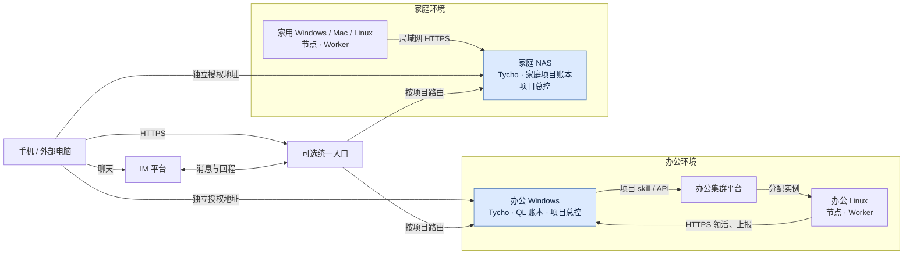
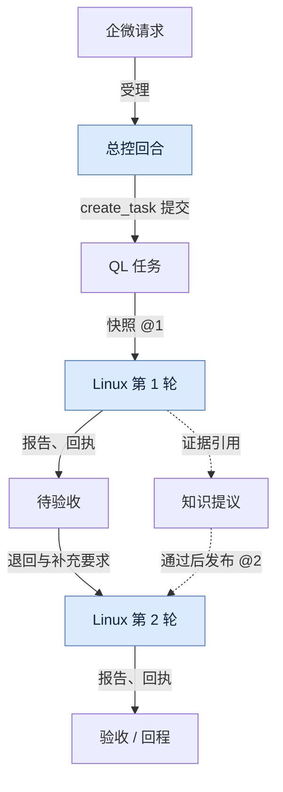
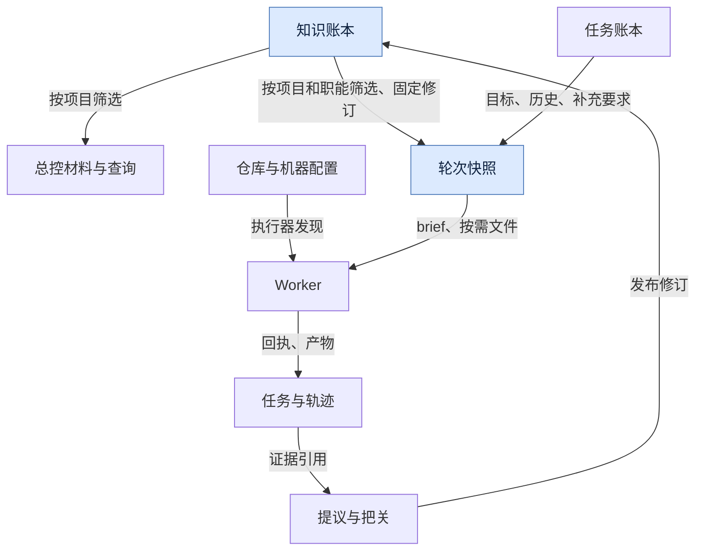

# Tycho 终态架构

读者是 Tycho 的使用者与维护者。本文回答你从企微或控制台交办一件事后，哪台机器负责什么、哪里能看到完整经过，以及 Tycho 怎样把反复发生的经验变成下一次工作的改进。

2026-11-14 的渠道优先级调整按主人决定执行。飞书真实群聊暂缓，先交付个人微信文字私聊。微信复用同一项目前台与通知策略，扫码、身份和收发恢复边界见 [微信私聊接入](weixin.md)。真实手机授权后，选项切换、GPT 建任务、Windows Worker 执行、微信待验收回程均已实际走通。控制台实际读取本轮报告并以主人身份验收，通过后再次读取登记副本。安装版 0.1.711 又在本机微信 Miro 私聊走通三轮普通聊天、固定绑定、解绑重绑及重启后原聊天回程，见 §8.2。飞书群聊和部署手册中尚未实测的平台边界不据此宣称完成。

**设计结论**　Tycho 是个人工作编排服务。每个项目由一套服务维护账本，项目总控负责理解和编排，Worker 使用各自机器上的原生执行器完成任务。状态转换和已定义的动作由程序处理。任务详情里的轨迹把消息、规则、Agent、工具、产物、审批和通知串起来。知识沿用有证据、有修订的账本，历史经过可以查找，改进经评测进入现有的知识发布或软件发布流程。

本文是设计终稿。以仓库快照 `8593f3b` 为现状基线，部署版本以现场核实为准。未来能力按末尾验收计划逐项交付。产品取舍、授权与发布由使用者决定。现有专题文档负责节点协议、代码来源、知识发布、审批和安装升级的细则。

## 1. 项目部署在哪里

同一台 Windows 可同时运行办公 Tycho、项目总控和本机 Worker。它们使用不同的执行职责。办公 Linux 节点执行适合它的任务。家庭 NAS 可以独立运行另一套服务和个人项目，也可以让家庭 Windows、Mac 或 Linux 执行工作。环境是部署与授权边界，一套服务可承载多个项目。

**蓝色设备维护各自环境的项目账本。** 统一入口故障时，有独立可达地址的服务仍可直接使用，服务内定时和内部事件继续运行。统一控制台按项目 ID 汇总各服务授权返回的目录，离线项目显示上次同步时间和原服务。目录可重建，项目状态以归属服务为准。外部访问走 HTTPS 或现有门牌、反代。内网节点优先直连所属服务。网页速度主要看入口往返、服务查询、流式代理缓冲和大日志传输，分别测量。EasyTier 暂缓集成。参见 [项目归属与开放入口](project-hosts-and-ingress.md) 和 [节点传输](nodes.md#8-传输)。

| 对象 | 谁有最终决定权 |
|---|---|
| 项目与任务 | 归属服务。保存消息、任务、Run、审批、触发器、证据和授权。同一项目同一时刻只在一个服务写入 |
| 项目总控 | 项目配置选择 Tycho 登记的合格账号或机器登录，能力和档位由适配器校验。服务默认配置用于新项目和未单独配置的项目 |
| 跨项目导航 | 入口按项目 ID 和已授权目录提供最近项目、搜索、固定聊天和可变绑定。统一浏览与切换由程序处理 |
| 节点与登录 | 节点上报系统、可用执行器、身份、能力、健康和容量。机器登录只在原机可用。托管账号按许可给满足条件的机器。切换身份时按新身份取额度，晚到的旧查询和旧轮次结果只归原凭据代次 |
| 工作位置 | 项目给出允许的节点、代码或资料来源、资源依赖、角色和权限。节点用自己的 Git 或外部系统身份访问。集群资源申请由 QL 自己的 skill 与平台完成 |
| 外部事实 | Git、CI、集群平台和 IM 分别保有各自事实。Tycho 记录查询证据和关联，项目总控通过已有接口读取 |

总控是每个项目的角色，Claude Code 和 Codex 按已验证的总控适配能力可接任。dsh 当前作为 Worker，取得同等级的能力与权限证据后再加入总控可选项。更换总控登录从账本重建上下文，正在处理的调用先结清或标为待核实。同一账号的多个已确认登录可合并展示账号名、额度和来源。派发与凭据仍由各登录管理。Claude、Codex 和 dsh 都尽量显示执行器可证实的实际身份，只有线路信息时就显示线路。机器重报、手动刷新或重新登录后更新已观察的身份和读取时间。共享账号的额度按登录实际范围计算。项目之间仍各自管理会话和队列。跨项目协调确有业务需要时，由一个明确授权的项目或外部工作流发出项目间请求。上层目录不持有对所有项目的写权限。参见 [项目总控](project-sessions.md) 和 [登录与机器](accounts-machines-decoupled.md)。

跨节点继续从能访问、已核实的 Git commit、报告或项目约定的检查点开始。原节点能证明同一个 Run 仍活着时认领原 Run。换机器时开新 Run，记录所依据的检查点及缺失信息。本地未提交文件、不可达原生会话和未知外部副作用分别显示待取回、重建或待核实。节点重新登记后使用新的身份代次，旧代次的任务凭据、节点令牌和迟到结果不能操作新登记。旧 Worker 已能触达的外部系统仍须按该系统的事实核对。

项目 ID 稳定。服务间迁移采用显式交接。先停止旧服务接收该项目写入，清点在途 Run、授权与外发，导出项目及可移交的引用，校验后在新服务待接管。旧服务先持久冻结写入，再签发一次性移交凭证，绑定项目、旧服务、新服务和下一归属代次。冻结状态在项目备份恢复边界之外。新服务核对凭证后接管，再更新目录。迁移未完成停在待核实。整机恢复或冻结记录不可核实时默认只读，重新取得写权需要向当前归属服务核对，或由操作人证明旧写者已从进程和访问路径隔离。迁移复制项目数据及经授权可转移的证据，账号凭据与外部来源授权按新环境重新核对。旧地址拒写并告知归属变化。归属不明确时暂停写入。切换前用两个服务和一份延迟目录验证。交接后再恢复迁移前备份，直连旧地址仍应拒写，第三个服务也无法使用这份移交凭证。

## 2. 同一个项目入口接收什么

入口可以来自控制台、企微或飞书私聊和群聊、个人微信适配器、签名 Webhook、定时和业务事件。渠道只负责平台鉴权、消息标准化和回程，项目服务负责项目归属、权限校验、受理、去重和后续业务动作。标准化事件携带来源身份、稳定事件号、项目绑定、事件类型、最小正文和回程引用。审批按钮和模型工具都经过原有的服务端校验。聊天回程引用只用于路由，对内容的读取权限仍由项目服务复核。

- 聊天可以固定到项目，也可在聊天里搜索、切换、解绑、重绑。选择时展示环境与项目名，避免同名选错。绑定更新只影响后续消息，已受理的消息保留原归属与回程。项目归档后可以重绑，机器人仍可用。
- 渠道提供合适的菜单或按钮时，把项目入口放到用户主动打开的位置。企微私聊按请求打开项目选择：每页正文列出最多三个编号与完整项目名，按钮只写“选1”“选2”“选3”“前页”“后页”“固定”或“解绑”，普通回复不反复附项目卡。其余渠道按原生能力验证入口，项目卡片只在首次选择、主动切换或需要消歧时出现。
- 群聊筛选、@ 规则和快答策略可以由外部适配器维护。一个群可先忽略闲聊、用确定规则答公开问题，再把需要调查或持续跟踪的问题提交给项目。源事件保留原线程与最小必要内容。私有资料的查询权由项目授权决定。
- 外部来源继续走签名受理。去重以已验证的来源、项目、来源事件 ID 和有效期为准。重复事件取回原凭证，键相同内容不同就报冲突。凭证表示已受理。结果回读按来源与事件隔离，只返回该来源获准看到的信息，来源负责发回原线程。回程失败留出站记录并给出可核实的交付状态。
- 企微、飞书和个人微信有不同的登录、推送与卡片能力。某个适配器存在只证明有候选实现。以实际账号分别验证私聊与群聊、卡片或链接、发回原线程、重复回调和重绑。参见 [入站来源](triggers.md#22-入站来源)、[企微聊天](project-sessions.md#企微聊天选项目当前规则) 和 [OpenClaw 飞书](https://docs.openclaw.ai/channels/feishu)、[个人微信](https://docs.openclaw.ai/channels/wechat)。

第一次使用，从创建项目、选总控和指定工作来源开始。服务展示当前是否已有合格 Worker。已有可用本机登录时可以直接跑一件小任务。缺登录、节点或访问权限时，项目页显示需要修的对象、当前状态和恢复后的下一步。日常用户只需选项目、描述任务，回来看成果或回答一个具体问题。

待审阅、待验收和待上线按任务的真实状态展示。审阅者以当前验收标准、提交和产物摘要为输入，独立给出通过、打回或证据不足。新提交或替换产物重新绑定审阅。卡住时显示谁能处理及可执行动作，例如重登、补证据、改用可接续节点、答复审批或继续等。用户点开轨迹可核查依据。

## 3. 程序何时处理，Agent 何时介入

**同一业务动作只经过一个权威入口。** 控制台、IM 按钮、定时规则和总控工具都调用该动作的原有权限、修订校验、状态机与审阅关卡。程序分流依赖已验证的事件类型、结构化参数、项目授权和当前账本状态。自然语言需要理解时，由项目总控形成意图。

| 事件 | 处理 |
|---|---|
| 按钮要求查看某任务、查询已确认的运行状态 | 直接读账本，程序回话 |
| 已受理的 Run 结算，规则确定下一步是排队、等待或通知 | 同一业务转换登记状态和通知，保留规则版本与原因 |
| 参数明确、项目启用的外部事件或定时动作 | 按获准动作调用服务，同事件重试核对原结果 |
| 新的自然语言任务、结果含糊、目标取舍、证据互相冲突 | 总控使用项目知识与工具决策，需要人的决定时进入同一审批流程 |
| 需要测试、分析、改代码或独立审阅 | 派 Worker，用机器原生工具，产物与验收标准绑定 |

首个优化取**待验收通知**。账本已确定验证任务交回报告，且没有后续规则、争议或总控待办时，服务直接给出状态、证据入口和你可做的下一步。只有需要调查报告、独立审阅、决定返工等情形才继续唤醒总控。另一个可选项是把此回合必读的少量职能或状态随输入提供，须比较额外 token 与省下的工具调用。整个执行器会话次数、模型调用次数、工具往返、等待时间分别计量。现有静默自动重排和结算通知已经证明程序可以承担其中一部分。参见 [自动重排测试](../../tests/router-quiet.test.ts)、[Anthropic 工作流与 Agent](https://www.anthropic.com/research/building-effective-agents) 和 [Hermes 程序化工具调用](https://hermes-agent.nousresearch.com/docs/user-guide/features/code-execution)。

程序动作若有副作用，为同一受理事件或授权动作保留稳定操作键。操作键、参数摘要、作用域、预期对象修订与业务结果在提交时绑定。每次尝试另有调用 ID，换回合重试仍用原操作键。同键同内容取回原结果，同键异内容拒绝。外部副作用未确认时先查外部权威，缺稳定键或无法核实时转待核实，高风险写操作等待确认。合并和上线仍受项目授权、产物身份与既有审阅约束。人工等待持久化在账本，释放 Agent 执行资源。复用现有业务操作达到目标后，才根据真实瓶颈判断是否需要通用工作流引擎。

## 4. 一条可展开的工作轨迹

**从企微那条消息或任务详情出发，能逐项看见输入、执行、输出、等待和人需要做什么。** 你之前看到的 QL 演示是目标体验的静态样例。终态以实际服务记录生成同样的视图。

**任务分支、返工轮次和经验提议都有各自的来源。** 蓝色节点可展开 Agent 的实际输入与输出。虚线路径上的提议发布后才会进入下一轮，用户也可直接在知识页发布修订。某轮从未收到的输入在这一轮中显示缺口。

| 点击哪一步 | 能展开什么 |
|---|---|
| 入站、切换、分流 | 来源、项目绑定、为什么受理或拒绝、程序规则或总控回合、回程状态 |
| 总控回合 | Tycho 发出的固定模板版本、恢复材料、本回合消息、知识目录与查阅结果，工具 schema、所发调用和服务返回，以及执行器报告的可用内容 |
| 业务工具 | 名称、脱敏参数、受理及拒绝、已提交的操作、返回尝试、执行器收讫情况。遇到断开，已创建的任务仍可点开 |
| Worker 轮次 | 节点、登录、代码来源、版本、启动消息、完整 brief 和可获准查看的快照，公开的模型/工具事件、命令、输出、退出和报告 |
| 等待与恢复 | 在排队、等权限、等节点、等人或待核实中的哪一步，等待原因和有权执行的下一步 |
| 审阅、验收、结果与经验 | 哪一份产物、哪次审阅和授权、回到了哪个线程、哪些经历被引用进提议 |

展示区分**已生成、节点确认收到、执行器报告已读取、可能加载、未知**。机器自带 AGENTS.md、技能、插件和原生记忆只按其报告展示。Tycho 可提供自己交付的准确内容及版本。执行器的内部推理、不可观测的本机内容和第三方截断的原文标明边界。可用量、排队、执行时间用实际观测值。仅有整回合耗时的执行器展示整回合耗时，跨机时间主要按因果排序。

### 4.1 数据与故障语义

1. **业务因果。** 利用现有账本消息、任务、Run、审批、出站与审计记录。查询视图从这些对象和因果引用组装，服务继续由现有状态机负责写入。创建等状态转换与其因果引用在原事务中写入。调用入口绑定项目、消息和回合，在执行前分配调用 ID，提交记录关联该 ID。已合并的多个输入、并行子任务和外部回执可以有多条因果链接。主因和其他引用来自实际操作，历史只回填可证明的关联。
2. **诊断正文。** 总控入口记录实际收到和发出的 Tycho 工具数据，适配器记录执行器公开事件。可归因的 Run、节点身份代次、事件源和源序号用于去重。Worker 原始输出留在节点，归属服务按字节偏移分块读取、脱敏解析，把有界事件与已处理完整行的游标一起保存为检查点。同一 Run 恢复连接后增量补读；收集端重启后恢复已保存的事件和游标，需要补读时再从原机器读取。积压、源端截断、保留期限、脱敏、节点永久丢失各有明确状态，节点清理了的区段保留缺口。保存失败时说明已显示的诊断可能在重启后丢失，诊断完整性不冒充业务提交结果。低价值大正文缺失时，账本结果和摘要仍可读。记录层避免阻塞正常的输出流。节点本地保留有界待传数据仍是交付要求。候选实现分别保留诊断尾段和原生结果，并在节点端先预留每轮及本机总预算；诊断淘汰显示缺口，结果超限显示不完整。新轮次只向明确报告能力与容量的节点派发，旧轮次保留原物理文件语义。该实现尚待完整检查、正常安装包和真实跨机故障验收；主机有界检查点不能代替这些要求。接口与范围见[节点输出预算](nodes.md#15-有界待传输出)。
3. **查看与授权。** 控制台用持久游标补读后接实时流，断线后补齐，投影可重建。任何展开、搜索、实时补读和导出由证据归属服务复核项目、来源和对象权限，校验通过后才返回摘要、存在性或访问链接。持久写入之前按字段白名单和服务端脱敏处理。已识别的密钥、认证头禁止进入新诊断载荷、索引、实时流和导出。保留期和体积上限由设置给出，界面说明哪些内容会过期。需要更深诊断时按项目显式启用。对外 telemetry 默认只含阶段、匿名关联、版本和指标，采用可选的 W3C/OTel 映射。
4. **结果与送达。** 分开记录已受理、已提交、已向连接写回、接收方确认。提交后总控连接断开时，可以看到“任务已创建，模型是否收到结果未知”。Worker 失联后迟到的事件可归档到原 Run，能否结算仍由账本的当前代次和修订规则决定。出站按渠道能力使用稳定键或核对，平台无法确认时显示送达未知。
5. **查阅、回放、重跑。** 查阅呈现保存的事实。离线回放用录制事件验证渲染或确定性业务投影。隔离重跑在冻结输入和替身连接器下验证新版本。三者在控制台明确区分。生产上的合 PR、发送、集群创建和上线只走原有授权入口。

现状中的 `traceRun` 主要回答“这轮为什么开始”，总控 Observer 可见工具开始、结束与错误。基线缺少统一保存的总控调用细节和跨机器因果视图。新增事实优先在工具入口和实际提交处记录。参见 [当前追溯代码](../../service/trace.ts)、[总控工具入口](../../service/http.ts)、[Worker 事件读取](../../runner/runner.ts) 和 [OTel 消息链路](https://opentelemetry.io/docs/specs/semconv/messaging/messaging-spans/#trace-structure)。

## 5. 记忆、知识和技能

**界面上可按跨项目、当前项目和本轮查看。底层以内容的正本、适用项目和职能、加载方式、内容类型、修订来表达。** 一条知识能适用几个指定项目，亦可显式设为当前服务全局。外部挂载是来源选择，本轮是工作材料的寿命。这样 QL 与其他办公项目可共享一条经验，家庭项目仍使用自己的知识范围。

| 你想找什么 | 对应机制 | 何时到 Agent |
|---|---|---|
| “这次做到哪了” | 任务修订、补充输入、已登记的进度或产物，原生会话中的临时上下文 | 启动或接续时通过 brief、快照、历史及可用会话恢复 |
| “上次类似的验证怎么失败” | 历史任务、Run、轨迹、回执和证据，属于情景记忆 | 经项目授权查历史，返回原始来源与发生时间 |
| “这类报告怎样才可复核” | 账本知识，属于语义记忆 | 常驻给正文，按需给目录与正文引用，标明范围和修订 |
| “怎么准备夹具并生成报告” | 账本 skill 或仓库/本机的 SKILL.md，属于程序性记忆 | Tycho skill 随快照交付并按需读，任务点名时按现行规则给正文。原生技能由执行器发现和读取 |
| “这个账号自己记得什么” | Codex、Claude、dsh 或其他 harness 的持久记忆 | 由执行器启动策略决定。普通 Worker 如实记录可能读取范围，独立审阅或把关按已验证能力隔离 |

**同一知识条目维护一次，每轮按适用规则选择并固定版本。** QL 的报告规则从 @1 修到 @2 后，正在跑的轮次仍可看到 @1 的快照。下一轮用 @2。执行器会话是否继续按现有兼容条件判断，知识修订集合变了则新开 Worker 会话，已核实的项目工作副本和历史仍可用。总控重新建上下文时从账本取得现行常驻知识及目录，并记录该次实际发送内容。参见 [知识现有细则](knowledge-and-skills.md)、[快照实现](../../runner/snapshot.ts) 和 [派发知识测试](../../tests/knowledge-dispatch.test.ts)。

跨服务知识默认由所属服务独立维护。确实要把一套通用资料分享给家庭和办公时，先支持显式授权的只读发布物，由指定来源维护，使用方安装或固定到来源 ID、修订和摘要。外部原件仍在原处编辑，项目可选择已授权修订，离线使用仍有效的已固定副本。授权撤回时停止新查询与新注入，历史是否能展开由保留与删除规则决定。跨服务同步、向量索引与自动摘录都以实际使用和评测收益为扩展条件。离线副本是否还能用取决于所持授权的有效期，来源撤权未同步时，已撤权服务无法远程抹除机器已取得的内容。

**机器入口的版本冲突需要单独验收。** 现有 Tycho 可为非 Tycho 会话生成全局常驻的 AGENTS.md，用户自有文件由其本人维护。Codex 同一个 home 可能还会读取这份 Tycho 投影，与项目快照重复，甚至看到不同修订。终态把机器级 Tycho 投影设为明确启用的外部会话入口。托管轮优先使用可验证的隔离策略。若同一登录无法隔离且机器入口确有 Tycho 投影，派发前按实际状态暴露重复或版本风险。对要求输入版本固定的审阅和评测轮，只有能保证取到指定输入才放行。已启用的外部入口先验证替代接法再迁移，用户文件保留。原生技能、外部 MCP 和原生记忆继续按执行器及角色的真实能力显示。

历史检索先从项目、职能、时间、主题关键词和提交号开始。结果带项目归属、任务与 Run ID、片段、知识修订和引用。历史案例查询限定事件当时可见的证据和修订，并重新核对调用者当前权限。当前任务检索显示最新生效状态。删除、过期与撤销应传播到派生索引，备份重建按同一规则执行。先用“找到相似失败且引用正确历史版本”的任务验证召回，能证明关键词不足再增加语义检索。

## 6. 从轨迹改进下一次工作

**轨迹给证据，评测决定是否晋升。** 现有的知识提议、独立审阅、版本发布和回退仍各自拥有最终决定权。

1. 你可从实际任务标记“值得复用”“哪里等太久”或“这个结论错了”。服务也可统计重复调用、返工、未采用的产物和等待阶段。统计定位候选，具体案例提供证据。
2. 候选按改变的内容进入现有责任方。拥有真实执行凭据的项目仍通过既有任务和审阅推进。可复用的判断走知识提议，有效操作步骤走 skill，确定流程走规则或程序改动。只有证据支持的目标和范围才提议扩大。独立把关核对来源、适用边界、反例、现有条目和冲突。
3. 从脱敏案例构建离线评测。冻结代码、知识、身份策略和工具响应。按任务族与时间区分调优集、发布验证集，答案与事后记录只供裁判。测试权限、幂等、回执、审批和产物绑定为硬断言。语义质量由可查证的预期与独立审阅判断。
4. 知识按现有证据提议和发布规则生效。全局常驻、主人写过或审过的条目沿用其确认门。程序、模板和规则经代码审阅及版本发布。仅兼容性已有证据时自动回退程序并保留现有账本。知识回退通过再发布一个修订保留历史。
5. 上线后用同类任务比较成功率、返工、关键路径与模型开销。测量结果进入下次候选评审。规则的启用可撤回，已经发生的外部效果按来源核查。

举例，连续几个 QL 任务都因为漏记 commit 被退回。先从真实轨迹核对是 brief 没写清、Worker 漏读，还是模板与职能冲突。当前验证样例确实暴露了“只交报告”与通用 Git 段要求提交推送的冲突。最直接的改进是让 brief 生成规则按交付职能给出对应 Git 步骤，并在离线案例中确认验证任务无需提交仍可完成。将来明确每个报告都须带源 commit 时，再用结构化验收核验字段。参见 [现有自我迭代与发布](self-iteration.md) 和 [Runner brief](../../runner/snapshot.ts)。

## 7. 参考系统与取舍

证据以官方规范、文档、开源实现、原始论文和本仓库实录为主。第三方能力用于设计对照。针对 Tycho 的跨环境适配、迁移成本和延迟收益仍需本地验证。

| 方向与参照 | 已有机制 | Tycho 的采用方式 |
|---|---|---|
| 原生 harness。Codex、Claude Code、dsh、OpenCode | Codex 有 thread、turn、item 和工具结果。Claude hooks 能区分工具响应与模型收到的投影。dsh 实录有工具 I/O、结束与 usage。OpenCode 的客户端事件流主要供实时订阅 | 保留各适配器，按能力报告观察边界。用原生实录验工具配对、中断与截断，用持久游标补订阅缺口。[Codex App Server](https://developers.openai.com/codex/app-server/) · [Claude hooks](https://code.claude.com/docs/en/hooks#posttoolbatch) · [dsh 实录](../../tests/fixtures/dsh/0.2.2-rc.1/README.md) · [OpenCode Client](https://opencode.ai/docs/build/client) |
| 个人 Agent。OpenClaw | Gateway 有渠道绑定、远端会话放置、轨迹导出和持久 Workboard。Lobster 可运行受限确定步骤并等待批准。Knowledge 有共享存储和修订前置条件 | 是最强的整体采用候选。先借用原路回程、脱敏轨迹、工作区迁移和小步骤的审批语义。Workboard 以单 Gateway 为边界，Tycho 仍须证明项目迁移、已有权限与发布绑定能保留。[路由](https://docs.openclaw.ai/channels/channel-routing) · [远端会话](https://docs.openclaw.ai/nodes/session-hosting) · [轨迹](https://docs.openclaw.ai/tools/trajectory) · [Workboard](https://docs.openclaw.ai/plugins/workboard) · [Lobster](https://docs.openclaw.ai/tools/lobster) · [Knowledge](https://docs.openclaw.ai/plugins/knowledge) |
| 个人 Agent。Hermes | Kanban 持久记录任务、Run 和依赖。内置程序调用复用工具权限。记忆启动时按预算冻结，技能按需展开 | 采用固定流程推进、视图回钻、冻结和历史另取。保留 Tycho 的归属服务、多环境权限和知识提议。[Kanban](https://hermes-agent.nousresearch.com/docs/user-guide/features/kanban) · [程序调用](https://hermes-agent.nousresearch.com/docs/user-guide/features/code-execution) · [Memory](https://hermes-agent.nousresearch.com/docs/user-guide/features/memory) · [Skills](https://hermes-agent.nousresearch.com/docs/user-guide/features/skills) |
| 编码 Agent 平台。OpenHands 与 GitHub Actions | OpenHands SDK 将 Agent、Conversation、Workspace、Action 和 Observation 分开，并提供远端工作空间。GitHub Actions 自托管 runner 使用本地系统与网络环境 | 借鉴执行器观测边界、证据和节点生命周期。QL 的私有集群及家庭设备沿用各自资源管理。[OpenHands SDK](https://docs.openhands.dev/sdk/arch/overview) · [GitHub 自托管 runner](https://docs.github.com/en/actions/concepts/runners/self-hosted-runners) |
| Agent 开发。LangGraph、LangSmith、OpenAI Agents SDK、PydanticAI | 检查点、跨会话命名空间、可下钻轨迹、trace 转数据集、模型/工具 span、替身模型 | 借鉴检查点边界和脱敏用例评测。Tycho 继续以账本恢复业务，原生模型回合与工具由执行器提供。[LangGraph 持久化](https://docs.langchain.com/oss/python/langgraph/persistence) · [LangSmith 评测](https://docs.langchain.com/langsmith/evaluation-concepts) · [Agents SDK tracing](https://openai.github.io/openai-agents-python/tracing/) · [PydanticAI 测试](https://pydantic.dev/docs/ai/guides/testing/) |
| 记忆。CoALA、Letta、Mem0、LongMemEval | 工作、情景、语义与程序性记忆。常驻块与按需归档、自动抽取归并，以及长历史中的更新、时间、拒答和跨会话检索 | 采用职责分离与按需加载，保留证据、权限和不可变修订。用本地案例检验自动抽取或向量检索边际收益。[CoALA](https://arxiv.org/abs/2309.02427) · [Letta 常驻块](https://docs.letta.com/v1-sdk/memory/memory-blocks) · [Letta 归档](https://docs.letta.com/v1-sdk/memory/archival-memory) · [Mem0](https://arxiv.org/abs/2504.19413) · [LongMemEval](https://arxiv.org/abs/2410.10813) |
| 耐久工作流。Temporal、Restate、Inngest、n8n、Dify | 用历史和稳定步骤 ID 恢复，支持持久等待外部信号。n8n 和 Dify 提供外部流程或人类输入节点 | 采用持久等待、版本化规则、已执行结果复用和外部副作用查验。外围可用现有低代码工具。多步等待、补偿与流程升级若成为主要成本，拿同一故障用例试 Temporal 或 Restate。[Temporal](https://docs.temporal.io/workflows) · [Activity](https://docs.temporal.io/activity-definition) · [Restate](https://docs.restate.dev/develop/ts/durable-steps) · [Inngest](https://www.inngest.com/docs/durable-execution/primitives) · [n8n Wait](https://docs.n8n.io/integrations/builtin/core-nodes/n8n-nodes-base.wait) · [Dify 人工输入](https://docs.dify.ai/en/cloud/use-dify/nodes/human-input) |
| 开放协议。CloudEvents、MCP、ACP、A2A、W3C/OTel | CloudEvents 有来源事件标识，MCP 提供工具发现和调用，ACP 协商会话与工具事件，A2A 面向外部 Agent 委托，Trace Context 负责关联 | 签名来源保留受理权。MCP 接编排工具和知识。ACP 按执行器能力接入。A2A 在有实际互通对象时作为投影。外部 trace ID 只作为观测关联。[CloudEvents](https://github.com/cloudevents/spec/blob/v1.0.2/cloudevents/spec.md#id) · [MCP Tools](https://modelcontextprotocol.io/specification/2025-11-25/server/tools) · [ACP 会话](https://agentclientprotocol.com/protocol/v1/session-setup) · [A2A](https://a2a-protocol.org/latest/specification/) · [Trace Context](https://www.w3.org/TR/trace-context/) |
| 可评测优化。DSPy 与 OpenAI Agent evals | 从可重现的案例和指标评测提示词与工作流，通过 trace 定位工具或交接错误 | 采用冻结评测集、确定性断言和语义裁判。统计有稳定收益再采用自动优化候选。[DSPy](https://arxiv.org/abs/2310.03714) · [Agent evals](https://developers.openai.com/api/docs/guides/agent-evals) |

现有 [ACP 实录](../spike/acp-evaluation.md) 覆盖当时版本的断连、续接和权限。新版规范已描述可选的系统提示词等能力，以版本实测决定可用性。各家原生方式的持续运行与跨机接续由各自适配器验证。正文采集和性能 telemetry 的权限边界参考 [OTel GenAI 正文采集](https://github.com/open-telemetry/semantic-conventions-genai/blob/main/docs/gen-ai/gen-ai-spans.md#capturing-instructions-inputs-and-outputs)。

### 采用路线的决策

| 路线 | 得到什么 | 本次判断与改变条件 |
|---|---|---|
| 保持当前形态 | 现有任务、快照、Run 现场与知识流程，改动成本最低 | 留作基准。当前无法在总控工具、业务提交和远端证据间完整回钻 |
| 整体采用 OpenClaw Workboard 或 Hermes | 可复用个人助手、渠道和持久工作板，家庭单环境价值高 | 优先作入口或单环境对照。只有同一用例可保留归属、跨节点权限、产物/审批/知识版本，并能演练单写迁移时再评估接管 |
| 用 Temporal 等承接所有编排 | 直接获得耐久流程、人工等待、重试和版本工具 | 适合规则清楚的独立长流程。替代现有项目账本需迁移已有状态语义与外部权限。现阶段可先外置一个独立流程验证收益 |
| 保留 Tycho 账本，采用已成熟的机制与接口 | 复用现有可验证业务操作，在真实使用中逐步增加轨迹、检索和确定性路径 | **选择此路。** 如果现有账本无法可靠记录提交因果，或者较复杂流程的维护已经占主要成本，以相同验收协议重新比较 |

独立反方审查提出的首要风险是“业务提交成功，诊断却让用户误以为没做”。该风险决定两个持久性等级的边界。业务提交与因果随原事务提交。诊断丢失只改变可见度。实现门以实际故障注入及投影重建为准。第三方整体采用的证据来自公开机制，还需要同用例试用。

## 8. 需要固定的接口与分阶段验收

### 8.1 能力基线与设计决策

| 产品面 | 基线已有 | 本稿目标 |
|---|---|---|
| 部署与账号 | 单服务多项目、节点通道、共享派发配置、Codex 与 Claude 总控适配 | 多服务项目目录与归属交接、项目级总控登录、可验证的跨机继续 |
| 渠道 | 企微私聊选择、内置事件和签名入站 | 按渠道验证常用入口、重绑、来源级结果查询与原线程回程 |
| 过程与记忆 | 轮次快照和现场、项目会话、版本知识与独立把关 | 跨阶段轨迹、可检索历史证据、可核对的输入范围 |
| 自动化与改进 | 结算与自动重排、任务审阅和发布入口 | 按证据移出重复模型回合、离线评测、受控发布和效果比较 |

| 决策 | 边界与不变量 |
|---|---|
| ADR 01　项目单写 | 稳定项目 ID 与显式归属代次。执行与访问可分布，写权交接由归属服务控制。目录只有路由权。以交接期间拒绝旧写入和备份恢复校验作为证明 |
| ADR 02　程序和 Agent 共享业务权限 | 人、事件和模型都凭服务认可的身份和已验证参数调用业务动作。程序规则的版本、匹配原因与审批绑定可回查 |
| ADR 03　业务因果与诊断 | 可见事实和业务状态一起提交。正文使用带源和序号的有界记录。读模型可重建。允许更新投影格式，保留来源与版本 |
| ADR 04　版本化记忆 | 正本、范围、版本及证据可核对。外部只读引用和快照由权限约束。历史查询可按当时版本读取，当前执行只接收获准且适用的修订 |
| ADR 05　改进与发布 | 真实轨迹经过授权和脱敏后进入案例，发布由现有授权和评测决定。隔离评测验证副作用，回退沿用现有程序/账本兼容规则 |

实现前冻结能独立开发的最小契约。入站保留现有签名 schema，回程查询只暴露授权范围内的凭证和状态。轨迹读接口以项目/任务或消息为根，分页游标和证据引用视权限生成。事件约定包含源、源序号、已确认的因果边、对象身份、版本及采集状态。快照保存实际输入引用，界面以服务器权限读取。具体 URL、索引和日志格式按实现试验确定。两套测试替身分别模拟渠道重发、远端节点晚到。用实现契约测试锁住边界，再并行开发 Console 视图和采集点。新的写入权限、项目迁移与跨服务知识分享在真实故障注入后进入实现门。

### 8.2 已有证据和下一道门

截至 2026-11-16，正式办公、家庭服务及实际节点仍为 0.1.765。节点有界输出和本安装系统服务观测的候选在 [PR #32](https://github.com/XaineChaeson/tycho/pull/32) 继续验收，尚未合入或正式推广；源码进度不代表部署已切换。

非空 Windows → 家庭 Linux 项目移交已完成业务闭环：原 12 行记录、知识 @1/@2、原报告和文件保持，真实总控读取已登记报告后派发新 Worker，实际使用当前知识 @2 并保留历史 @1 引用。任务 `01M7FZFVPXDKPGW3973D9VN2HB` 的首个 failed 轮次保留；修订 2 的 Run `01M7G0BRPKFST7SZC0W3QS09QM` 交回 5850 字节报告，Owner 已读取并验收登记，正文 SHA-256 为 `88709517158fbf439711121c12f94f4bc40102310074ea83cf62e9a77adab000`。该结果补齐上述非空项目场景，不覆盖未迁移的账号和凭据。

Windows node-role 使用新后缀计划任务完成正常注册、启动、停止及再次启动，尚未注销重登录。额外的 Windows Codex 0.167.1 可写 Worker 在手工启动和计划任务启动两轮中均 failed，任务 held；改由计划任务启动后，先前的 Core 上下文错误不再出现，但 setup helper 仍退出 1。原生 profiles 和 sandbox 均未改，尚无证据证明 npm 升级到 0.169 即可修复。

2026-11-16 已按主人授权修复真实公网门牌：专用 SSH 账号只接受公钥认证，保留所需远端转发，禁止命令会话及其他方向的转发；新运行密钥仅授权给专用账号，管理员授权与生效配置保持。通过 Tycho 正常设置切换密钥后，实际 SSH 子进程与服务器认证记录均确认使用新密钥。公网 HTTPS 首页正常，未登录接口仍要求凭据，原家庭 Linux 节点心跳在切换后恢复。正式服务保持 0.1.765/schema42，进程与启动时间未变；原配置和授权文件已保留持久回退副本。原始输出与维护窗口中的短暂断连见 `dist/gateway-ssh-approved-801/REPORT.md`。该结果不等于旧版登录凭据协议已升级，也不代替候选 801 尚未执行的跨机故障验收。

主人切换为自动审批后，801 隔离包已补齐原生跨机恢复样本。A 的 Linux 报告先经正常 Owner API 登记；首次重启观察过早，保留该错误和清场后，再正常启动同一 Host，仅补读原 Run，38 条事件及 2199 字节登记报告均保持。B 的专用链路断开约 15.5 秒，本机公开采集窗口仍增加完整原生工具记录，恢复后同一 Run 的原 14 条事件前缀在最终 55 条中保持。C 正常扩大项目池并保留 Linux 许可后切断链路，旧 Linux Run 判 lost，Windows 以不同 Run 和采集来源完成；任务没有登录或机器 pin。新材料含服务生成的失联提醒、旧 Run 的 lost/空回执历史，无旧执行器会话引用，报告如实说明未知旧轮工作。该样本未恢复旧执行器内存，也不证明任意外部副作用可自动接续。原始材料及 Root 独立核对见 `dist/native-capture-fault-801-auto-review-f7a91c/`；准备脚本错误、A 的观察纠正和原始输出边界均保留。

候选源码还新增本安装的系统服务只读观测，见 [节点观测边界](nodes.md#121-本安装的系统服务状态)。CLI、节点异步采样、Host 白名单归一和机器页/总控查询已接通；删除后同名登记不会读取旧采样，坏的可选诊断不会使心跳失败。集群定向回归和 Linux 容器无用户总线探针已有原始结果；Windows 用新源码只读查询现有 765 安装，实际识别 Host/Node 自启已启用且运行中，查询前后定义摘要保持，未切换正式程序。证据在 `dist/service-observation-802-9ysxkncv/`。这些限定验证不代替最终候选资格、独立审阅、家庭 systemd 对照或正式推广。

macOS 真机由主人明确留待下次补验，飞书真实群聊继续暂缓。Windows 注销重登录及个人微信正式迁入仍未完成。以下是历史验收记录，版本与部署描述均以当次观测为准；先前的权限拒绝不能覆盖上述新审批模式下已完成的工作。

2026-11-15，正式服务曾升级为私有预发行版 0.1.741，冻结源 `d76f9339e605cefba93a49c058c61139b399c22f`，包 SHA-256 为 `ab8c44e4ee4ede2c94958b9f81174d393eaa231582a344db78a7cbe6bdef0717`，schema 42、节点协议 6。正式安装版通过本机正常 GitHub CLI 身份执行 `tycho update --to 0.1.741`，从 737 下载发行资产并切换；新版经过控制台、核心接口、账本、恢复清点和十秒稳定观察的健康检查。企微和门牌恢复，Windows 与 linux-worker-01 节点均自动跟随 741，无需节点拉源码构建。当时保留了 737 程序。

报告原文缺口已实际关闭：新轮次随首次有效结算保存声明为报告的最终回复，旧轮次在原始记录仍可核对时有界恢复；普通元数据查询不自动带正文，总控通过 `get_run_report` 显式读取。家庭反馈分析任务 `01M7DJX1S5FF3VY43GAHQYDV9K` 的旧报告恢复为完整 10788 字节，SHA-256 `9df3740a8a505c81f289816366ff34476e3e128ddc90fbfd498496822a767173`；重复读取及正式服务重启后不变。真实 Edge 公网页面打开完整正文并标明恢复来源，旧抽屉正文宽约 825 像素、修后 490 像素，外层不再横向溢出。另用桌面 1280 和手机 375 像素视口的长表格/代码夹具验证局部滚动与末段位置。主线已验收接收该分析，不把它当作宿主观测实现完成。

实际只读任务 `01M7DR16KM5VJ95AS35GVTE1YC` 在 linux-worker-01 运行两轮。737 的首轮正确结果保留，741 补验轮保持原生 read-only 和空代码来源，实际交付的 brief 不再要求写 artifacts 或处理 Git 工作。原始工具事件记录 `uname -srm` 返回 `Linux 6.8.0-149-generic x86_64`、退出码 0；579 字节最终报告随结算保存，SHA-256 `28fcc40d0f96c0533d4e18cc2b837cb5e703c04d5622e2a9cc5147109f019705`。真实 Edge 读取第二轮报告、填写依据验收，再读报告与验收前一致。证据为 `dist/tycho-readonly-741-verification.json`、`dist/tycho-report-usability-741-production-verification.json`、`dist/tycho-report-usability-741-acceptance-verification.json` 及对应快照、事件和截图。

741 冻结包在研究 Linux 容器 Node 24.22 的标准后端全量中 3378 项通过、77 项默认平台/环境跳过、零失败；root types、正常打包的前端 types/build 和 298 项 manifest/源码校验通过。Console 源码、shared、配置及依赖锁与 740 相同，引用其 697 项通过记录，未重复该套测试。Windows Node 24.19 的公共账本重派和模板相关 73 项通过，正常隔离安装、启动、主人登录、构建资源及干净停止通过。实际 Edge 隔离服务及合成 CLI 的全套冒烟 27 项通过、1 项可选截图跳过；最终报告布局目标 3 项通过。DSH 最终增量静态复核自然完成，188 秒、退出码 0，范围内未发现可重现缺陷；不代替以上动态验收。完整打包证据在 `dist/report-usability-linux-verification-741/verification.json`。

DSH 原始元数据及最终判定另保存在 `dist/tycho-report-usability-741-dsh-metadata.json`、`dist/tycho-report-usability-741-dsh-final.txt`，原会话号为 `session-ae6e0d06-7c4b-48e9-97a2-ea76ab0c5359`；静态摘录范围外的链路由上述公共账本回归和真实派发补证。

家庭连接恢复后，已取回独立服务的原始证据并核对报告摘要。Ubuntu 的 `tycho.service` 为 enabled、active/running，主进程属于该用户 unit；独立程序与账本位于 `~/.tycho/home-service/`，仅监听回环 8788。真实总控建任务、Worker 执行、主人读取并验收报告及正常停启均有记录；首次混合 stdout/stderr 的不足记录保留，第二轮分别记录并交付。安装版用正常 `tycho update --to 0.1.741` 从 724 升级，服务身份、schema 42、既有项目及 1862 字节报告保持，报告 SHA-256 为 `cc909b7cfe09af06787dffc4e6b31a3814119f3b5c27a709271f85f563171e71`。办公节点的 unit、身份及原办公后台绑定保留。完整公共证据为 `dist/home-native-public-741.json`，独立复核为 `dist/home-native-public-741-independent-audit.json`。此项不证明家庭服务已有独立的外部访问入口。

另以 Windows 隔离源服务和该家庭 Ubuntu 服务完成一次真实归属交接：正常 export、目标 stage、源 freeze、目标 import；家庭端保持项目暂停，Owner 接口实际改名并读回 owned、generation 2、writable。源端只恢复移交前的 `ledger.db`，保留独立归属库，仍能读历史且拒绝恢复写入；第三个服务正常 stage 后，使用同一凭证 import 被拒，账本没有该项目。目标原项目公开视图、报告摘要及两个 systemd unit 保持。原始包 1464 字节，SHA-256 `ee9d18a0fc4d2fcec0c0947498e24bc487d0c19bb325636c2040bcf07d1c2737`；目标原始记录 SHA-256 `799b442e0d90cd2e4319203fe446deeea2bcd178cf470353838134c9ce0c813d`。记录在 `dist/project-home-physical-741/`。该验证仅覆盖暂停的空便携项目，不证明账号、知识、文件或凭据可迁移；Windows 源是本次创建的隔离服务，没有迁移正式办公项目。

当时尚未通过的下一道门包括：节点/CLI 共享固定只读宿主管理器观测写入被自动审批以 `blocked by policy` 拒绝，未绕过重试；Windows 真实新登录、macOS、门牌服务器侧边界和个人微信正式迁入未完成，飞书真实群聊按主人决定暂缓。

741 的第三道门补得部分原生证明，当时尚未整体通过。家庭 Ubuntu 的 Codex 0.169.0 在独立私有 home 中通过适配器原样的 read-only 探针，未复制沙箱内部标记或降级保护。741 真实作者轮读取知识 @1；发布 @2 并产生全局入口投影后，再次派发同一审阅被 held，没有新增 Run。正常关闭投影时观察到“原生文件已撤、节点仍报 present”，absent 确认后再由操作者恢复审阅；该中间窗口没有实际 resume，不能把观察结果写成 guard 已拒派发的原生证明。随后新会话以原生 read-only 读取 @2，审阅材料仍绑定作者 @1 的正式报告，SHA-256 `76b7738cd90920ebf1fcf61f800014755dbf8a6f00db6ff796dedf421acf4c25`。独立复核重算正文、投影文件和原生读取输出摘要，核对报告正文在实际工具输出中完整出现；原生输出本身已有的脱敏标记保留，不补造被遮蔽的摘要行。范围仅为已观察的 Tycho 入口、知识 MCP、记忆策略与新上下文，不保证隔离未知的原生插件、技能或连接器。

该次 741 场景还暴露两个未通过项：可写报告职能未说明最终回复的固定回执引用，首轮报告未登记，正常返工后才交付；总控无条件的上层推进模板与主人要求等待相冲突，提前创建审阅，并在项目已有验收权限下自行验收。实际验收 actor 是 router，不能写成主人验收。完整首轮、返工、提前审阅及验收审计均保留；修复须在最终候选的新原生场景验证，不能把人工补充后的本次结果算作修复证明。浏览器因工具无法可靠识别当前 URL 而停止，未换 UI 路径；held、关闭、恢复及验收的 UI 部分仍未验证。原研究容器和 Windows 私有 home 的失败探针保留为前提不足记录，分别见 `dist/tycho-fixed-input-741-capability/`、`dist/tycho-fixed-input-741-windows/`。普通报告独立审阅还需明确启用审阅的职能；预置分析和验证职能默认均不强制审阅。审阅轮冻结派发时现行知识，作者原轮报告与修订绑定另行保留。

后续冻结 750（`c8b15eecc56e424acfda3331dba00979a1aeaf91`）的私有候选修复报告引用与等待模板，仍未推广。研究 Linux Node 24.22 标准后端 3386 通过、77 平台或环境跳过、零失败，Console 698 通过、双 types 与正常包检查通过；Windows 实际 Edge、隔离服务和执行器夹具的冒烟 27 通过、1 可选截图跳过，另实际核对 375 像素的错误报告提示并退回到第二轮。DSH 实树审查自然完成，原始意见与 Root 裁定均保留，不能把进程退出 0 写成无条件通过。证据在 `dist/report-owner-control-linux-verification-750/`。

家庭 750 原生场景采用新私有 HOME、正常 OAuth 认证副本、无 Codex config 文件及 Tycho 原生收养登录的默认档位，显式选择 Codex 总控和 operate（回退 execute/medium）；不代表复制了原主人配置或验证了原来的插件与 MCP 组合。首个作者 Run `01M7EWMNW1VHNAYXM7X4CBXDXP` 直接保存完整 804 字节报告，SHA-256 `8d2980f3b31df623b1b98518e27f466a2976b6d74531a0fc95d73dd7a4e8bb95`，未人工补回执或返工，业务命令实际执行一次。项目默认验收授权开启，总控在结算后及正常新话题的新上下文中均遵守等待；原话在实际恢复材料和 get_task 中保留，后来才按主人明确放行创建审阅。

该场景在全局投影 @2 存在时审阅 held、零 Run。正常关闭后的实际 resume 在 SIGSTOP 扩大的窗口中观测五次，均为 queued、零 Run、文件已撤且节点仍报 present，后三次 API 原话是 `waiting.no_machine`；不能写成纯天然窗口或捏造更具体的拒派原因。恢复客户端并确认 absent 后才创建只读审阅 Run，使用 @2 并绑定作者 @1 报告。两次审阅均为 `cannot`，没有任何验收：总控读日志、正常 update_task 补证并恢复，但第二轮 brief/context 未带入审阅任务自己的补充说明。当时该缺口尚待修复，不能把绿色回归替代真实链路完成。原始公共 JSON 为 `dist/home-native-public-750.json`，SHA-256 `2b2535df553eeb5229eefc5e92cac5f7dcba36073ef6a640970048c34581490b`；独立复核 `dist/home-native-public-750-independent-audit.json` 重算 34 份内嵌正文摘要并核对调用及材料，保留清理动作缺少完整原始回包的边界。该次验收时，正式办公及家庭服务仍为 741。

当时部署复核另发现，同一 Linux 用户的两份安装都写 `tycho-node.service`，第二次正常安装会覆盖第一份定义；家庭 host 不会自动提供 local Worker。该次家庭证据明确是临时节点进程，不证明家庭 Worker 常驻；当时实例寻址修复和真实双节点自启验收仍待推进，见 `dist/home-worker-autostart-independent-audit.json`；在修复前，不能在家庭 prefix 再装 node 自启来覆盖办公节点。

2026-11-15 已发布私有预发行版 0.1.724，源提交 `0ce3bf6`，包 SHA-256 为 `e3b1092189df7b2bf59b5b220133b9c38343bde9514969201444b6a3b5ade5e3`。295 项 manifest 摘要全部匹配，账本仍为 42。Windows 实际安装后用包内 CLI 读取私有 GitHub 发行版，验证缺少稳定版、确认版本不符时不切换，明确选择预发行包时可安装，手动服务提示重启后生效。发布后再次用安装版取回 GitHub 附件，包及安装脚本的摘要均匹配。默认不降级在安装锁内按实际版本判断，独立公开 CLI 复现拒绝并发的 1.2→1.1、允许 1.0.5→1.1，真实旧安装器拒绝不认识的新内部参数。DSH 增量复核自然完成，未留下可复现的 P1/P2。Linux Node 24.22 正常全量回归 3414 项，3337 通过、77 项环境或平台跳过、零失败；Windows Node 24.19 定向回归 160 项，159 通过、1 项跳过、零失败。类型检查通过。Linux 三个旧测试的过强时序或正向 SLA 假设已修正，没有改变节点运行时。记录为 `dist/tycho-0.1.724-private-release-verification.json` 和 `dist/tycho-private-update-installed-724-verification.json`。当时正式服务仍为 0.1.711，这次发布没有切换正式服务。

后续在真实 0.1.711 浏览器中发现一次 outbox 未定义引起的空白页，刷新后恢复，未捕到故障当次响应体。独立公共 HTTPS 的三次 overview 读取均正常，不能据此倒推先前响应。在隔离的 0.1.731 安装包上，用自有回环只读代理给 overview 返回一次不可解析的成功响应，验证新 API 入口将其报告为读取错误，导航与页标题保留；恢复接口并通过真实 SSE 重读后，同一页面恢复总览，无整页刷新及新渲染错误。隔离账本两项目、零消息、零任务、零轮次，服务正常退出。记录为 `dist/tycho-api-ui-731-verification.json` 与 `dist/tycho-api-ui-731-browser-verification.json`。该候选同时移除 POSIX 安装器的 Claude 专属 PATH 误警告，账号可用性仍由现有服务和控制台检查负责。Console 693 项、类型检查通过，Windows 定向 132 项中 131 通过、1 项平台跳过。真实 DSH 复核完整结束，其条件性疑问经消费者核对未确认为本次回归。731 尚为 QA 包，没有上线到正式服务。

2026-11-14 经主人确认，正式 Windows 服务已从 0.1.707 升级到冻结包 0.1.711，账本从 41 迁移到 42。升级前副本 `ledger.before-v42.db` 经快照校验仍为 41。原有三件已完成任务和四轮结束记录保持，节点在空闲后自动跟随到 0.1.711，企微及门牌连接恢复。随后经真实 HTTPS 向项目总控发消息，实际调用 get_project、记录执行器收讫并回复；又由总控建立「正式711只读系统验收」，本机 dsh 使用正常生产配置执行一次 `cmd.exe /d /c ver`，退出码 0，交回原始输出和报告。Edge 在验收前读取节点报告，填依据验收后重新读取登记副本，正文一致。新增验收任务已完成，正式账本此时合计四件完成任务、五轮结束记录。没有用隔离 Codex 沙箱覆盖替代这一轮。证据为 `dist/tycho-0.1.711-promotion-result.json`、`dist/tycho-0.1.711-controller-promotion-verification.json` 和 `dist/tycho-0.1.711-production-task-verification.json`。

同一正式 0.1.711 的公网 HTTPS 门牌已补验：一次性链接重复兑换 410、Secure/HttpOnly/SameSite=Strict Cookie、内外 Cookie 互用 401、本机控制接口外网 404，Console 及核心 API 可读，SSE 初始帧和心跳实际到达。Edge 保留升级前会话并打开新版本，随后走完上述任务和报告验收。结果为 `dist/tycho-0.1.711-gateway-verification.json`。Windows 真实注销再登录的自启、macOS 真机，以及门牌服务器的 sshd 限制与日志脱敏仍未证明。家用 Ubuntu 节点的真实注销与重启观察已在下文补齐。

家用 Ubuntu 节点 linux-worker-01 已通过公网 HTTPS 配对，运行 Node 24.14.0、Tycho 0.1.711。首轮 Codex 0.145.0 Worker 执行系统及 Node 版本命令并交回报告，访问用户总线被拒后如实保持待处理。家庭端会话随后直接 SSH 核对 enabled、active/running、MainPID 10190 及其 cgroup 与 `Linger=yes`，在普通任务沙箱内复现拒绝；原始观测保存在 `dist/tycho-home-linux-systemd-native-verification.json`。后来家庭端按主人另外授权完成真实注销和重启，并提供固定只读 MCP `tycho_host_checks`。原任务的第二轮使用本机 Codex 0.169.0 和该工具取得当前宿主信息及 root 所有的观察记录，未改写第一轮失败事实。

注销前存在登录会话，注销后三次采样均为零会话、同一 boot_id、同一 MainPID 10190，服务保持 enabled、active/running 并连接后台。重启前后 boot_id 不同，开机 9.48 秒的首次采样尚未就绪，其 D-Bus 失败保留；16.16 秒时仍无人登录，服务已启用并运行、MainPID 1157 的 cgroup 对应 unit，客户端 PID 1247 已连接后台。外部控制侧按原始字段重新核对，没有只采用观察器的 passed 标记。Edge 实际打开第二轮节点报告、填写验收依据并验收通过，再读取登记副本，正文 SHA-256 与验收前一致，任务成为已完成、两轮记录均保留。证据为 `dist/tycho-home-linux-logout-reboot-verification.json`、`dist/tycho-home-linux-accepted-verification.json` 和对应报告；结论仅覆盖本次实际观察窗口，不承诺所有未来重启时限。

上述环境提供的只读 MCP 和 Tycho 节点自动上报管理器状态是不同能力。后者仍未实现：此前开发写入被自动审批拒绝，返回 blocked by policy，未重试绕过。该次家庭端只证明节点接入办公服务，尚不能替代“家庭独立服务与账本”的部署验收；独立主服务当时仍是第五道门的待办。

0.1.720/721 隔离安装包补验 Console 换版提示：旧页面读到新服务版本时显示手动刷新入口，未发送草稿仍保留；点击刷新后页面版本更新。随后正常停止 721、启动 720，旧页面显示回退版本并保留另一份草稿。首段 720→721 的验收脚本误用停止函数签名，旧进程由测试作业结束而终止，因此该段只证明非干净重启恢复；后段回退确实正常停止并退出。隔离账本始终为一个项目、零消息、零任务、零轮次；该次补验时正式服务仍为 0.1.711。包来自 Git 历史计数，不覆盖已发布的同号包，尚未作为正式 Release 发布。记录为 `dist/tycho-console-upgrade-browser-verification.json`。版本提示不能追加入旧版已加载的 JavaScript，旧页面需先手动刷新一次取得新代码。

当时正式 0.1.707 的公网门牌另做只读基线验收：保持正常证书校验，经真实 HTTPS 兑换一次性登录链接，重复兑换返回 410，Cookie 具有 Secure/HttpOnly/SameSite=Strict，内外两种 Cookie 互用均返回 401，本机控制接口在外网返回 404。Edge 实际显示已登录的 Console，未记录浏览器警告或错误；SSE 初始片段约 768 ms 到达，约 12 s 后读到心跳，仅为一次探针观测。程序 PID、企微和门牌保持正常，无配置或隧道变更。结果在 `dist/tycho-0.1.707-gateway-verification.json`。此证据不替代 0.1.711 推广后验收，也未证明门牌服务器日志脱敏、全部 sshd 限制或手机企微链路。

非 IM 发布补验在借用的研究 Linux 容器中用同一 0.1.711 包运行正常 `install.sh --from` 与安装后的 `bin/tycho`。Node 24.22.0、容器内 UID 0，294 个安装文件的摘要及八个评测案例的源码 basis 与 Windows 一致。真实 CLI 启动、主人登录、Console 页面及两个入口资源、创建项目、干净停止再启动和项目保留均通过，八个冻结案例均通过且外部副作用为零。容器 PID 1 为 appinit，没有 systemctl/systemd；实际自启安装返回 1 并说明人工方法，因此 systemd 自启仍未证明。结果在 `dist/tycho-0.1.711-linux-verification.json`，运行进程和独享临时目录已核对清理，借用实例保留。此补验不替代普通 Linux 用户的 systemd 登录启动或 macOS 验收。

冻结发行版为 `61ab365` 的 0.1.711，SHA-256 为 `a85bc57f7b299a580051f7f7e57581ac10dc71d69dbb7383bbd9265980af8f5c`。推广前，通过正常 Windows 离线安装脚本安装到独立目录，核对安装后 294 个文件的 manifest 摘要，用包内程序启动空账本、登录和访问 Console/API，再经 HTTP 跑完八个冻结规则案例，均通过且外部副作用为零。包内没有源码工作区的 scripts、测试夹具或 node_modules。随后同一安装版加载已有微信验收账本，原报告、反馈及通知确认仍可读。这个隔离步骤没有切换正式服务；之后的正式推广和验收见本节开头。个人微信仍在独立验收环境，尚未迁入正式服务。

真实微信 Miro 私聊先完成三轮逐条普通聊天，客户端分别显示「收到一」「收到二」「收到三」，没有附加项目菜单。在同一聊天固定验收辅助3、解绑、重新打开最新项目列表、选第二项验收乙并再次固定，均收到对应的确定性回复。干净停止并重启安装版后发送新探针，原聊天显示「【验收乙】重启收到」。只读账本复核固定绑定仍是验收乙，新流程的九条入站均可追溯，四条模型回复归入正确项目，十条新增 Outbox 全部已发送且没有错误。任务和 Run 总数仍各二，先前完成任务、登记报告正文和一条反馈保持不变。Windows 自动锁屏曾中断电脑操作，解锁后继续，未以模拟收发替代。原始安装与聊天验收记录分别为 `INSTALLED-711-RESULT.json`、`WEIXIN-FINAL-711-ACCEPTANCE.json`，原生截图记录固定、重绑和重启回程。

2026-11-14 在 Windows、Node 24.19.0 的候选工作区运行仓库正常 `npm test`：3394 项中 3369 项通过、25 项按平台或环境条件跳过、零失败。跳过项包括 POSIX 信号与权限、文件符号链接和未配置的真实 Claude 总控。`npm run typecheck`、`npm --prefix console run typecheck` 均通过；`npm --prefix console test` 的 38 个文件、675 项全部通过。Edge 浏览器冒烟 25 项通过，另一个按需全页截图用例跳过。真实 IM 验收分别记录如下。

终态逐项审查补齐了三个用户入口：任务反馈、录制现场回放及隔离规则评测、诊断留存预算。Edge 在真实微信验收任务上保存「值得复用」反馈并核对原轮次，完整播放本轮 18 条录制事件，运行冻结发布案例得到通过及外部副作用 0。任务仍为已完成、任务及轮次总数不变。规则评测的基线 1、候选 0 表示确定规则交给总控的回合数，不表示本次调用了模型。在设置页保存诊断条数 5001 后恢复默认 5000，核对裁剪和过期说明；字节预算仍为默认 1024 KiB。故障回归覆盖持久游标、降低预算后裁剪及重启续读。真实 dsh 0.2.2-rc.1 只读对抗审查及修复后复审，未留下可复现 P1/P2。具体操作见 [回放与评测](replay.md)，反馈仍经既有知识提议流程才能生效。

候选账本 42 记录总控的恢复材料、实际发送的回合输入、执行器回复和 Tycho 工具调用。任务的账本变更在原事务引用调用。建任务的操作编号按项目去重，参数一致时返回已落库的结果。提交前后断开分别验证重试与已落库结果。一批内部事件在取走事务里关联到同一回合，重启后可从任一条查看实际输入和工具调用，调用游标按项目和回合核对。任务详情显示原因、Worker 快照和现场、结算与通知。诊断脱敏后有界保存。Codex 报告与原调用 ID 一致的工具结果时显示已收讫。其他缺少同等证据的执行器显示未知。

每个新回合还保存该项目当时可提供的 Tycho 工具定义及 JSON schema，以 service_available 标记来源。固定提示词和工具定义共同按内容摘要保存，旧回合保持当时的版本，移交沿现有模板闭包保留。实际 Codex 调用 get_project 的新回合已在 Edge 展开工具清单、create_task 的参数和本项目登录枚举。这个快照记录服务开始时的配置，执行器的接收与采用仍按各自证据判断。旧记录显示当时未保存工具定义。

在运行 Node 24.19.0 的 Windows 隔离服务上，以真实 Codex 0.167.1 处理一条通过 Console API 提交的项目请求。它调用 list_tasks 并用返回的测试任务标题回答。停止、重启、重新登录后，轨迹响应逐项一致。Windows 主机经 SSH 字节转发连运行 Node 24.22.0 的 Linux 节点，以 dsh 0.2.2-rc.1 完成测试任务。第一件结算后节点离线，Windows 主机重启仍读回相同 38 条事件。第二件执行中断网约 36 秒，同一节点恢复后从 20 条补到 36 条，前缀一致且只有一个 Run。第三件切断 Linux 链路，旧轮判定失联，下一轮由 Windows Codex 接续并交回报告。旧轮可读且标明诊断缺口，新轮只记自己的 20 条事件。新轮知道旧轮失联和没有可用检查点。

隔离 Windows 服务以真实 Codex 走过待审阅、打回、自动升档、修正、复审和主人验收。实际审阅者打开了随轮交付的登记报告和清单，核对摘要后给出结论。审阅使用相同执行器的新上下文。验收进程临时使用 Codex 非提升沙箱来避开本机沙箱初始化的权限错误。

从空数据目录启动服务，用一次性登录链接换取控制台会话，通过控制台 HTTP 接口创建首项目，登记本机并采用已有 Codex 登录。首条项目消息由真实 GPT 总控发出建任务调用，Windows Codex Worker 执行系统版本命令、交回报告，主人验收后任务完成。Edge 浏览器独立覆盖一次性登录、项目总控设置、节点放行、轨迹和历史证据入口。

项目工作页和项目总控可按关键词、职能、时间与提交前缀查已结束轮次，并查看当时生效的修订。模拟 QL 用真实 Windows Codex 读取了首轮的 @1，发布 @2 后，同一 Worker 再读仍为 @1。下一轮实际读到 @2。历史接口分别返回两版，按首轮结束时间查询只返回首轮，另一项目的同名知识未串入。样例没有使用 QL 数据。新环境的机器级 Tycho 知识投影默认关闭，旧账本升级保留原投影。强制固定版本的审阅和知识工作在派发和启动前核对投影及标准 Tycho 知识 MCP。原生项目指令仍由执行器处理。未取得隔离能力证据的组合可以承担普通执行，固定版本审阅等待合格节点。

已有直接通知 A/B 用相同报告、验收权限及出站渲染比较。实际运行中，基线启动一次真实 Codex 回合，结算后约 15 秒完成。候选未启动总控回合。两组仍各发送一条同内容的待验收通知，经本地企微 WebSocket 替身均在结算后约 2 秒送达。该单例测到调用节省，通知等待基本相同。Worker 回执为合成输入。只有任务明确选择主人自行验收、已有合格的通知路径、且没有订阅或未完工作时才匹配。可以用 router.directReadyNotice 关闭。轨迹记录规则版本、原因和通知关联。离线回放分为调优和发布两组，复用真实账本结算及通知渲染。另验证相同成功回执重投不会重复唤醒总控。见[回放方法](replay.md)。

随后在两个全新 Windows 隔离服务中补做真实 Worker A/B，先候选、后基线，各一次。两组冻结相同输入、预置验证职能和主人验收权限，差别只有直接通知开关。真实 Codex 0.167.1 执行系统版本命令，两份最后消息报告的 SHA-256 相同。报告写在原生最后消息，登记文件集合为空，Run 和修订绑定一致，两组都由主人 HTTP 验收完成，总控验收均被拒绝。候选未启动总控回合，基线启动一个回合，原生 usage 事件中共有七个不同总控响应 ID。两组结算到本地企微替身通知分别为 366 和 142 毫秒，Worker 分别耗时 77.499 和 73.780 秒。样本证明总控处理被省去，未证明通知等待改善。预置验证职能具有可写权限，所执行的系统检查只读；unelevated 沙箱配置仅用于两份隔离 Codex home。

项目归属首版支持新启用环境中的便携项目。两个独立 Windows 服务和真实账本验证了签名接管、同名拒绝、崩溃后重试、第三服务拒绝和恢复旧备份后旧端仍拒写。另在 Windows 与集群 Linux 上以私有 HTTPS 和临时 CA 验证了目录撤权、离线缓存和直达归属服务。Windows 目录服务停止后，Linux 仍可独立访问。Linux 项目签名交接到 Windows 后，恢复移交前备份的 Linux 旧端仍可读历史、拒绝写入。目录只授权项目名、ID 和归属代次。离线工具显式拒绝尚有在途副作用或需要另外迁移的本机路径、凭据、证据和知识。准备新环境和移交步骤见部署手册。启用归属的环境需要隔离无法理解归属的旧程序。

以本机实际运行的 0.1.707 账本做在线 SQLite 备份，再用隔离副本演练 41 → 42。项目、任务、轮次、消息、审批及 Outbox 行数一致，迁移后完整性检查通过。旧程序拒绝打开 42。旧程序可以重新打开迁移前的备份，正式账本没有参与启动或切换。Windows 离线安装了独立编号的候选包，实测可启动、换取一次性控制台会话和读取核心页面。回退到迁移前备份必须先核对升级后的新增写入。

Linux dsh 在独立快照上做了反方审查，实跑 135 项。之后对 Codex 追加了执行器收讫关联，对服务内部调用错误和传输断开分开落账。实际日志使用同一节点登记的追加写协议。飞书桥接按开放协议转发加密事件并在原线程回程，已有合成飞书与真实 Tycho API 的集成结果，实际飞书应用和群聊还要验证。见[飞书桥接](../../integrations/feishu/README.md)。

真实企微私聊已用两个项目验过切换与原聊天回程：在甲项目创建验证任务后切换绑定到乙，甲 Worker 实际等待 30.011 秒，执行系统版本命令成功并交回报告；甲的待验收通知仍发回原聊天，任务与 Run 保留甲的归属。重启候选后，主人接口仍返回该次总控的三次调用（list_roles、get_working_context、create_task）、完整工具输入输出和全部收讫证据；15 条 Run 事件、快照、轨迹与报告读取一致。

桌面恢复可操作后，又在真实企微依次实点解绑乙、临时选择甲、固定甲和直接换绑乙。乙连续三轮普通回复均未附加项目卡，各轮归属乙，未调用工具或新建任务。随后发送“我想换个项目”，新选择卡在最新消息处出现，全程没有翻查历史。隔离服务增加到七个项目，中间页的六个短按钮实际分成三行两列，项目编号、前后页和解绑文字完整，点击结果与账本审计一致。此次覆盖 Windows 企微桌面，手机尚未实测。[官方 SDK](https://github.com/WecomTeam/aibot-node-sdk/blob/main/src/types/api.ts) 声明按钮数量上限为六。验收结束后候选已干净停止，原 0.1.707 服务、企微订阅和外网门牌均已恢复。

真实 Edge 页面继续沿该企微消息展开总控输入、建任务工具 I/O 和收讫证据，沿任务链接读取完整 Worker brief。现场发现报告原先只有路径，主人无法在验收前阅读。修复后，页面按服务提供的本轮报告清单打开最多 128 KiB 的 UTF-8 文本，读取不触发登记或验收。实际打开 report.md 核对等待 30.011 秒、系统版本原始输出和退出码后，在页面填依据并验收通过。验收后再次读取显示登记副本，正文和登记摘要与验收前一致。机器读取与登记副本沿同一报告入口选择，失联、清理和摘要不符均显示原因。

Windows dsh 0.2.2-rc.1 又复审了项目归属、签名来源回执和飞书回程。隔离回归验证了冻结旧端的定时任务不会阻塞其他项目、有效签名也不能把移交数据写进无关项目、目标账本回退后不会误报重试成功。飞书积压的首次提交、请求失败后的继续处理和主人可查的公开答复均有回归用例。

本轮隔离 Windows dsh 0.2.2-rc.1 以 deepseek-v4.1-flash、decide/high 完成短按钮、轨迹与材料、报告读取链的独立审查及精确补审。源码复核后用两个真实账本确认，恢复材料及原生会话引用的部分旧审计行缺少项目归属，移交漏带这些历史行。修复在上下文入口写明项目，以已知审计动作和包内上下文闭包纳入旧记录，合法签名的包外上下文引用仍被拒绝。原先关于同消息重试游标的疑点不成立，另一个请求的游标仍被拒绝。

报告读取的独立复核用真实节点复现并修复了目录链接跨轮读取和小报告触发无关大文件哈希。节点入口拒绝经过子目录链接的产物读取，配置的数据根自身链接仍可用。报告只读选中文件，并在节点读前核大小。旧客户端会忽略新增参数，因而预览使用独立的受限文件读取命令。真实旧客户端在报告 I/O 前拒绝并提示升级，新客户端能读本轮普通文件，拒绝跨轮目录链接。既有诊断命令继续使用原入口。精确补审已自然完成，未发现新增可复现的 P1/P2。节点和服务仍使用协议 6，账本保持 42。

| 顺序和负责边界 | 交付和通过条件 |
|---|---|
| 1. 账本与 Runner | 打通消息 → MCP → 任务 → Worker → 回执 → 通知的可追溯样条。分别在提交前断开、提交后回包前断开、节点重连晚到、诊断队列满、服务重启下注入故障。同操作键实重投仍只提交一次，同键异内容冲突，关联从空投影可重建。丢失正文明确可见，收讫状态与账本提交独立。用另一个项目、另一签名来源、撤权后的查询游标和样例密钥验证读链及导出隔离 |
| 2. Console 与渠道 | 从一条真实企微私聊需求展开实际工具 I/O、快照、节点与产物。完成项目切换、几轮日常交流、解绑重绑，旧任务回原线程，普通回复不持续发项目卡。断线重连验证补读。真实走完首次配置、待审阅、打回和恢复后的下一步。用 Windows 主机和 Linux 节点验证继续运行、确认旧节点失效后的接续及无可用检查点时的提示 |
| 3. 历史检索与知识 | QL @1 在运行中修订到 @2，前后轮正确可查。加入同名跨项目、过时证据、外部来源撤权、Codex 全局入口重复的案例。验证检索返回有效且获准的证据，独立审阅输入满足指定版本 |
| 4. 固定路径与评测 | 选一个基线确实唤醒总控的待验收场景，候选路径少启动一轮总控，状态、权限、产物绑定与通知结果一致。覆盖该通知原本需要总控判断的变体，确保仍能被处理。基线和候选只更换受测规则，输入和判定固定。离线真实外部副作用为零，硬断言全过，关键变体逐案通过。真实任务再测调用次数、端到端等待和用户结果 |
| 5. 多服务、开放回程与可持续发布 | 办公和家庭各一套，入口离线可直接访问，归属交接后恢复旧备份并直连仍拒写，第三套服务不能用原交接凭证接管。一个实际群聊适配器完成忽略、快答、项目执行和原线程回程，隔离来源读权。评测集和发布/回退演练覆盖代码、规则或知识修订的实际改动 |

依赖顺序以账本语义和接口为先。Console 视图可对同一冻结样例开发。知识评测与轨迹采集分别由知识模块和记录模块负责，等证据读接口可用后合并验收。多服务目录和渠道回程可独立演进，跨服务证据读权限在来源侧统一实现。第一道实现门需要 Windows、Linux、真实企微私聊与独立审阅能力，后续再安排群聊和第二套服务。完成线包含实际渠道、真实节点和独立审阅。隔离测试通过后逐项补记实测结果。

发布先在隔离账本副本上跑旧记录和新记录，旧记录缺边时如实显示。推广前明确候选预期收益、测量方法、样本和观察窗口。上线条件为硬断言全过、关键场景逐案无退化，并达到该次预先登记的收益。先用现有 ID 关联已知事实，只有新的因果记录需要追加字段。先启用只读投影和少量现有工作记录，再扩大采集与真实渠道。遇到重复业务动作、越权读取、无法解释的提交状态，停止推广并保持原入口可用。当前版本兼容经证明后方可换回旧程序。先在副本上回退，核对在途 Run、审批、Outbox 和新版新增写入，确认无重复外发或再次派发。数据格式不兼容时，按既有迁移演练和人工恢复流程处理。参见 [发布回退](self-iteration.md#35-自动回退的边界) 和 [故障验收](phase1-design.md#11-故障验收)。
