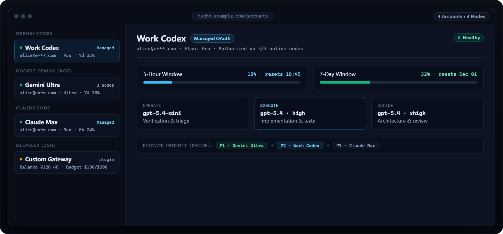

# 账号池、档位与执行机器

Tycho 将 **「在哪里跑（机器）」**、**「用谁的额度跑（账号）」** 和 **「任务需要什么强度（档位）」** 彻底解耦，让你把多台电脑和多份 AI 订阅组合成一个自动容错的弹性算力池。

<p align="center">
  
</p>

## 一、接入执行机器（Nodes）

机器永远通过**主动外连**接入主机，不需要在控制台填 IP 或配置入站 SSH。

1. 在目标机器上以日常用户安装 Tycho（见[快速上手](quickstart.md#第-1-步安装-tycho)）。
2. 运行加入命令（地址填控制台对外地址；同一台机器填 `http://127.0.0.1:8787`）：

   ```bash
   tycho node join --to https://your-tycho-host
   ```

3. 终端会打印一个 **6 位验证码** 并等待放行；在已登录的控制台左下角点击 **「放行」**（或通过企微卡片）输入验证码确认。
4. **成功标志**：控制台 **「机器」** 页出现该机器且状态为「在线」，终端输出 `已加入`。

要让节点后台常驻并开机自启，请在该机器运行：

```bash
tycho node service install
```

> 节点上线后会自动跟随主机版本：主机升级后，节点会在空闲（无在跑轮次）时自动从主机拉取同版本并平滑重启，无需在每台机器上重复手工更新。

---

## 二、两类账号：集中托管 vs 单机本地

Tycho 用 **`提供商 × 真实登录身份 × 授权机器`** 统一呈现你的全部账号：

| 类型 | 适用场景 | 凭据存哪 | 跨机能力 |
| --- | --- | --- | --- |
| **集中托管账号** | Codex 设备码授权、OpenAI / Gemini API Key、Claude OAuth、dsh 自定义线路 | 加密/属主只读存于主机 `secrets/` | **全机通用**：每轮按需下发给任意装有该执行器的在线节点 |
| **单机本地登录** | 节点上已自行登录的 `claude`、`codex`、`agy`（Google AI Pro/Ultra）、`dsh` | 留在各自机器原生目录 / Keyring | 仅在已登录该账号的机器上运行；多台机器登录同一邮箱时会自动聚合为同一逻辑账号池自动负载均衡 |

### 支持的原生执行器

- **Claude Code (`claude`)**：支持本机登录自动发现，或主机侧集中授权（Windows 主机）。
- **OpenAI Codex (`codex`)**：推荐在「添加账号」中选择 **设备码授权登录**（主机统一托管并自动续期，全机可用），也支持 API Key 或单机登录。自动识别 ChatGPT 套餐（Pro / Plus / Team 等）与 5h / 7d 额度窗口。
- **Gemini / Antigravity (`agy`)**：支持填 `GEMINI_API_KEY` 集中托管，或直接在节点上运行一次 `agy` 登录后自动发现（自动识别 Google AI Ultra / Pro 套餐与多窗口额度）。
- **DeepSeek (`dsh`)**：自动发现本地配置与自定义网关线路，也支持在控制台选择线路并托管密钥。

> 你可以在 **「账号」** 页点击任意账号标题直接行内修改自定义别名，同时始终保留脱敏后的真实登录身份与套餐标签，多号并行绝不混淆。

---

## 三、全局固定三档（Tiers）与顶替规则

每份账号登录都配置最多三个档位，从低到高固定为：

| 档位 | ID | 典型用途 | 未配置时的规则 |
| --- | --- | --- | --- |
| **操作档** | `operate` | 照指令执行、跑验证脚本、例行检查 | 未填时**自动顶替使用同一登录的执行档** |
| **执行档** | `execute` | 编写代码、修 Bug、写测试 | 未填时不接该档位任务 |
| **决策档** | `decide` | 架构设计、深度排查、关键代码审阅 | 未填时不接该档位任务 |

- 档位下拉里的模型列表由执行器实时上报；若想使用尚未出现在列表中的新模型，可直接填写自定义模型名。
- 每个任务在创建时绑定一个 **职能（Role）**（如实现、审阅、分析、验证），由职能决定默认档位；必要时可单独覆盖。

---

## 四、派发策略与额度容错

在 **「账号 › 派发策略（优先级槽）」** 中，你可以为三个档位分别排列优先使用的账号顺序：

1. **额度自动歇息与故障切换**：某账号触发限流/额度耗尽时，Tycho 会读取执行器回报的重置时间让该账号自动歇息（默认 30 分钟，指数退避至 6 小时），同时将排队的任务无缝切到同项目允许的下一个账号；无需人工值守。
2. **高水位自动靠后**：当账号用量达到 `quota.warnPercent`（在「设置 › 执行」调整）时自动退后，优先消耗余量充足的账号。
3. **凭据失效即时止损**：若令牌过期或被吊销，该账号立即停止接活，任务安全退回队列（不计入失败重试），控制台与消息通道立即通知你重新授权。
4. **多机 CLI 空闲自动升级**：在 **「机器」** 页可查看全部节点上的 `codex` / `claude` / `agy` / `dsh` 版本，一键在空闲时升级，详见 [执行器自动升级器](../executor-updaters.md)。
