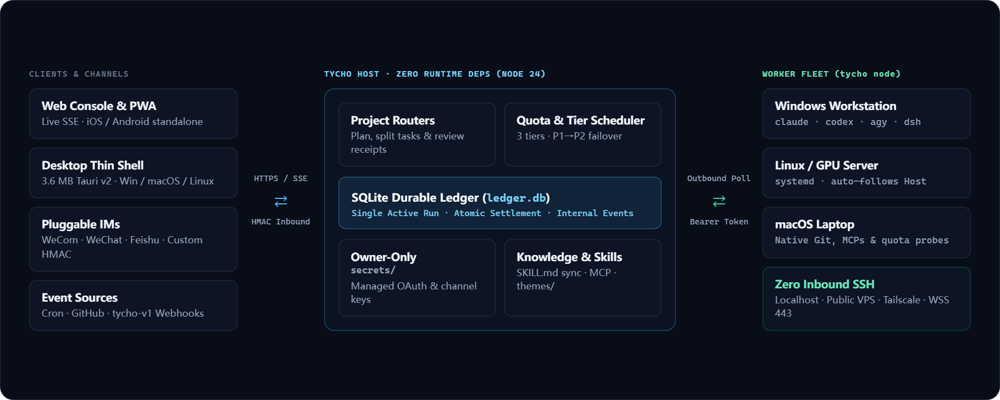

# 核心架构与安全边界

在开始批量接入机器和账号之前，花 3 分钟理解 Tycho 的四个核心角色和真实信任边界，后面几乎不会踩坑。

  

## 核心心智模型

Tycho 的世界里只有四个角色：

1. **主机（Host）**：运行 `tycho run` 的那台电脑，持有唯一的 **SQLite 账本（`ledger.db`）**、密钥目录（`secrets/`）、Web 控制台、HTTP/SSE 服务以及调度器。
2. **项目总控（Project Router）**：挂在主机上的对话大脑（每个项目独立上下文），负责听懂你的目标、查看上下文、拆解任务、审核交付并向你汇报。
3. **执行节点（Worker Node）**：任何运行 `tycho node` 的机器（可以是主机自己，也可以是远程 Linux / Mac / Windows）。节点**主动外连**主机长轮询领活，主机绝不 SSH 反向连入节点。
4. **原生执行器（Executors）**：安装在执行节点上的 `Claude Code`、`Codex`、`Gemini (agy)`、`dsh`。Tycho 通过轻量适配器启动它们、采集结构化事件流并沉淀结果，**不重造 Agent 循环**。

## 为什么采用「账本优先」？

Tycho 的所有状态变更遵循几条硬工程纪律：

- **先记账，再动外部世界**：发起一轮执行（Run）前先持久化意图；任何时刻断电、重启、网络抖动，重启后都会按账本逐条核实现场。
- **单活跃轮次与原子结算**：数据库唯一索引保证同一任务同时最多一个活跃 Run；回执结算在单个事务内完成。
- **不确定性如实报告**：节点失联、进程退出码未知、额度用完等情况全部明文展示，绝不悄悄重跑可能产生副作用的操作。
- **服务端零运行时依赖**：根目录 `package.json` 零 `dependencies`，基于 Node 24 原生 TypeScript + `node:sqlite` 运行，控制台前端构建产物随发布包一并交付。

## 数据目录与文件布局

程序与数据严格分离：

| 路径（默认） | 内容 | 升级/卸载时 |
| --- | --- | --- |
| `~/.tycho/app/` | 版本化程序目录（`versions/<ver>`、`current`、`bin/tycho`）及私有 Node 运行时 | 随升级替换 |
| `~/.tycho/host/ledger.db` | 主 SQLite 账本（含 WAL） | **永久保留** |
| `~/.tycho/host/secrets/` | 托管账号凭据、渠道密钥、登录会话密钥（属主只读，**不进自动备份**） | **永久保留** |
| `~/.tycho/host/releases/` | 已登记的任务产物副本（按保留期自动清理） | **永久保留** |
| `~/.tycho/host/skills/` | 主机技能正本（可按节点授权增量镜像到各机器） | **永久保留** |

通过环境变量 `TYCHO_DATA` 可自定义数据目录。

## 安全模型与信任边界

在把 Tycho 部署到多人环境或公网前，请清楚以下真实边界（详见 [SECURITY.md](../../SECURITY.md)）：

1. **OS 用户与机器本身是主要安全边界**：
   - Tycho 为支持无人值守执行编译、测试、Git 操作，会以原生能力运行执行器。
   - 项目总控与审阅/分析任务目前**不提供硬文件系统沙箱保证**；请勿使用 `root` 或 Windows 管理员身份运行主机或节点，敏感隔离请依赖独立系统用户、容器或专用工作机。
2. **内外入口分离**：
   - 登录链接签发、本机停机与本机知识 MCP 仅绑定回环地址，对外公网监听不暴露这些接口。
   - 跨机或公网访问请务必走 HTTPS（Nginx / Caddy / Tailscale），并启用 `HttpOnly + SameSite=Strict + Secure` Cookie。
3. **凭据不落账本、不落备份**：
   - 所有 API Key、OAuth 令牌、企微 Secret 均独立存放在 `secrets/`，不写入账本也不随自动备份拷贝，输出日志流自动脱敏。
