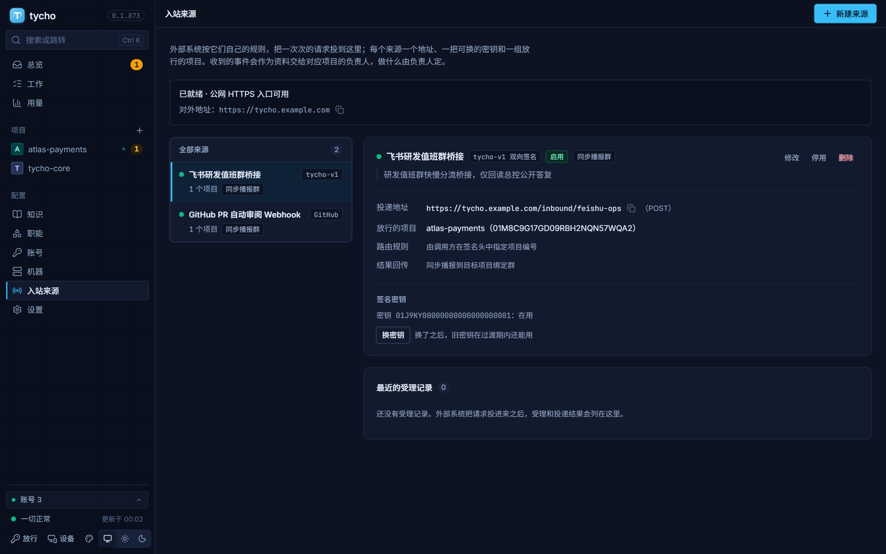

# IM 通道与插件级事件触发器

Tycho 不把你绑死在浏览器里：你可以用**企业微信、个人微信、飞书或任何自定义 IM** 像指挥同事一样向项目派活、审批、收汇报，也能用**定时规则、内部生命周期事件与签名 Webhook** 让项目自动运转。

  

---

## 一、开箱即用的 IM 通道

### 1. 企业微信机器人（官方长连接，零公网回调）

无需暴露公网回调端口，即可获得流式回复气泡、交互式审批/节点放行卡片、私聊与群聊 `@机器人` 项目绑定：

1. 在企业微信管理端创建智能机器人，选 **API 模式 + 长连接**，可见成员勾自己，记下 **Bot ID** 与 **Secret**。
2. 在 Tycho 控制台 **「设置 › 消息通道（企业微信）」**：
   - 先填 **Secret** 保存 → 再填 **接收人（userid）** → 最后填 **Bot ID** 启用。
3. 在企业微信私聊机器人发一句话完成握手。
4. **成功标志**：总览页底部显示 **「企微：已连接」**。

**常用交互**：
- 私聊点 **「选项目」** 或发 `项目 关键词` 切换/固定项目；群聊中 `@机器人 项目` 固定群绑定（支持群上下文环形缓冲、图片附件自动安全拉取与回复引用锚定）。
- 私聊发 **`登录`** 立即取一次性控制台登录链接；审批卡片与远程节点接入卡片直接点按钮放行。

### 2. 个人微信（iLink 协议，零依赖扫码接入）

直接适配腾讯官方 iLink 协议，**无需任何第三方框架或公网回调端口**：

1. 打开控制台 **「设置 › 微信」**，点击 **「连接微信」**，用手机微信扫码确认。
2. 在微信私聊机器人发 **`我想换个项目`** 按序号选项目并可发送 **`固定当前项目`**，之后发文字即直接与项目总控对话并收到任务交付回程。
3. 凭据独占保存在 `<TYCHO_DATA>/secrets/weixin.json`，不进账本也不进普通备份。

### 3. 飞书群聊桥接 & 任意自定义 IM（Slack / Discord / Telegram / 钉钉）

Tycho 提供内置的飞书群聊桥接器（[integrations/feishu/README.md](../../integrations/feishu/README.md)）和开放的 **`tycho-v1` 双向签名协议**：
- 支持 **群聊快慢分流**（闲聊忽略 / 预设 FAQ 秒回 / 复杂问题连同群上下文提交项目总控）。
- 总控调用 `reply_to_inbound_source` 显式发布的公开回复才会回传原话题，绝不把私有控制台链接或内部草稿泄露到团队群。
- 自建其他 IM 桥接器的完整签名与回读协议见 **[扩展与插件开发指南](extensibility.md)**。

---

## 二、插件级事件与触发器引擎

所有触发器遵循同一条强不变量：**受理先记账、严格去重幂等、周期合并防风暴、由触发引起的任务绝不形成死循环**。

### 1. 定时触发器（Cron / 间隔 / 一次性）
在项目页 **「触发器」** 创建，支持：
- **标准 5 段 Cron**（显式绑定 IANA 时区如 `Asia/Shanghai`，夏令时安全跳过/去重）
- **固定间隔** 与 **一次性绝对时刻**
- 典型场景：工作日早 9 点自动巡检 CI 失败与待审 PR、每周五汇总周报并播报到绑定群聊。

### 2. 内部生命周期事件触发器（事务级原子触发）
订阅 Tycho 账本内的核心业务提交点，在状态变更的**同一个 SQLite 事务内**原子触发下游指令：

| 内部事件 | 触发时机 | 典型用法 |
| --- | --- | --- |
| **工作就绪（`ready`）** | 顶层任务进入「就绪等验收」 | 自动汇总变更要点或触发额外合规检查 |
| **已验收（`accepted`）** | 主人确认验收通过 | 自动起草发布说明或准备上线清单 |
| **已合入（`merged`）** | PR 合入主线 | 自动触发文档同步或下一阶段任务 |
| **已上线（`released`）** | 发布包上线落账 | 自动做线上回归核验并播报群聊 |

### 3. 外部签名入站来源（Inbound Webhooks）
在控制台 **「入站来源」** 创建带独立密钥的公网/内网入口 `POST /inbound/<来源编号>`：
- **`github` 内置翻译器**：自动验证 `X-Hub-Signature-256`，按仓库名 `owner/name` 精准路由到放行项目，支持事件去重与载荷瘦身。
- **`tycho-v1` 通用签名入口**：HMAC-SHA256 + 时间戳防重放 + 密钥平滑过渡轮换，可直接对接 **GitLab CI、Prometheus Alertmanager、Sentry、n8n** 或任意自研脚本。
- **播报群联动**：任何触发器或入站来源均可勾选 **播报群**，让项目总控处理完事件后自动将摘要推送到指定的 IM 群聊。
