# 网关通道：443 HTTPS/WebSocket 隧道 vs SSH 22 端口技术评估

> **读者与决策**：供 tycho 主人决定当公网入口遇到企业/家宽代理封禁 TCP 22 端口时，是否以及如何用 443 端口通道替换或补充 `service/gateway.ts` 当前的 OpenSSH `-R` 反向隧道。

## 结论与建议

1. **当前立即采取的方案**：保持 `service/gateway.ts` 的 **OpenSSH 22 端口直连为主通道**，在启用系统代理的工作站上配置规则让 `ssh.exe` 直连（如 Clash `PROCESS-NAME,ssh.exe,DIRECT`）。`D:\code\tycho-codex-takeover-verify\HANDOFF-804\GATEWAY-804-NETWORK-DIAGNOSIS.md` 已证实同机代理在 22 端口 `CONNECT` 返回 `403` 而直连 22 与 443 均可用；直连零额外帧头、零服务端常驻桥接进程，适合作首选与随时可切回的退路。
2. **必须穿透仅放行 443 的代理/防火墙时，推荐方案**：采用 **SSH over WSS（`wss://<host>:443/_gateway`）+ OpenSSH `ProxyCommand`**，保留上层完整 OpenSSH 会话，只替换底层传输，**不引入第三方隧道二进制，不自研应用层 HTTP 复用协议**。
3. **不采用的两条路**：拒绝“自研 HTTP/SSE over WebSocket 反向复用”，也拒绝作为核心通道引入 `frp`/`chisel`/`cloudflared` 等独立守护进程。

## 问题事实基础

- **现有实现**：[service/gateway.ts](../../service/gateway.ts) 直接托管 `ssh -N -v -R 127.0.0.1:<remotePort>:127.0.0.1:<localPort> ...`；[docs/deploy.md](../deploy.md) 已在网关侧定义好 `Match User` 与 `restrict,port-forwarding,permitlisten="127.0.0.1:<port>"` 最小权限 SSH 密钥策略。
- **故障现象**：多出口代理链上实测（`GATEWAY-804-NETWORK-DIAGNOSIS.md`），代理服务器对 `CONNECT <gateway>:22` 固定返回 HTTP `403`（仅允许 `443` 白名单端口，对 `CONNECT <gateway>:443` 返回 `200`）。SSH 客户端在开启系统代理或仅放行 443 的网络环境下无法建链。

## 机制对比：三条技术路线

下表比较在现有 SSH 22 基础上支持 443 穿透的三种做法：

| 维度 | A. SSH over WSS (`ProxyCommand`) ✅推荐 | B. 自研 WebSocket 反向 HTTP 复用 | C. 第三方隧道 (`frp` / `chisel` / `cloudflared`) |
|---|---|---|---|
| 代理/防火墙兼容性 | 走标准 HTTPS 443 + HTTP Upgrade (`wss://`)，穿透只放行 443 的 HTTP 代理与企业防火墙 | 同左 | 依赖各工具协议（`chisel`/`cloudflared` 可走 WSS/QUIC，`frp` 需配 WSS） |
| 对 `service/gateway.ts` 与主服务的改动 | 只给 `sshArgs` 加一条 `-o ProxyCommand=...` 与本机桥接脚本；反向转发、保活、断线判定零重写 | 重写整套反向代理协议（替换 SSH 通道、重写长轮询/SSE/大文件背压与取消传播） | 重写进程拉起、凭证分发、存活探针与断开恢复 |
| 身份与权限边界 | **完全沿用** `sshd` `authorized_keys`（密钥指纹 + `restrict,port-forwarding,permitlisten`）与主机密钥钉住 | 另建 Token/TLS 双向认证、重放防护与端口归属校验 | 另管一套配置文件与独立鉴权密钥 |
| 网关端部署增量 | nginx 现有 443 `location = /_gateway` + 本机小巧 WS→TCP 环回拆帧进程指向 `127.0.0.1:22` | 网关运行自定义 mux 服务端，nginx 转给该进程 | 网关多装并维护额外守护进程 |
| 主要短板 | 多一层 WebSocket 帧封装与一个轻量拆帧桥；需确保客户端 Node 桥遵循 HTTP 代理 `CONNECT` | **工程与 bug 风险极高**：HTTP/1.1 分块、SSE 断流、背压卡死极易引入隐性故障 | 跨 Win/macOS/Linux 分发、版本升级与供应链面扩大 |

### 推荐方案如何工作

只替换 TCP 字节流的搬运方式，OpenSSH 安全边界与反向端口转发语义一字不改：

```mermaid
flowchart LR
  subgraph Host["tycho 主机"]
    direction LR
    SVC["tycho 服务 (127.0.0.1:localPort)"]
    SSH["ssh.exe -R"]
    PC["Node ProxyCommand (stdIO <-> WSS)"]
    SVC <-->|"被转发的 HTTP / SSE"| SSH
    SSH <-->|"SSH 原生加密字节流 (stdin/stdout)"| PC
  end

  subgraph Net["受限网络 / HTTP 代理"]
    P["HTTP 代理 (CONNECT :443 -> 200)"]
  end

  subgraph GW["公网网关"]
    direction LR
    NG["nginx :443 (location = /_gateway)"]
    BR["WS->TCP 桥 (127.0.0.1:bridge -> 拆去 WS 帧)"]
    SSHD["sshd 127.0.0.1:22 (restrict, permitlisten)"]
    NGX["nginx 公网入口 -> 127.0.0.1:remotePort"]
    NG -->|"TLS 终结后的 WS 帧"| BR
    BR -->|"原始 SSH TCP 字节流"| SSHD
    SSHD -->|"反向监听 127.0.0.1:remotePort"| NGX
  end

  PC <-->|"wss://gateway:443/_gateway"| P
  P <-->|"TLS over 443"| NG
```

**关键实现细节（不可省略的边界）：**

1. **为什么 nginx `/_gateway` 不能直指 `127.0.0.1:22`**：nginx HTTP 模块的 `proxy_pass` 按 RFC 6455 向后端透传 WebSocket 帧头，而 OpenSSH `sshd` 期望纯 `SSH-2.0-...` 原始 TCP 流。因此网关本机必须在 nginx 与 `sshd` 之间放一个极简环回拆帧桥（WebSocket text/binary payload <-> raw TCP socket，监听 `127.0.0.1` 私网端口），或改由四层 `stream` 按独立域名 SNI 终结 TLS 后裸转 `127.0.0.1:22`——但纯 L7 HTTP 代理（只放行标准 HTTPS/WSS 时）对 WSS 兼容度显著高于自定义 ALPN/原始 TLS 透传。
2. **客户端无新依赖（Node 24 自带传输）**：tycho 已要求 Node >= `24.3.0`。`ProxyCommand` 只需几十行内置 `node` 脚本，在检测存在 `HTTPS_PROXY`/`ALL_PROXY` 时经 HTTP `CONNECT <host>:443` 建立 TLS 隧道（需上线前实测 Node 原生 `WebSocket` 与代理环境下手动 `http.request({ method: 'CONNECT' })` + TLS Upgrade 的连通性），再将 WebSocket 二进制帧与 `process.stdin`/`process.stdout` 双向泵送。
3. **为什么不选另外两条**：
   - **拒绝自研 HTTP-over-WS**：tycho 的 `/api/node/poll` 依赖长轮询挂起与客户端断开即感知，控制台依赖 SSE，产物与备份涉及流式大响应。把 HTTP 请求/响应切进单条 WebSocket 自研多路复用，等价于重写半个 HTTP/2 协议栈——一旦流控窗口或半关闭处理有瑕疵，就会出现轮询假死或上传挂起；OpenSSH 已把每条 `-R` 连接直接映射到独立内核 socket，省掉全部帧序号与背压重造。
   - **拒绝 `frp` / `chisel` / `cloudflared`**：它们解决的核心是“没有可控公网 SSH”或“内网组网”，而 tycho 已经假设主人拥有自己的公网网关，并且依赖 OpenSSH 的密钥绑定与端口许可清单（`permitlisten`）。引入外部二进制会在安装器（`cli/`）、升级清点与故障诊断上增加整套运维面。

## 落地触发条件与分步路径

只有当后续出现以下任一信号时再立项实现（在此之前保留直接 TCP 22，零开发成本）：

- 工作站处于无法关闭系统 HTTP 代理或出口防火墙封锁 TCP 22 的网络环境；
- 需要在公共或企业网络下无人值守自动重连公网网关，而不能要求管理员放行 22 端口。

若触发实现，按最小闭环分三步推进：

1. **网关侧验证**：在公网网关 nginx `:443` 增加 `location = /_gateway`（Upgrade header + 超长 `proxy_read_timeout`），配套最小 WS<->TCP 环回转发进程指向 `127.0.0.1:22`，确认 `authorized_keys` 限制策略保持不变。
2. **桥接脚本与设置项**：增加 `service/gateway-ws-bridge.ts`（客户端 `ProxyCommand` 桥，显式支持直连 443 TLS 与经 `HTTPS_PROXY` 走 `CONNECT :443` 升级 WSS），并在设置项中提供传输方式切换（`ssh` / `wss`，默认仍可保持兼容或按代理探测 fallback）。
3. **故障语义对齐**：确保 `ProxyCommand` 报错退出时仍通过 `ssh -v` / stderr 回写到现有网关状态（区分证书失败、代理 `403/407`、路径 `404` 与 SSH 密钥拒绝），不吞掉诊断信息。
